# Swimlane Diagram — Contract Lifecycle Management System

## Mermaid Code

```mermaid
flowchart LR
    Start(["Start Contract Lifecycle Management Cycle"])

    subgraph Lane_Manager["Contract Manager"]
        M1["Assemble Contract Draft using Standard Template & Clause Library"]
        M2["Review AI Risk Score & Insert Pre-Approved Fallback Clause"]
    end

    subgraph Lane_Counterparty["External Counterparty Legal Rep"]
        C1["Open Interactive Redline Portal & Propose Clause Edits"]
        C2["Accept Fallback Term & Confirm Approved Draft v2.0"]
    end

    subgraph Lane_System["Contract Lifecycle Management System"]
        S1["Parse Contract Text & Calculate AI Risk Score (0-100)"]
        S2{"Passes AI Risk Scoring & Redline Agreement?"}
        S3["Route for Executive CLO Approval & Require Risk Sign-Off"]
        S4["Lock Approved Draft v2.0 & Generate E-Signature Package"]
        S5["Track Post-Execution Obligations & Set Auto-Renewal Timers"]
    end

    subgraph Lane_ESign["E-Signature Gateway (DocuSign)"]
        E1["Dispatch E-Signature Envelopes to Sequential Signers"]
        E2["Return Completed Envelope Webhook & Signed PDF File"]
    end

    Finish(["End Contract Lifecycle"])

    Start --> M1 --> S1 --> S2
    S2 -->|"No / High Risk Deviations"| M2 --> C1 --> C2 --> S3 --> S4
    S2 -->|"Yes / Standard Paper"| S4 --> E1 --> E2 --> S5 --> Finish
```

## Flow Description | Mô tả luồng

| Lane | Actor | Role in Flow |
|------|-------|-------------|
| 1 | Contract Manager | Assembles contract drafts from pre-approved clause templates, reviews AI NLP risk scores, negotiates redlines, inserts approved fallback clauses, and locks final contract packages. |
| 2 | External Counterparty Legal Rep | Opens the interactive web redline portal, proposes track-changes edits and comments, reviews fallback clause proposals, and accepts final contract draft revisions. |
| 3 | Contract Lifecycle Management System | Parses contract text using AI NLP to calculate risk scores (0-100), flags non-standard terms, enforces multi-tier approval chains, locks clean contract versions, dispatches e-signature packages, and tracks post-execution obligation/renewal timers. |
| 4 | E-Signature Gateway (DocuSign) | Delivers electronic signature invitations to sequential signers (DocuSign / Adobe Sign), executes digital signatures, and streams completed contract PDF webhooks back to the system. |
