# Action Tree — Contract Lifecycle Management System

## Mermaid Code

```mermaid
graph TD
    Root["Contract Lifecycle Management System"]

    Root --> M1["Intake & Automated Contract Assembly"]
    Root --> M2["AI Contract Parsing & Risk Scoring Engine"]
    Root --> M3["Interactive Redline & Collaborative Negotiation"]
    Root --> M4["Multi-Tier Approval Workflows & Governance"]
    Root --> M5["E-Signature Integration & Document Lock"]
    Root --> M6["Post-Execution Obligations & Renewal Tracking"]

    M1 --> A11["Process Self-Service Contract Request Intake from CRM & Web Forms"]
    M1 --> A12["Assemble Customized Contract Drafts from Standard Clause Templates"]
    M1 --> A13["Select Pre-Approved Fallback Clauses for Rejected Standard Terms"]
    M1 --> A14["Ingest Third-Party Vendor Contract Paper (Word / PDF Formats)"]

    M2 --> A21["Parse Contract Text using AI NLP Models (OpenAI / Kira Systems)"]
    M2 --> A22["Calculate Composite Contract Risk Scores (Scale 0 to 100)"]
    M2 --> A23["Flag Non-Standard Liability, Indemnity & Governing Law Deviations"]
    M2 --> A24["Detect Missing Mandatory Legal Clauses & Cyber Risk Disclosures"]

    M3 --> A31["Provide Interactive Web Portal for Collaborative Redline Negotiation"]
    M3 --> A32["Highlight Redline Modifications in Track-Changes Markup Format"]
    M3 --> A33["Render Side-by-Side Visual Diff Comparisons of Contract Versions"]
    M3 --> A34["Log Immutable Version History Audit Trails for All Proposed Edits"]

    M4 --> A41["Enforce Multi-Tier Threshold Contract Approval Chains (> $100K)"]
    M4 --> A42["Route High-Risk Contracts for Mandatory Chief Legal Officer Sign-Off"]
    M4 --> A43["Track Approval Status, Delegation Limits & Sign-Off Timestamps"]
    M4 --> A44["Lock Approved Final Contract Drafts (v2.0) to Prevent Un-Authorized Edits"]

    M5 --> A51["Assemble Final Clean Contract Packages with SOW & Exhibit Attachments"]
    M5 --> A52["Dispatch E-Signature Envelopes via DocuSign & Adobe Sign APIs"]
    M5 --> A53["Define Sequential Signer Routing Orders & Signature Tag Placements"]
    M5 --> A54["Track Real-Time E-Signature Execution Status & Ingest Signed PDFs"]

    M6 --> A61["Track Post-Execution Contract Milestones & Payment Obligations"]
    M6 --> A62["Set Automated Advance Warnings for Auto-Renewal Cancellation Windows"]
    M6 --> A63["Synchronize Executed Contract Terms & Payment Schedules to ERP"]
    M6 --> A64["Export Executive Contract Portfolio Value, Cycle Time & ROMI Reports"]
```

## Module Description | Mô tả Module

| # | Module | Description | Actions |
|---|--------|-------------|---------|
| 1 | Intake & Automated Contract Assembly | Captures contract requests from CRM, assembles drafts using pre-approved clause templates, selects fallbacks, and ingests third-party paper. | Process Self-Service Contract Requests, Assemble Drafts from Clause Templates, Select Pre-Approved Fallback Clauses, Ingest Third-Party Vendor Paper. |
| 2 | AI Contract Parsing & Risk Scoring Engine | Parses contract text using AI NLP, calculates risk scores (0-100), flags non-standard liability/indemnification deviations, and detects missing clauses. | Parse Contract Text using AI NLP, Calculate Composite Contract Risk Scores, Flag Non-Standard Liability Deviations, Detect Missing Mandatory Legal Clauses. |
| 3 | Interactive Redline & Collaborative Negotiation | Renders web negotiation portals, tracks redline markup edits, compares versions side-by-side on canvas, and logs immutable version history audit trails. | Provide Interactive Redline Negotiation Portals, Highlight Redline Track-Changes Markup, Render Side-by-Side Version Diff Comparisons, Log Version History Audit Trails. |
| 4 | Multi-Tier Approval Workflows & Governance | Routes contracts through threshold approval chains ($> \$100\text{k}$), enforces CLO sign-offs for high-risk terms, tracks delegation limits, and locks final drafts. | Enforce Multi-Tier Threshold Approval Chains, Route High-Risk Contracts for CLO Sign-Off, Track Approval Delegation Limits, Lock Approved Final Contract Drafts. |
| 5 | E-Signature Integration & Document Lock | Assembles contract packages with exhibits, dispatches DocuSign/Adobe Sign envelopes, sets sequential signer routing, and ingests signed PDF files. | Assemble Final Clean Contract Packages, Dispatch E-Signature Envelopes via API, Define Sequential Signer Routing Orders, Track Real-Time E-Signature Status & Signed PDFs. |
| 6 | Post-Execution Obligations & Renewal Tracking | Tracks post-execution milestones and payment obligations, enforces auto-renewal cancellation notice windows, syncs metadata to ERP, and exports scorecards. | Track Post-Execution Milestones & Obligations, Set Automated Auto-Renewal Notice Timers, Synchronize Contract Metadata to ERP, Export Executive Contract Scorecards. |
