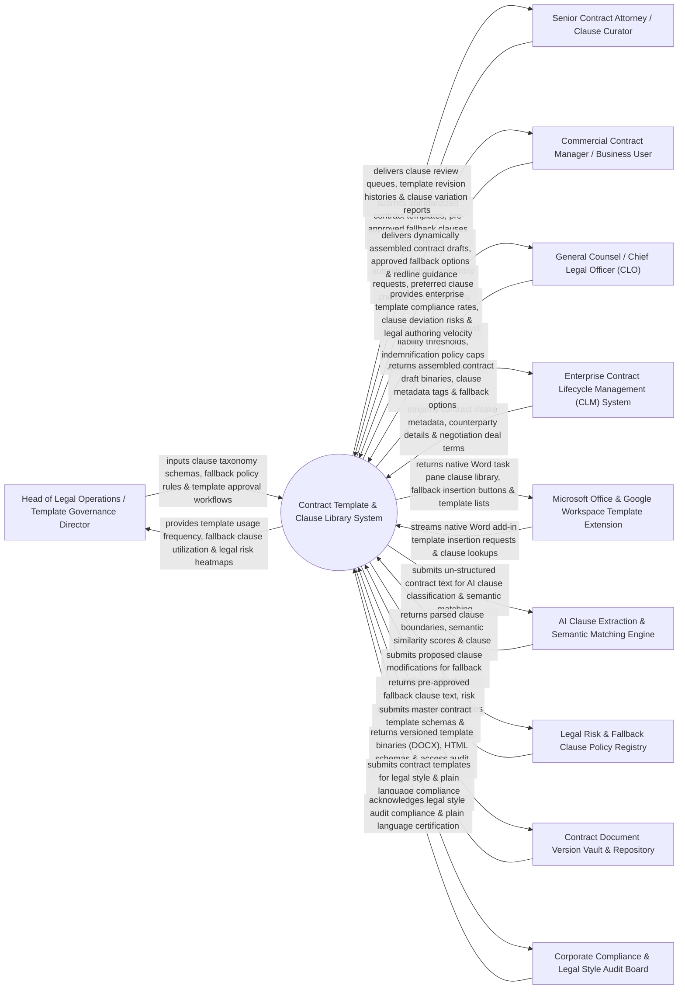

# Context Diagram — Contract Template & Clause Library System

## Mermaid Code

## Actor & Interaction Table | Bảng Actor & Tương tác

| # | Actor | Actor Type | Data Sent TO System | Data Received FROM System | Notes |
|---|-------|------------|---------------------|---------------------------|-------|
| 1 | Head of Legal Operations / Template Governance Director | Primary | Clause taxonomy schemas, fallback policy rules, template approval workflows, deprecation schedules. | Template usage frequency metrics, fallback clause utilization, legal risk heatmaps, authoring SLA reports. | Legal operations director governing enterprise contract templates, clause libraries, and legal risk policies. |
| 2 | Senior Contract Attorney / Clause Curator | Primary | Standardized contract templates (NDA, MSA, SOW), pre-approved fallback clauses, legal definitions, clause guidance. | Clause review queues, template revision histories, clause variation reports, fallback usage analytics. | Senior contract attorney curating pre-approved legal language, fallback terms, and drafting guidance. |
| 3 | Commercial Contract Manager / Business User | Primary | Contract assembly request details, preferred clause selections, custom counterparty terms. | Dynamically assembled contract drafts, approved fallback clause options, redline drafting guidance. | Contract manager assembling contract drafts and selecting pre-approved fallback clauses during negotiations. |
| 4 | CLO | Primary | Non-standard liability thresholds, indemnification policy caps, template deprecation directives. | Enterprise template compliance rates, clause deviation risk scorecards, legal authoring velocity, CLM ROI. | Executive monitoring legal risk exposure resulting from non-standard clauses and template adherence. |
| 5 | Enterprise Contract Lifecycle Management System | Supporting | Contract intake metadata, counterparty account profiles, negotiation deal values, deal stage tags. | Assembled contract draft binaries, clause metadata tags, approved fallback clause alternatives. | Enterprise CLM system (Icertis / Conga) triggering contract assembly and fetching clause library items. |
| 6 | Microsoft Office & Google Workspace Template Extension | Supporting | Native Word add-in template insertion requests, clause lookups, active cursor position tokens. | Native Word task pane clause library, fallback insertion buttons, approved template dropdown lists. | Desktop add-in (Word / Google Docs) rendering interactive clause libraries directly inside word processors. |
| 7 | AI Clause Extraction & Semantic Matching Engine | Supporting | Parsed clause boundaries, semantic similarity scores, clause type tags (Indemnity, IP, Term, Termination). | Un-structured contract text streams, custom prompt extraction rules, clause classification parameters. | AI NLP engine parsing un-structured contract documents to extract, categorize, and index legal clauses. |
| 8 | Legal Risk & Fallback Clause Policy Registry | Supporting | Pre-approved fallback clause text, risk ratings (Low/Medium/High), mandatory approval delegation matrices. | Proposed clause modifications, counterparty rejection terms, clause deviation parameters. | Policy engine maintaining pre-approved primary terms, Fallback A, Fallback B, and mandatory sign-off rules. |
| 9 | Contract Document Version Vault & Repository | Supporting | Versioned template binaries (`.docx`), HTML template schemas, access audit logs, check-out file locks. | Master contract template schemas, versioned clause objects, template rollback commands. | Central repository securing master template files, version histories, and clause library objects. |
| 10 | Corporate Compliance & Legal Style Audit Board | Supporting / Regulatory | Legal style guidelines, plain language standards, corporate branding compliance rules. | Contract templates, clause library items, legal style audit logs, plain language compliance certificates. | Board auditing legal templates for plain language clarity, legal style compliance, and brand consistency. |

## System Boundary Description | Mô tả Phạm vi Hệ thống

The **Contract Template & Clause Library System** is an enterprise legal template governance, clause repository, AI semantic clause matching, pre-approved fallback management, and native Word add-in authoring platform.

**Inside System Scope:**
- Centralized clause library managing standard primary clauses, pre-approved Fallback A/B alternatives, and drafting guidance.
- Dynamic contract assembly engine generating customized contract drafts (NDAs, MSAs, SOWs) from template schemas.
- AI NLP semantic clause extraction parsing third-party contract documents to categorize clauses and detect deviations.
- Native Microsoft Word and Google Docs add-in task pane allowing attorneys to search and insert pre-approved clauses.
- Fallback clause risk policy engine enforcing mandatory approval chains when counterparties reject standard terms.

**Outside System Scope:**
- Direct physical printing of paper contract copies for physical filing cabinets (handled by Commercial Print Rooms).
- Direct processing of credit card merchant payments for contract fees (handled by Enterprise Accounts Receivable).
- Direct physical court litigation of contract breach lawsuits (handled by Trial Litigation Attorneys).
