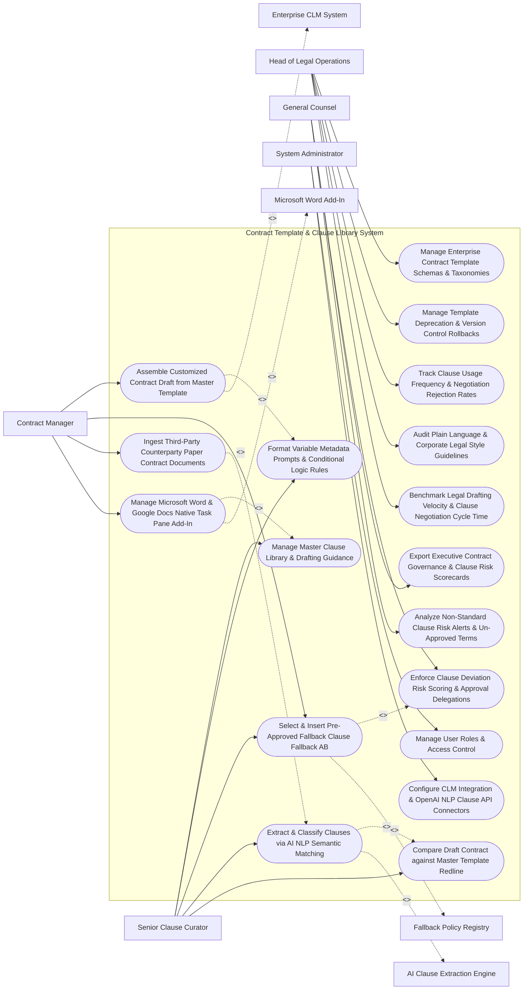

# Use Case Diagram — Contract Template & Clause Library System

## Mermaid Code

## Actor Table | Bảng Actor

| # | Actor | Actor Type | Role Description | Related Use Cases |
|---|-------|------------|------------------|-------------------|
| 1 | Head of Legal Operations | Primary | Executive managing template schemas, version rollbacks, clause usage metrics, style audits, and drafting velocity. | UC01, UC06, UC11, UC13, UC14 |
| 2 | Senior Clause Curator | Primary | Attorney curating clause libraries, setting variable rules, managing fallbacks, parsing AI clauses, and reviewing redlines. | UC03, UC04, UC05, UC08, UC09 |
| 3 | Contract Manager | Primary | Commercial user assembling contract drafts, selecting fallback terms, ingesting third-party paper, and using the Word add-in. | UC02, UC05, UC07, UC10 |
| 4 | General Counsel | Primary | Executive evaluating clause deviation risk scoring, viewing executive scorecards, and monitoring risk alerts. | UC12, UC15, UC18 |
| 5 | System Administrator | Primary | IT admin managing user security roles, CLM API credentials, and OpenAI NLP clause connectors. | UC16, UC17 |
| 6 | Enterprise CLM System | System (Secondary) | Contract Lifecycle Management system (Icertis/Conga) triggering contract assembly and receiving draft DOCX binaries. | UC02 |
| 7 | Microsoft Word Add-In | System (Secondary) | Desktop add-in task pane rendering interactive clause libraries and fallback insertion buttons directly inside MS Word. | UC10 |
| 8 | AI Clause Extraction Engine | System (Secondary) | AI NLP engine parsing un-structured contract documents to classify clause types and compute semantic match scores. | UC08 |
| 9 | Fallback Policy Registry | System (Secondary) | Policy engine storing Fallback A/B terms, risk ratings, and mandatory escalation approval matrices. | UC05 |

## Use Case Table | Bảng Use Case

| # | UC ID | Use Case Name | Primary Actor | Secondary Actor | Description | Priority |
|---|-------|---------------|---------------|-----------------|-------------|----------|
| 1 | UC01 | Manage Enterprise Contract Template Schemas & Taxonomies | OpsDirector | None | Configures master contract template categories (NDA, MSA, SOW, License) and clause taxonomy hierarchies. | Critical |
| 2 | UC02 | Assemble Customized Contract Draft from Master Template | Manager | CLM | Prompts users for key deal variables, dynamically generating a customized DOCX contract draft from template schemas. | Critical |
| 3 | UC03 | Manage Master Clause Library & Drafting Guidance | Curator | None | Maintains centralized clause repository storing primary terms, negotiation rationale, and attorney drafting guidance. | Critical |
| 4 | UC04 | Format Variable Metadata Prompts & Conditional Logic Rules | Curator | None | Configures conditional logic rules (e.g., IF `Contract Value > $1M` THEN `Insert Mutual Indemnification`). | High |
| 5 | UC05 | Select & Insert Pre-Approved Fallback Clause Fallback AB | Manager | FallbackReg | Provides pre-approved Fallback A and Fallback B clause alternatives when counterparties reject standard terms. | Critical |
| 6 | UC06 | Manage Template Deprecation & Version Control Rollbacks | OpsDirector | None | Manages template versioning (v1.0 to v2.5), deprecating outdated templates and permitting instant version rollbacks. | High |
| 7 | UC07 | Ingest Third-Party Counterparty Paper Contract Documents | Manager | None | Uploads third-party counterparty contract PDFs/Word files, converting un-structured text for AI clause analysis. | Critical |
| 8 | UC08 | Extract & Classify Clauses via AI NLP Semantic Matching | Curator | AIClause | Runs AI NLP models to extract clause boundaries, categorizing terms (Indemnity, Limitation of Liability, IP) and scoring match. | Critical |
| 9 | UC09 | Compare Draft Contract against Master Template Redline | Curator | None | Auto-generates a visual redline comparison comparing a counterparty document against the firm's master template. | Critical |
| 10 | UC10 | Manage Microsoft Word & Google Docs Native Task Pane Add-In | Manager | WordAddin | Renders an interactive sidebar task pane inside MS Word and Google Docs, allowing one-click clause search and insertion. | Critical |
| 11 | UC11 | Track Clause Usage Frequency & Negotiation Rejection Rates | OpsDirector | None | Measures how frequently each clause and fallback option is used, identifying terms most frequently rejected by counterparties. | High |
| 12 | UC12 | Enforce Clause Deviation Risk Scoring & Approval Delegations | CLO | None | Calculates contract risk scores based on clause deviations, routing non-standard terms to CLO for approval. | Critical |
| 13 | UC13 | Audit Plain Language & Corporate Legal Style Guidelines | OpsDirector | None | Audits contract text readability scores (Flesch-Kincaid), enforcing plain language clarity and corporate style rules. | High |
| 14 | UC14 | Benchmark Legal Drafting Velocity & Clause Negotiation Cycle Time | OpsDirector | None | Measures contract assembly turnaround speed, clause insertion velocity, and negotiation cycle time reduction %. | High |
| 15 | UC15 | Export Executive Contract Governance & Clause Risk Scorecards | CLO | None | Renders executive scorecards detailing active template adoption %, clause risk score distribution, and authoring ROI. | High |
| 16 | UC16 | Manage User Roles & Access Control | Admin | None | Controls user login credentials, RBAC permissions, and template editing authorization limits. | High |
| 17 | UC17 | Configure CLM Integration & OpenAI NLP Clause API Connectors | Admin | None | Configures API connection parameters for Icertis CLM, Salesforce, Microsoft 365 Add-In, and OpenAI GPT-4. | High |
| 18 | UC18 | Analyze Non-Standard Clause Risk Alerts & Un-Approved Terms | CLO | None | Dispatches urgent notifications when a high-risk non-standard clause (e.g., Unlimited Liability) is inserted without approval. | High |

## Use Case Specification | Đặc tả Use Case

---

### UC02 — Assemble Customized Contract Draft from Master Template

| Field | Detail |
|-------|--------|
| **UC ID** | UC02 |
| **Use Case Name** | Assemble Customized Contract Draft from Master Template |
| **Actor(s)** | Primary: Commercial Contract Manager, Senior Contract Attorney   Secondary: Enterprise CLM System (Icertis / Conga API) |
| **Description** | Prompts commercial users for key deal variables through an interactive questionnaire, dynamically assembling a customized, brand-compliant DOCX contract draft based on conditional logic rules. |
| **Precondition** | 1. Master contract template schema (e.g., `Master Services Agreement v3.2`) is published (UC01).   2. Variable prompts and conditional logic rules (UC04) are configured. |
| **Main Flow** | 1. Contract Manager opens "Contract Assembly Wizard" for Master Template `Master Services Agreement (MSA)`.   2. System renders Interactive Deal Variable Questionnaire:   &nbsp;&nbsp;&nbsp;&nbsp; a. Counterparty Legal Name: `"Acme Global Logistics LLC"`.   &nbsp;&nbsp;&nbsp;&nbsp; b. Jurisdiction State: `"Delaware"`.   &nbsp;&nbsp;&nbsp;&nbsp; c. Total Annual Deal Value: `"$2,500,000.00"`.   &nbsp;&nbsp;&nbsp;&nbsp; d. Data Processing Required: `Yes (EU Customer Data involved)`.   &nbsp;&nbsp;&nbsp;&nbsp; e. Intellectual Property Ownership: `Client Retains Foreground IP`.   3. System evaluates Conditional Assembly Rules:   &nbsp;&nbsp;&nbsp;&nbsp; a. Rule 1: Deal Value $2.5M > $1.0M -> Inserts `Clause #IND-102 (Mutual Indemnification with $5M Cap)`.   &nbsp;&nbsp;&nbsp;&nbsp; b. Rule 2: Data Processing = Yes -> Inserts `Schedule D (GDPR Data Processing Addendum - DPA)`.   &nbsp;&nbsp;&nbsp;&nbsp; c. Rule 3: Jurisdiction = Delaware -> Inserts `Clause #GOV-401 (Delaware Governing Law & Chancery Court Jurisdiction)`.   4. System compiles dynamic XML/HTML schema into formatted Word document: `MSA_Acme_Global_Logistics_Draft_v1.docx`.   5. System checks Document Styling: Applies corporate typography, header logos, section numbering, and cross-reference links.   6. System delivers assembled DOCX draft to user and dispatches copy to Enterprise CLM System via REST API. |
| **Alternative Flow** | **AF1** — Direct CLM Automated Assembly: Enterprise CLM (Icertis) sends deal metadata via API; System auto-assembles contract draft in background without manual questionnaire prompts. |
| **Exception Flow** | **EX1** — Missing Mandatory Deal Variable Error: User leaves "Intellectual Property Ownership" unanswered; System blocks assembly (`MISSING_MANDATORY_VARIABLE`), highlighting missing question in red. |
| **Postcondition** | Deal variables are processed, conditional rules evaluate, brand-compliant DOCX contract draft generates, and file syncs to CLM. |
| **Business Rule** | **BR1**: Contract assembly MUST enforce conditional logic rules, automatically inserting required regulatory addenda (e.g., GDPR DPA) based on deal parameters. |

---

### UC05 — Select & Insert Pre-Approved Fallback Clause (Fallback A/B)

| Field | Detail |
|-------|--------|
| **UC ID** | UC05 |
| **Use Case Name** | Select & Insert Pre-Approved Fallback Clause (Fallback A/B) |
| **Actor(s)** | Primary: Commercial Contract Manager, Senior Contract Attorney   Secondary: Legal Risk & Fallback Clause Policy Registry |
| **Description** | Provides pre-approved Fallback A and Fallback B clause alternatives when a counterparty rejects standard terms, showing risk ratings, drafting rationale, and mandatory approval triggers. |
| **Precondition** | 1. Active contract negotiation is in progress.   2. Master Clause Library contains primary terms and pre-approved Fallback A/B options (UC03). |
| **Main Flow** | 1. Contract Manager is negotiating MSA with counterparty who rejects Primary Limitation of Liability Clause:   &nbsp;&nbsp;&nbsp;&nbsp; a. Primary Term (`Clause #LOL-101`): Aggregate Liability capped at $1 \times \text{Annual Fees Paid}$ -> Counterparty Rejects.   2. Manager opens "Fallback Clause Selection Desk" (or MS Word Task Pane Add-In UC10) for `Limitation of Liability`.   3. System renders Pre-Approved Fallback Alternatives:   &nbsp;&nbsp;&nbsp;&nbsp; a. Option 1: `Primary Term (#LOL-101)` — Cap = 1x Fees Paid | Risk Score: Low (10/100) | Approval: Auto.   &nbsp;&nbsp;&nbsp;&nbsp; b. Option 2: `Fallback A (#LOL-102)` — Cap = 2x Fees Paid | Risk Score: Medium (35/100) | Rationale: *"Acceptable for Tier-1 Strategic Clients"* | Approval: Business VP Auto.   &nbsp;&nbsp;&nbsp;&nbsp; c. Option 3: `Fallback B (#LOL-103)` — Cap = $5,000,000 Fixed Cap | Risk Score: High (65/100) | Rationale: *"Requires Legal Lead Approval"*.   4. Manager selects `Fallback A (#LOL-102)` (Cap = 2x Fees Paid).   5. System checks Approval Matrix: Fallback A is pre-approved for deals under $5M -> `AUTO_APPROVED`.   6. System replaces Primary Clause with Fallback A text in Word document and updates Contract Risk Scorecard (UC12):   &nbsp;&nbsp;&nbsp;&nbsp; a. Risk Score updated from 10/100 to `35/100 (Medium Risk Accepted)`.   7. System logs clause negotiation outcome: `Clause #LOL-101 Rejected -> Fallback A #LOL-102 Substituted`. |
| **Alternative Flow** | **AF1** — Non-Standard Clause Escalation to CLO: Counterparty demands Fallback B ($5M Cap); System flags `HIGH_RISK_ESCALATION`, routing request to CLO for electronic sign-off before insertion. |
| **Exception Flow** | **EX1** — Un-Approved Clause Insertion Block: Manager attempts to paste custom un-approved liability text; System flags `UNAPPROVED_CLAUSE_BLOCKED`, requiring formal legal review. |
| **Postcondition** | Pre-approved fallback clause is selected, risk score updates, approval matrix is enforced, and Word document updates with fallback text. |
| **Business Rule** | **BR1**: Selecting Fallback A or Fallback B clauses MUST automatically recalculate the contract legal risk score and enforce approval delegation matrices. |

---

### UC08 — Extract & Classify Clauses via AI NLP Semantic Matching

| Field | Detail |
|-------|--------|
| **UC ID** | UC08 |
| **Use Case Name** | Extract & Classify Clauses via AI NLP Semantic Matching |
| **Actor(s)** | Primary: Senior Contract Attorney, Commercial Contract Manager   Secondary: AI Clause Extraction & Semantic Matching Engine (OpenAI GPT-4 / Pinecone Vector DB API) |
| **Description** | Parses un-structured third-party paper contracts using AI NLP models, identifying clause boundaries, classifying clause types, and scoring semantic similarity against the firm's master library. |
| **Precondition** | 1. Third-party counterparty contract (PDF or Word DOCX) is ingested (UC07).   2. AI NLP clause classification model and Pinecone vector database are active. |
| **Main Flow** | 1. Contract Manager uploads Third-Party Vendor MSA: `Vendor_Standard_MSA_Unstructured.pdf` (20 Pages).   2. System dispatches PDF text stream to AI Clause Extraction Engine.   3. AI Engine executes 3-Stage Semantic Analysis:   &nbsp;&nbsp;&nbsp;&nbsp; a. Stage 1 (Clause Boundary Parsing): Identifies 42 distinct contractual paragraphs/sections.   &nbsp;&nbsp;&nbsp;&nbsp; b. Stage 2 (Clause Classification): Categorizes each clause into taxonomy types (`Indemnification`, `Limitation of Liability`, `Governing Law`, `IP Rights`, `Termination`).   &nbsp;&nbsp;&nbsp;&nbsp; c. Stage 3 (Semantic Similarity Scoring): Compares vendor clause vectors against firm's Master Template Clause vectors using cosine similarity.   4. AI Engine outputs Clause Classification Matrix:   &nbsp;&nbsp;&nbsp;&nbsp; a. Vendor Section 8 (`Indemnification`): Semantic Match Score = `62% Match` (`DEVIATION_DETECTED`).   &nbsp;&nbsp;&nbsp;&nbsp; b. Vendor Section 12 (`Governing Law - New York`): Semantic Match Score = `95% Match` (`STANDARD_MATCH`).   5. System flags Key Legal Deviations: Vendor Indemnification contains un-capped uncapped IP indemnity -> `HIGH_LEGAL_RISK_DEVIATION`.   6. System triggers UC09 (Compare Draft Redline), rendering side-by-side comparison of vendor clause vs. firm primary term and suggesting Fallback A replacement. |
| **Alternative Flow** | **AF1** — Automated Metadata Extraction: AI Engine simultaneously extracts key contract metadata (Effective Date, Initial Term, Renewal Notice Period, Governing Law State) and populates CLM fields. |
| **Exception Flow** | **EX1** — Un-Classified Clause Tagging: Vendor document contains novel environmental ESG clause not in taxonomy; AI Engine tags clause as `UNCLASSIFIED_CUSTOM_TERM`, alerting Clause Curator to add to taxonomy. |
| **Postcondition** | Third-party contract is parsed, clause boundaries and types are categorized, semantic similarity match scores generate, and deviations are flagged. |
| **Business Rule** | **BR1**: Third-party counterparty contracts MUST undergo automated AI semantic clause matching to identify legal risk deviations before execution. |

---

### UC10 — Manage Microsoft Word & Google Docs Native Task Pane Add-In

| Field | Detail |
|-------|--------|
| **UC ID** | UC10 |
| **Use Case Name** | Manage Microsoft Word & Google Docs Native Task Pane Add-In |
| **Actor(s)** | Primary: Commercial Contract Manager, Senior Contract Attorney   Secondary: Microsoft Office & Google Workspace Template Extension (Word Office JS Add-In API) |
| **Description** | Renders an interactive sidebar task pane inside Microsoft Word and Google Docs, enabling attorneys to search the master clause library, view fallback guidance, and insert terms with a single click. |
| **Precondition** | 1. User opens Microsoft Word 365 or Google Docs desktop/web editor.   2. Corporate Legal Add-In manifest (`LegalClauseLibrary.xml`) is deployed via Microsoft 365 Admin Center. |
| **Main Flow** | 1. Attorney opens Word document `Draft_SOW_Negotiation.docx` in Microsoft Word.   2. Attorney clicks "Legal Clause Library" ribbon icon in MS Word header.   3. Word launches Task Pane Sidebar on right side of screen, authenticating user credentials.   4. Attorney types keyword `"Indemnity"` in task pane search bar.   5. Task Pane displays Matching Clause Library Items:   &nbsp;&nbsp;&nbsp;&nbsp; a. `Primary Term #IND-101 (Mutual IP Indemnification)` — [Insert Button].   &nbsp;&nbsp;&nbsp;&nbsp; b. `Fallback A #IND-102 (Unilateral IP Indemnity capped at $2M)` — [Insert Button].   &nbsp;&nbsp;&nbsp;&nbsp; c. `Drafting Rationale`: *"Use Fallback A when counterparty refuses mutual indemnification."*   6. Attorney places cursor at Section 6.2 in Word document and clicks `[Insert Fallback A]`.   7. Task Pane inserts formatted Fallback A text directly into Word document at active cursor position, applying document font styles and section numbering.   8. System logs real-time insertion event in Clause Usage Registry (UC11). |
| **Alternative Flow** | **AF1** — One-Click Redline Comparison in Word: Attorney selects text in Word; Task Pane compares selected text against master template, displaying inline redline suggestions inside task pane. |
| **Exception Flow** | **EX1** — Add-In Token Expiration Error: User session expires; Task Pane displays "Session Expired - Re-Authenticate with Single Sign-On", refreshing OAuth token seamlessly upon click. |
| **Postcondition** | Native task pane renders in MS Word/Google Docs, clause search executes, fallback terms insert at active cursor, and usage logs update. |
| **Business Rule** | **BR1**: The native Word/Google Docs task pane add-in MUST insert clauses matching the surrounding document's font styling and paragraph numbering. |

---

### UC12 — Enforce Clause Deviation Risk Scoring & Approval Delegations

| Field | Detail |
|-------|--------|
| **UC ID** | UC12 |
| **Use Case Name** | Enforce Clause Deviation Risk Scoring & Approval Delegations |
| **Actor(s)** | Primary: General Counsel, Chief Legal Officer   Secondary: Legal Risk & Fallback Clause Policy Registry |
| **Description** | Calculates composite contract legal risk scores based on clause deviations from master standards, enforcing automated approval delegation matrices (e.g., High Risk requires CLO sign-off). |
| **Precondition** | 1. Contract draft contains modified or fallback clauses (UC05, UC08).   2. Clause risk point weightings and approval delegation thresholds are configured. |
| **Main Flow** | 1. System scans contract draft `MSA_Vendor_Acme_Final.docx` containing 5 modified clauses.   2. System evaluates Clause Risk Point Matrix:   &nbsp;&nbsp;&nbsp;&nbsp; a. Clause 1 (`Limitation of Liability Fallback B`): Risk Points = `+35 Points` (High Risk).   &nbsp;&nbsp;&nbsp;&nbsp; b. Clause 2 (`Governing Law - Foreign Jurisdiction`): Risk Points = `+20 Points` (Medium Risk).   &nbsp;&nbsp;&nbsp;&nbsp; c. Clause 3 (`Indemnification Uncapped Material Breach`): Risk Points = `+30 Points` (High Risk).   &nbsp;&nbsp;&nbsp;&nbsp; d. Clause 4 (`Payment Terms 90 Days`): Risk Points = `+5 Points` (Low Risk).   3. System calculates Composite Contract Legal Risk Score: $35 + 20 + 30 + 5 = \mathbf{90 / 100 \text{ Risk Score}}$ (`CRITICAL_LEGAL_RISK_TIER`).   4. System checks Approval Delegation Matrix Rules:   &nbsp;&nbsp;&nbsp;&nbsp; a. Score 0-25 (Low Risk): Contract Manager Auto-Approve.   &nbsp;&nbsp;&nbsp;&nbsp; b. Score 26-50 (Medium Risk): Legal Operations Director Sign-Off.   &nbsp;&nbsp;&nbsp;&nbsp; c. Score 51-100 (Critical Risk): General Counsel / CLO Mandatory Written Sign-Off Required.   5. System places contract on `LEGAL_RISK_HOLD`, blocking contract execution in CLM.   6. System dispatches urgent notification to General Counsel: *"APPROVAL REQUIRED: Contract MSA_Vendor_Acme has Critical Risk Score 90/100 due to Uncapped Indemnity and Foreign Law."*   7. General Counsel reviews risk scorecard, approves exception with risk mitigation note, and signs approval token, releasing contract for execution. |
| **Alternative Flow** | **AF1** — Automated Low-Risk Approval: Contract score is 15/100 (Low Risk); System auto-clears legal risk check, allowing contract manager to send for signature immediately. |
| **Exception Flow** | **EX1** — Un-Mitigated Unlimited Liability Block: Contract contains unlimited consequential damages liability; System flags `PROHIBITED_TERM_BLOCKED`, prohibiting approval until clause is renegotiated. |
| **Postcondition** | Composite contract legal risk score is calculated, risk tier is assigned, approval delegation matrix enforces, and CLO sign-off unlocks contract. |
| **Business Rule** | **BR1**: Contracts with composite risk scores exceeding 50/100 MUST obtain written approval from the General Counsel prior to execution. |
