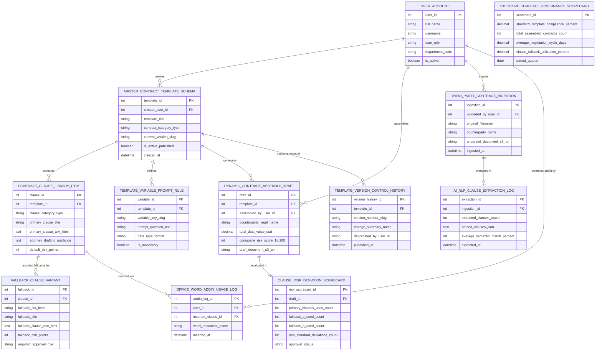

# Conceptual ERD — Contract Template & Clause Library System

## Mermaid Code

## Entity Description Table | Bảng mô tả Entity

| # | Entity Name | Vietnamese Name | Description | Key Attributes | Main Relationships |
|---|-------------|-----------------|-------------|----------------|-------------------|
| 1 | USER_ACCOUNT | Tài khoản Nguời dùng | System credentials and access roles for legal ops directors, clause curators, contract managers, and admins. | `user_id`, `username`, `user_role`, `department_code` | Creates `MASTER_CONTRACT_TEMPLATE_SCHEMA`, assembles `DYNAMIC_CONTRACT_ASSEMBLY_DRAFT`, ingests `THIRD_PARTY_CONTRACT_INGESTION`, operates add-in by `OFFICE_WORD_ADDIN_USAGE_LOG`. |
| 2 | MASTER_CONTRACT_TEMPLATE_SCHEMA | Schema Master Contract Template | Central contract template schema record tracking template titles, categories (NDA, MSA), current version slugs, and published status. | `template_id`, `creator_user_id`, `template_title`, `contract_category_type`, `current_version_slug`, `is_active_published` | Contains `CONTRACT_CLAUSE_LIBRARY_ITEM`, defines `TEMPLATE_VARIABLE_PROMPT_RULE`, generates `DYNAMIC_CONTRACT_ASSEMBLY_DRAFT`, tracks versions of `TEMPLATE_VERSION_CONTROL_HISTORY`, created by `USER_ACCOUNT`. |
| 3 | CONTRACT_CLAUSE_LIBRARY_ITEM | Mục Thư viện Điều khoản | Master clause library record storing clause categories, primary titles, primary HTML text, attorney drafting guidance, and default risk points. | `clause_id`, `template_id`, `clause_category_type`, `primary_clause_title`, `primary_clause_text_html`, `attorney_drafting_guidance`, `default_risk_points` | Belongs to `MASTER_CONTRACT_TEMPLATE_SCHEMA`, provides fallbacks for `FALLBACK_CLAUSE_VARIANT`, inserted via `OFFICE_WORD_ADDIN_USAGE_LOG`. |
| 4 | FALLBACK_CLAUSE_VARIANT | Biến thể Điều khoản Fallback | Pre-approved fallback clause alternative record tracking tier levels (Fallback A/B), fallback HTML text, risk points, and required approval roles. | `fallback_id`, `clause_id`, `fallback_tier_level`, `fallback_title`, `fallback_clause_text_html`, `fallback_risk_points`, `required_approval_role` | Belongs to `CONTRACT_CLAUSE_LIBRARY_ITEM`. |
| 5 | TEMPLATE_VARIABLE_PROMPT_RULE | Quy tắc Variable Prompt Template | Dynamic contract variable prompt rule record tracking variable keys (`{{Counterparty_Name}}`), prompt questions, data types, and mandatory flags. | `variable_id`, `template_id`, `variable_key_slug`, `prompt_question_text`, `data_type_format`, `is_mandatory` | Belongs to `MASTER_CONTRACT_TEMPLATE_SCHEMA`. |
| 6 | DYNAMIC_CONTRACT_ASSEMBLY_DRAFT | Bản thảo Hợp đồng Dynamic | Custom assembled contract draft record tracking counterparty names, deal values USD, composite risk scores (1-100), and document S3 URIs. | `draft_id`, `template_id`, `assembled_by_user_id`, `counterparty_legal_name`, `total_deal_value_usd`, `composite_risk_score_1to100` | Generated by `MASTER_CONTRACT_TEMPLATE_SCHEMA`, evaluated in `CLAUSE_RISK_DEVIATION_SCORECARD`, assembled by `USER_ACCOUNT`. |
| 7 | THIRD_PARTY_CONTRACT_INGESTION | Ingestion Hợp đồng Bên thứ ba | Third-party counterparty contract ingestion log recording original filenames, counterparty names, unparsed S3 URIs, and ingestion timestamps. | `ingestion_id`, `uploaded_by_user_id`, `original_filename`, `counterparty_name`, `unparsed_document_s3_uri`, `ingested_at` | Extracted in `AI_NLP_CLAUSE_EXTRACTION_LOG`, ingested by `USER_ACCOUNT`. |
| 8 | AI_NLP_CLAUSE_EXTRACTION_LOG | Nhật ký Extraction Clause AI NLP | AI NLP clause extraction audit log tracking extracted clause counts, parsed clauses JSON, average semantic match %, and timestamps. | `extraction_id`, `ingestion_id`, `extracted_clauses_count`, `parsed_clauses_json`, `average_semantic_match_percent`, `extracted_at` | Belongs to `THIRD_PARTY_CONTRACT_INGESTION`. |
| 9 | OFFICE_WORD_ADDIN_USAGE_LOG | Nhật ký Sử dụng Word Add-In | Microsoft Word / Google Docs add-in insertion log tracking user IDs, inserted clause IDs, Word document names, and insertion timestamps. | `addin_log_id`, `user_id`, `inserted_clause_id`, `word_document_name`, `inserted_at` | Belongs to `CONTRACT_CLAUSE_LIBRARY_ITEM`, operated by `USER_ACCOUNT`. |
| 10 | CLAUSE_RISK_DEVIATION_SCORECARD | Scorecard Deviation Risk | Contract clause deviation risk scorecard recording primary clause counts, Fallback A/B counts, non-standard deviations, and approval status. | `risk_scorecard_id`, `draft_id`, `primary_clauses_used_count`, `fallback_a_used_count`, `fallback_b_used_count`, `non_standard_deviations_count` | Belongs to `DYNAMIC_CONTRACT_ASSEMBLY_DRAFT`. |
| 11 | TEMPLATE_VERSION_CONTROL_HISTORY | Lịch sử Version Control Template | Master template version history log tracking version slugs (`v1.0` to `v2.5`), change notes, deprecating user IDs, and publication timestamps. | `version_history_id`, `template_id`, `version_number_slug`, `change_summary_notes`, `deprecated_by_user_id`, `published_at` | Belongs to `MASTER_CONTRACT_TEMPLATE_SCHEMA`. |
| 12 | EXECUTIVE_TEMPLATE_GOVERNANCE_SCORECARD | Scorecard Executive Governance | Executive template governance scorecard aggregating standard compliance %, total assembled contracts, average negotiation days, and fallback utilization %. | `scorecard_id`, `standard_template_compliance_percent`, `total_assembled_contracts_count`, `average_negotiation_cycle_days`, `clause_fallback_utilization_percent` | Standalone executive performance entity. |

## Relationship Description | Mô tả Quan hệ

| # | From Entity | Cardinality | To Entity | Label | Business Explanation |
|---|-------------|-------------|-----------|-------|----------------------|
| 1 | MASTER_CONTRACT_TEMPLATE_SCHEMA | 1 to 1..N | CONTRACT_CLAUSE_LIBRARY_ITEM | contains | A master contract template schema contains clause library items. |
| 2 | MASTER_CONTRACT_TEMPLATE_SCHEMA | 1 to 0..N | TEMPLATE_VARIABLE_PROMPT_RULE | defines | A master contract template schema defines variable prompt rules. |
| 3 | MASTER_CONTRACT_TEMPLATE_SCHEMA | 1 to 0..N | DYNAMIC_CONTRACT_ASSEMBLY_DRAFT | generates | A master contract template schema generates dynamic contract drafts. |
| 4 | MASTER_CONTRACT_TEMPLATE_SCHEMA | 1 to 0..N | TEMPLATE_VERSION_CONTROL_HISTORY | tracks versions of | A master contract template schema tracks version control history records. |
| 5 | CONTRACT_CLAUSE_LIBRARY_ITEM | 1 to 0..N | FALLBACK_CLAUSE_VARIANT | provides fallbacks for | A contract clause library item provides pre-approved fallback variants. |
| 6 | CONTRACT_CLAUSE_LIBRARY_ITEM | 1 to 0..N | OFFICE_WORD_ADDIN_USAGE_LOG | inserted via | A contract clause library item is inserted via Word add-in usage logs. |
| 7 | THIRD_PARTY_CONTRACT_INGESTION | 1 to 1 | AI_NLP_CLAUSE_EXTRACTION_LOG | extracted in | A third-party contract ingestion is extracted in AI NLP clause logs. |
| 8 | DYNAMIC_CONTRACT_ASSEMBLY_DRAFT | 1 to 1 | CLAUSE_RISK_DEVIATION_SCORECARD | evaluated in | A dynamic contract draft is evaluated in a clause risk deviation scorecard. |
| 9 | USER_ACCOUNT | 1 to 0..N | MASTER_CONTRACT_TEMPLATE_SCHEMA | creates | A legal operations user account creates master contract template schemas. |
| 10 | USER_ACCOUNT | 1 to 0..N | DYNAMIC_CONTRACT_ASSEMBLY_DRAFT | assembles | A contract manager user account assembles dynamic contract drafts. |
| 11 | USER_ACCOUNT | 1 to 0..N | THIRD_PARTY_CONTRACT_INGESTION | ingests | A contract manager user account ingests third-party contracts. |
| 12 | USER_ACCOUNT | 1 to 0..N | OFFICE_WORD_ADDIN_USAGE_LOG | operates addin by | An attorney user account operates the MS Word add-in. |
