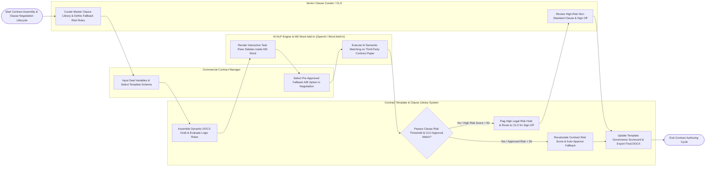

# Swimlane Diagram — Contract Template & Clause Library System

## Mermaid Code

## Flow Description | Mô tả luồng

| Lane | Actor | Role in Flow |
|------|-------|-------------|
| 1 | Commercial Contract Manager | Inputs deal metadata into the assembly questionnaire, selects pre-approved Fallback A or Fallback B clauses during counterparty negotiations, and ingests third-party paper. |
| 2 | Senior Clause Curator / CLO | Curates master primary terms, defines fallback clause drafting rationale, reviews high-risk contract deviations ($> 50/100$), and signs off on non-standard terms. |
| 3 | Contract Template & Clause Library System | Evaluates conditional template assembly logic rules, generates customized DOCX contract drafts, calculates composite contract legal risk scores, enforces approval delegation matrices, tracks clause usage frequency, and exports governance scorecards. |
| 4 | AI NLP Engine & MS Word Add-In (OpenAI / Word Add-In) | Renders interactive sidebar task panes inside MS Word and Google Docs, and executes AI NLP semantic matching to extract and classify clauses in third-party paper. |
