# Action Tree — Contract Template & Clause Library System

## Mermaid Code

```mermaid
graph TD
    Root["Contract Template & Clause Library System"]

    Root --> M1["Template Schema & Dynamic Contract Assembly"]
    Root --> M2["Master Clause Repository & Fallback Rules"]
    Root --> M3["AI NLP Clause Extraction & Semantic Matching"]
    Root --> M4["Microsoft Word & Google Docs Task Pane Add-In"]
    Root --> M5["Clause Deviation Risk Scoring & Approvals"]
    Root --> M6["Template Governance & Executive Scorecards"]

    M1 --> A11["Configure Enterprise Master Contract Template Categories (NDA, MSA, SOW)"]
    M1 --> A12["Format Variable Metadata Questionnaires & Conditional Logic Rules"]
    M1 --> A13["Dynamically Assemble Custom Brand-Compliant DOCX Contract Drafts"]
    M1 --> A14["Manage Template Version Control, Deprecations & Version Rollbacks"]

    M2 --> A21["Curate Centralized Clause Library (Primary Terms & Drafting Rationale)"]
    M2 --> A22["Configure Pre-Approved Fallback A & Fallback B Clause Alternatives"]
    M2 --> A23["Define Mandatory Approval Delegation Matrices per Fallback Tier"]
    M2 --> A24["Audit Plain Language & Corporate Legal Style Guidelines (Flesch-Kincaid)"]

    M3 --> A31["Ingest Third-Party Counterparty Paper Contract PDFs & Word Files"]
    M3 --> A32["Extract Clause Boundaries & Classify Clause Categories via AI NLP Models"]
    M3 --> A33["Calculate Cosine Semantic Match Scores against Master Clause Vectors"]
    M3 --> A34["Generate Redline Visual Comparisons comparing Vendor Text vs. Master Terms"]

    M4 --> A41["Render Interactive Task Pane Sidebar inside MS Word & Google Docs"]
    M4 --> A42["Enable One-Click Clause Search & Fallback Insertion at Active Cursor"]
    M4 --> A43["Apply Automatic Document Typography, Headers & Paragraph Numbering"]
    M4 --> A44["Track Real-Time Add-In Clause Insertion Events & User Analytics"]

    M5 --> A51["Assign Risk Points to Clause Deviations & Non-Standard Legal Terms"]
    M5 --> A52["Calculate Composite Contract Legal Risk Scores (Scale 0 to 100)"]
    M5 --> A53["Place Critical Risk Contracts (Score > 50) on Mandatory Legal Hold"]
    M5 --> A54["Route High-Risk Non-Standard Term Approval Requests to CLO / General Counsel"]

    M6 --> A61["Track Clause Usage Frequency & Counterparty Rejection Percentages"]
    M6 --> A62["Benchmark Legal Authoring Velocity & Clause Negotiation Cycle Time"]
    M6 --> A63["Sync Assembled Contract Drafts with Enterprise CLM Systems (Icertis API)"]
    M6 --> A64["Export Executive Contract Governance, Clause Risk & Compliance Scorecards"]
```

## Module Description | Mô tả Module

| # | Module | Description | Actions |
|---|--------|-------------|---------|
| 1 | Template Schema & Dynamic Contract Assembly | Configures master template categories, formats variable questionnaires, dynamically generates customized DOCX contract drafts, and manages version control. | Configure Master Template Categories, Format Variable Questionnaires & Logic Rules, Dynamically Assemble Custom DOCX Contract Drafts, Manage Template Versioning & Rollbacks. |
| 2 | Master Clause Repository & Fallback Rules | Curates standard primary terms, configures Fallback A/B variants, sets approval delegation matrices, and audits plain language compliance. | Curate Centralized Clause Library, Configure Pre-Approved Fallback A/B Alternatives, Define Approval Delegation Matrices per Tier, Audit Plain Language & Legal Style Guidelines. |
| 3 | AI NLP Clause Extraction & Semantic Matching | Ingests third-party paper, extracts clause boundaries via AI NLP models, calculates semantic similarity scores, and renders redline comparisons. | Ingest Third-Party Counterparty Paper Documents, Extract Clause Boundaries & Categories via AI NLP, Calculate Semantic Match Scores against Master Vectors, Generate Redline Visual Comparisons. |
| 4 | Microsoft Word & Google Docs Task Pane Add-In | Renders interactive sidebar task panes inside MS Word/Google Docs, enables one-click clause insertion at active cursor, and auto-matches typography. | Render Interactive Task Pane Sidebar in Word/Docs, Enable One-Click Clause Search & Insertion, Apply Automatic Document Typography & Numbering, Track Real-Time Add-In Insertion Events. |
| 5 | Clause Deviation Risk Scoring & Approvals | Assigns risk points to non-standard terms, computes composite contract legal risk scores (0-100), places high-risk contracts on hold, and routes sign-offs to CLO. | Assign Risk Points to Non-Standard Terms, Calculate Composite Contract Risk Scores, Place High-Risk Contracts on Mandatory Legal Hold, Route Non-Standard Term Approvals to CLO. |
| 6 | Template Governance & Executive Scorecards | Tracks clause rejection %, benchmarks legal authoring velocity, syncs drafts with CLM systems via API, and exports executive governance scorecards. | Track Clause Usage Frequency & Rejection %, Benchmark Legal Authoring Velocity & Cycle Time, Sync Assembled Drafts with Enterprise CLM Systems, Export Executive Template Governance Scorecards. |
