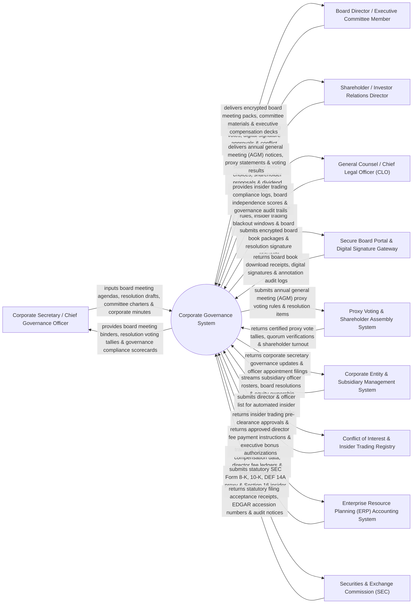

# Context Diagram — Corporate Governance System

## Mermaid Code

## Actor & Interaction Table | Bảng Actor & Tương tác

| # | Actor | Actor Type | Data Sent TO System | Data Received FROM System | Notes |
|---|-------|------------|---------------------|---------------------------|-------|
| 1 | Corporate Secretary / Chief Governance Officer | Primary | Board meeting agendas, resolution drafts, committee charters, corporate minutes, board evaluation templates. | Board meeting binders, resolution voting tallies, governance compliance scorecards, officer appointment logs. | Corporate Secretary organizing board of director meetings, minutes, resolutions, and governance filings. |
| 2 | Board Director / Executive Committee Member | Primary | Board resolution votes (For/Against/Abstain), digital signature approvals, annual director conflict disclosures. | Encrypted board meeting packs, committee briefing materials, executive compensation decks, board evaluations. | Board member or committee chair reviewing board books, voting on resolutions, and signing minutes. |
| 3 | Shareholder / Investor Relations Director | Primary | Proxy voting choices, shareholder resolution proposals, annual general meeting (AGM) attendance registrations. | AGM notices, proxy statements (DEF 14A), certified voting result reports, dividend policy disclosures. | Corporate shareholder or IR lead participating in annual general meetings and exercising proxy votes. |
| 4 | CLO | Primary | Corporate governance rules, insider trading blackout window schedules, director independence criteria. | Insider trading compliance logs, board independence scorecards, governance audit trails, SEC compliance alerts. | Executive governing legal compliance of board decisions, insider trading prevention, and SEC disclosures. |
| 5 | Secure Board Portal & Digital Signature Gateway | Supporting | Board book download receipts, cryptographic digital signatures, annotation audit logs, device security status. | Encrypted board book packages (Diligent / Computershare API), resolution signature envelope payloads. | Secure board portal platform delivering encrypted board packs to iPad/mobile devices and capturing signatures. |
| 6 | Proxy Voting & Shareholder Assembly System | Supporting | Certified proxy vote tallies, AGM quorum verification receipts, shareholder voting turnout percentages. | AGM proxy voting rules, resolution item lists, shareholder eligibility lists, voting deadline timers. | Proxy voting service (Broadridge / Computershare) managing shareholder voting for Annual General Meetings. |
| 7 | Corporate Entity & Subsidiary Management System | Supporting | Subsidiary officer rosters, parent-subsidiary ownership trees, minute book histories, director appointments. | Corporate secretary governance updates, statutory officer appointment filings, entity dissolution logs. | Entity management platform tracking global corporate subsidiaries, officer positions, and minute books. |
| 8 | Conflict of Interest & Insider Trading Registry | Supporting | Insider trading pre-clearance approvals, director conflict hit reports, Form 4 trading pre-notification logs. | Director & Officer (D&O) lists, insider trading blackout window dates, restricted trading lists. | Governance registry enforcing insider trading blackout periods (SEC Rule 10b5-1) and D&O conflict checks. |
| 9 | Enterprise Resource Planning (ERP) Accounting System | Supporting | Executive compensation financial ledgers, director fee payment ledgers, financial audit reports. | Approved director fee payment instructions, executive bonus pool authorizations, committee stipend logs. | Enterprise ERP synchronizing executive compensation and triggering director stipend payments. |
| 10 | Securities & Exchange Commission (SEC / Financial Regulator) | Supporting / Regulatory | Statutory filing acceptance receipts, EDGAR accession numbers, SEC examination notices, filing confirmations. | Electronic SEC filings (Form 8-K, 10-K, DEF 14A Proxy Statements, Section 16 Form 4 Insider filings). | Securities regulator receiving statutory corporate governance disclosures, proxy statements, and insider filings. |

## System Boundary Description | Mô tả Phạm vi Hệ thống

The **Corporate Governance System** is an enterprise board portal, resolution voting, corporate minutes, SEC EDGAR filing, subsidiary management, insider trading blackout, and Annual General Meeting (AGM) proxy voting platform built for public and private enterprise boards.

**Inside System Scope:**
- Secure board book creation, agenda compilation, and encrypted distribution to mobile board portals (Diligent API).
- Unanimous written consent and resolution voting workflow with cryptographic digital signature execution.
- SEC EDGAR statutory filing integration for Form 8-K (Current Reports), DEF 14A (Proxy Statements), and Form 4 (Insider Trades).
- Insider trading blackout window management (SEC Rule 10b5-1) enforcing pre-clearance and trading bans for D&Os.
- Annual General Meeting (AGM) proxy voting management, quorum calculation, and shareholder resolution tallies.

**Outside System Scope:**
- Direct physical hosting of in-person board of directors dinner events (handled by Corporate Hospitality).
- Direct physical counting of paper proxy ballots mailed by retail shareholders (handled by Transfer Agents).
- Direct physical custody of stock certificates (handled by Depository Trust Company - DTC).
