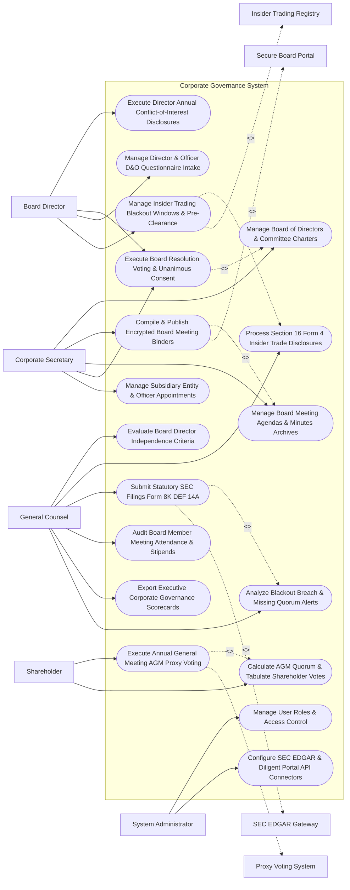

# Use Case Diagram — Corporate Governance System

## Mermaid Code

## Actor Table | Bảng Actor

| # | Actor | Actor Type | Role Description | Related Use Cases |
|---|-------|------------|------------------|-------------------|
| 1 | Corporate Secretary | Primary | Chief Governance Officer managing board charters, board books, meeting minutes, resolution voting, and subsidiary rosters. | UC01, UC02, UC03, UC05, UC13 |
| 2 | Board Director | Primary | Board member reviewing encrypted board books, completing conflict disclosures, voting on resolutions, and pre-clearing trades. | UC04, UC05, UC06, UC08 |
| 3 | Shareholder | Primary | Corporate investor participating in Annual General Meetings (AGM), submitting proxy choices, and reviewing vote tallies. | UC10, UC11 |
| 4 | General Counsel | Primary | Executive evaluating director independence, Section 16 insider trades, SEC filings, board attendance, and scorecards. | UC07, UC09, UC12, UC14, UC15, UC18 |
| 5 | System Administrator | Primary | IT admin managing user security roles, Diligent portal API keys, and SEC EDGAR gateway credentials. | UC16, UC17 |
| 6 | Secure Board Portal | System (Secondary) | Mobile board portal platform (Diligent/Computershare) delivering encrypted board packs and capturing signatures. | UC02 |
| 7 | Proxy Voting System | System (Secondary) | Shareholder proxy voting service (Broadridge) calculating quorums and tabulating AGM resolution votes. | UC10 |
| 8 | SEC EDGAR Gateway | System (Secondary) | US Securities and Exchange Commission gateway receiving statutory Form 8-K, 10-K, and DEF 14A disclosures. | UC12 |
| 9 | Insider Trading Registry | System (Secondary) | Compliance registry tracking insider trading blackout windows (SEC Rule 10b5-1) and D&O pre-clearances. | UC08 |

## Use Case Table | Bảng Use Case

| # | UC ID | Use Case Name | Primary Actor | Secondary Actor | Description | Priority |
|---|-------|---------------|---------------|-----------------|-------------|----------|
| 1 | UC01 | Manage Board of Directors & Committee Charters | Secretary | None | Maintains board rosters, committee compositions (Audit, Compensation, Governance), and formal charters. | Critical |
| 2 | UC02 | Compile & Publish Encrypted Board Meeting Binders | Secretary | BoardPortal | Compiles board meeting agendas, executive decks, and financial reports into encrypted board books (Diligent API). | Critical |
| 3 | UC03 | Manage Board Meeting Agendas & Minutes Archives | Secretary | None | Records official board meeting minutes, tracking action items, motion seconders, and legal minute book archives. | Critical |
| 4 | UC04 | Execute Director Annual Conflict-of-Interest Disclosures | Director | None | Collects annual Director & Officer (D&O) conflict-of-interest disclosures, identifying potential board interlocks. | High |
| 5 | UC05 | Execute Board Resolution Voting & Unanimous Consent | Secretary | None | Manages board resolution voting (For/Against/Abstain) and cryptographic Unanimous Written Consent (UWC) sign-offs. | Critical |
| 6 | UC06 | Manage Director & Officer D&O Questionnaire Intake | Director | None | Automates annual D&O questionnaire collection for SEC proxy disclosures, tracking digital signatures. | High |
| 7 | UC07 | Evaluate Board Director Independence Criteria | CLO | None | Evaluates director independence under NYSE/Nasdaq listing standards, flagging non-independent relationships. | Critical |
| 8 | UC08 | Manage Insider Trading Blackout Windows & Pre-Clearance | Director | InsiderReg | Enforces quarterly earnings blackout windows (SEC Rule 10b5-1) and processes D&O trade pre-clearance requests. | Critical |
| 9 | UC09 | Process Section 16 Form 4 Insider Trade Disclosures | CLO | None | Tracks D&O equity transactions, auto-generating SEC Form 4 filings within the statutory 2-business-day deadline. | Critical |
| 10 | UC10 | Execute Annual General Meeting AGM Proxy Voting | Shareholder | ProxySys | Manages Annual General Meeting (AGM) proxy statements (DEF 14A), voting instructions, and shareholder resolutions. | Critical |
| 11 | UC11 | Calculate AGM Quorum & Tabulate Shareholder Votes | Shareholder | None | Calculates shareholder meeting quorum percentage and tabulates votes on executive compensation and director elections. | High |
| 12 | UC12 | Submit Statutory SEC Filings Form 8K DEF 14A | CLO | SEC | Submits electronic XML/HTML corporate governance filings (Form 8-K, DEF 14A) directly to SEC EDGAR gateway. | Critical |
| 13 | UC13 | Manage Subsidiary Entity & Officer Appointments | Secretary | None | Tracks global subsidiary corporate entities, officer/director appointments, annual filings, and power of attorney logs. | High |
| 14 | UC14 | Audit Board Member Meeting Attendance & Stipends | CLO | None | Tracks director meeting attendance rates ($> 75\%$ SEC requirement) and calculates annual director retainer fees and stipends. | High |
| 15 | UC15 | Export Executive Corporate Governance Scorecards | CLO | None | Renders executive scorecards detailing board independence %, meeting attendance %, insider trade compliance, and D&O audit. | High |
| 16 | UC16 | Manage User Roles & Access Control | Admin | None | Controls user login credentials, RBAC permissions, and confidential board book access clearances. | High |
| 17 | UC17 | Configure SEC EDGAR & Diligent Portal API Connectors | Admin | None | Configures API connection parameters for SEC EDGAR, Diligent Boardbooks, Broadridge, and Workday HR. | High |
| 18 | UC18 | Analyze Blackout Breach & Missing Quorum Alerts | CLO | None | Dispatches urgent alerts if a director trades during a blackout window or an AGM fails to reach minimum quorum. | High |

## Use Case Specification | Đặc tả Use Case

---

### UC02 — Compile & Publish Encrypted Board Meeting Binders

| Field | Detail |
|-------|--------|
| **UC ID** | UC02 |
| **Use Case Name** | Compile & Publish Encrypted Board Meeting Binders |
| **Actor(s)** | Primary: Corporate Secretary, Chief Governance Officer   Secondary: Secure Board Portal & Digital Signature Gateway (Diligent API) |
| **Description** | Compiles board meeting agendas, executive decks, financial statements, and committee reports into encrypted, DRM-protected board books, publishing them securely to directors' mobile devices via Diligent API. |
| **Precondition** | 1. Board meeting date and agenda items are configured (UC03).   2. Executive committee reports and financial presentations are submitted. |
| **Main Flow** | 1. Corporate Secretary opens "Board Book Compilation Studio" for Upcoming Board Meeting: `Q4 Board Meeting (Nov 15, 2026)`.   2. Secretary compiles Board Pack Agenda Items:   &nbsp;&nbsp;&nbsp;&nbsp; a. Item 1: `Q3 Financial Results & Audit Committee Report (PDF)`.   &nbsp;&nbsp;&nbsp;&nbsp; b. Item 2: `Strategic M&A Acquisition Proposal (Confidential Deck)`.   &nbsp;&nbsp;&nbsp;&nbsp; c. Item 3: `Executive Compensation Committee Recommendations`.   &nbsp;&nbsp;&nbsp;&nbsp; d. Item 4: `Proposed Board Resolution #RES-2026-08 (Unanimous Consent)`.   3. System converts all attached documents into unified, page-numbered, indexed Board Book (`Board_Pack_Q4_2026.pdf` - 250 Pages).   4. System applies AES-256 Envelope Encryption & DRM Protection:   &nbsp;&nbsp;&nbsp;&nbsp; a. Disables local file saving, printing, and screenshot capture on mobile apps.   &nbsp;&nbsp;&nbsp;&nbsp; b. Stamps dynamic watermarks (Director Name + IP Address).   5. Secretary clicks "Publish Board Book to Board Directors".   6. System dispatches HTTPS REST API payload to Diligent Board Portal Gateway API.   7. Diligent API syncs encrypted board book to mobile tablet apps of all 9 Board Directors.   8. Directors receive notification: *"Q4 Board Book Published - Access available in Diligent App."* |
| **Alternative Flow** | **AF1** — Late Executive Presentation Replacement: CFO submits updated financial deck 2 hours prior to meeting; Secretary swaps presentation; System auto-syncs revision v2.0 to all director devices, highlighting updated pages. |
| **Exception Flow** | **EX1** — Un-Authorized Device Access Error: Director attempts to open board book on an un-registered personal phone; System blocks access (`SECURITY_DEVICE_NOT_APPROVED`), notifying Corporate Secretary. |
| **Postcondition** | Board book is compiled, AES-256 encrypted, published via Diligent API, and synced securely to directors' mobile devices. |
| **Business Rule** | **BR1**: Board meeting binders MUST be encrypted at rest and in transit with DRM copy-protections prohibiting file exports. |

---

### UC05 — Execute Board Resolution Voting & Unanimous Consent

| Field | Detail |
|-------|--------|
| **UC ID** | UC05 |
| **Use Case Name** | Execute Board Resolution Voting & Unanimous Consent |
| **Actor(s)** | Primary: Board Director, Corporate Secretary   Secondary: Secure Board Portal & Digital Signature Gateway |
| **Description** | Manages formal board resolution voting workflows (For, Against, Abstain) and Unanimous Written Consent (UWC) executions, capturing cryptographic digital signatures and logging corporate minutes. |
| **Precondition** | 1. Proposed board resolution (e.g., `#RES-2026-08 - Approval of $50M Credit Facility`) is published (UC02).   2. Quorum of board directors is logged in system. |
| **Main Flow** | 1. Corporate Secretary launches "Board Resolution Voting Session" for Resolution `#RES-2026-08`.   2. System dispatches voting ballot to all 9 Board Directors via board portal app.   3. Directors review resolution text, legal opinion, and credit facility terms.   4. Each Director selects Vote Choice:   &nbsp;&nbsp;&nbsp;&nbsp; a. 8 Directors select: `FOR (Approve)`.   &nbsp;&nbsp;&nbsp;&nbsp; b. 1 Director selects: `ABSTAIN (Conflict of Interest)`.   5. System checks Voting Threshold Rules (Corporate Bylaws Rule: Simple Majority > 50% required):   &nbsp;&nbsp;&nbsp;&nbsp; a. Result: 8 For, 0 Against, 1 Abstain -> `RESOLUTION_PASSED`.   6. For Unanimous Written Consent (UWC) resolutions, System prompts all directors to apply Cryptographic Digital Signatures.   7. All required directors apply digital signatures; System generates Certified Resolution Record `#RES-CERT-88412`.   8. System attaches certified resolution to Corporate Minute Book (UC03) and triggers ERP execution task (UC13). |
| **Alternative Flow** | **AF1** — Resolution Rejection Workflow: 5 of 9 Directors vote `AGAINST`; System flags `RESOLUTION_FAILED`, logs voting breakdown in minutes, and notifies Managing Partner. |
| **Exception Flow** | **EX1** — Conflicted Director Vote Block: Director with logged conflict of interest (UC04) attempts to vote `FOR`; System blocks vote (`VOTE_BLOCKED_CONFLICT`), recording vote status as "Recused Due to Conflict". |
| **Postcondition** | Director votes are cast, voting thresholds are evaluated, cryptographic digital signatures are applied, and certified resolution is archived in minute book. |
| **Business Rule** | **BR1**: Board resolution votes MUST be recorded with individual director choices, recusal logs, and cryptographic digital signatures. |

---

### UC08 — Manage Insider Trading Blackout Windows & Pre-Clearance

| Field | Detail |
|-------|--------|
| **UC ID** | UC08 |
| **Use Case Name** | Manage Insider Trading Blackout Windows & Pre-Clearance |
| **Actor(s)** | Primary: Board Director, General Counsel   Secondary: Conflict of Interest & Insider Trading Registry |
| **Description** | Enforces quarterly earnings insider trading blackout windows (SEC Rule 10b5-1), processes Director & Officer (D&O) stock trade pre-clearance requests, and tracks 10b5-1 trading plan compliance. |
| **Precondition** | 1. Quarterly earnings calendar and blackout dates are set.   2. Director & Officer (D&O) insider list is synchronized. |
| **Main Flow** | 1. System enters Quarterly Earnings Insider Trading Blackout Window:   &nbsp;&nbsp;&nbsp;&nbsp; a. Blackout Start Date: `October 15, 2026` (15 days prior to quarter end).   &nbsp;&nbsp;&nbsp;&nbsp; b. Blackout End Date: `November 03, 2026` (48 hours post-earnings announcement).   2. System dispatches Blackout Notice to all D&Os: *"ATTENTION: Insider Trading Blackout Window Active. All open-market trading in company stock is PROHIBITED until Nov 03."*   3. Outside of blackout window (e.g., Nov 10), Board Director John Smith submits Trade Pre-Clearance Request:   &nbsp;&nbsp;&nbsp;&nbsp; a. Proposed Trade: Sell 5,000 Shares of Company Common Stock.   &nbsp;&nbsp;&nbsp;&nbsp; b. Proposed Execution Window: `Nov 12 to Nov 15, 2026`.   4. General Counsel opens "Insider Trade Pre-Clearance Desk".   5. General Counsel verifies D&O Material Non-Public Information (MNPI) Status:   &nbsp;&nbsp;&nbsp;&nbsp; a. MNPI Check: Director holds no pending un-disclosed M&A information -> `CLEARED`.   6. General Counsel approves pre-clearance request: `TRADE_PRE_CLEARED_VALID_3_DAYS`.   7. Director executes trade on Nov 13; System auto-generates draft SEC Form 4 (UC09) for filing within 2 business days. |
| **Alternative Flow** | **AF1** — SEC Rule 10b5-1 Pre-Scheduled Trading Plan: Director has pre-established 10b5-1 trading plan approved 90 days prior; System permits automated trade execution during blackout window per Rule 10b5-1 defense. |
| **Exception Flow** | **EX1** — Un-Cleared Blackout Trade Attempt: Director attempts to execute trade during active blackout window without pre-clearance; System flags `CRITICAL_INSIDER_TRADING_VIOLATION`, sending immediate alert to General Counsel and CISO. |
| **Postcondition** | Blackout windows are enforced, D&O trade pre-clearance requests are reviewed, approvals are logged, and draft SEC Form 4 filings generate. |
| **Business Rule** | **BR1**: Directors and Officers MUST obtain General Counsel pre-clearance before executing open-market transactions in company securities. |

---

### UC10 — Execute Annual General Meeting (AGM) Proxy Voting

| Field | Detail |
|-------|--------|
| **UC ID** | UC10 |
| **Use Case Name** | Execute Annual General Meeting (AGM) Proxy Voting |
| **Actor(s)** | Primary: Shareholder, Corporate Secretary   Secondary: Proxy Voting & Shareholder Assembly System (Broadridge / Computershare) |
| **Description** | Manages Annual General Meeting (AGM) shareholder proxy voting, distributing official Proxy Statements (DEF 14A), tabulating proxy ballots, and calculating statutory meeting quorum percentages. |
| **Precondition** | 1. Annual General Meeting (AGM) date, record date, and Proxy Statement (DEF 14A) are approved (UC12).   2. Shareholder registry (record date shareholder list) is synchronized from transfer agent. |
| **Main Flow** | 1. Corporate Secretary launches "AGM Shareholder Proxy Campaign" for Meeting Date: `May 20, 2027`.   2. System dispatches Proxy Packages (DEF 14A Statement + Proxy Ballot Card) to all 50,000 registered shareholders via mail and electronic proxy delivery (Broadridge API).   3. Shareholder Acme Capital (Holding 2,000,000 Shares) opens "Online Proxy Voting Portal".   4. Shareholder votes on AGM Proposals:   &nbsp;&nbsp;&nbsp;&nbsp; a. Proposal 1 (Election of 9 Board Directors): Votes `FOR` all nominees.   &nbsp;&nbsp;&nbsp;&nbsp; b. Proposal 2 (Ratification of Independent Auditor): Votes `FOR`.   &nbsp;&nbsp;&nbsp;&nbsp; c. Proposal 3 (Say-on-Pay Advisory Executive Compensation): Votes `FOR`.   &nbsp;&nbsp;&nbsp;&nbsp; d. Proposal 4 (Shareholder Proposal on Climate Reporting): Votes `AGAINST`.   5. Shareholder submits proxy ballot.   6. System ingests proxy votes via Broadridge API, tabulating share counts and updating Quorum Tracker:   &nbsp;&nbsp;&nbsp;&nbsp; a. Total Outstanding Shares: 100,000,000.   &nbsp;&nbsp;&nbsp;&nbsp; b. Total Voted Shares to Date: 72,500,000 Shares (`72.5% Quorum Reached` >= 50% Bylaw Minimum).   7. On AGM date (May 20), System renders Certified AGM Voting Results Report for Corporate Secretary. |
| **Alternative Flow** | **AF1** — In-Person AGM Ballot Voting: Shareholder attends physical AGM in person; Transfer agent issues physical voting card, entering votes into portal; System updates final vote tallies. |
| **Exception Flow** | **EX1** — Insufficient Quorum Warning Alert: 3 days prior to AGM, voted shares reach only 42% (below 50% quorum); System alerts Corporate Secretary, dispatching urgent proxy solicitation follow-up emails to institutional shareholders. |
| **Postcondition** | Shareholder proxy ballots are cast, votes are tabulated by share count, statutory meeting quorum (72.5%) is achieved, and voting results certify. |
| **Business Rule** | **BR1**: Annual General Meetings MUST achieve minimum statutory quorum percentages prior to formally tabulating shareholder resolution votes. |

---

### UC12 — Submit Statutory SEC Filings (Form 8-K / DEF 14A)

| Field | Detail |
|-------|--------|
| **UC ID** | UC12 |
| **Use Case Name** | Submit Statutory SEC Filings (Form 8-K / DEF 14A) |
| **Actor(s)** | Primary: General Counsel / CLO, Corporate Secretary   Secondary: Securities & Exchange Commission (SEC EDGAR Gateway API) |
| **Description** | Formats, validates, signs, and dispatches electronic statutory corporate governance disclosures (Form 8-K Current Reports, DEF 14A Proxy Statements, Form 4 Insider Trades) to the SEC EDGAR portal. |
| **Precondition** | 1. Material corporate event (e.g., Executive Officer Appointment or Board Resolution) occurs, requiring Form 8-K filing within 4 business days.   2. SEC EDGAR CIK/CCC filing credentials are authenticated. |
| **Main Flow** | 1. Board approves appointment of new Chief Financial Officer (CFO) Jane Doe (Item 5.02 Form 8-K Trigger).   2. General Counsel opens "SEC EDGAR Statutory Filing Desk".   3. General Counsel prepares Form 8-K Filing Package:   &nbsp;&nbsp;&nbsp;&nbsp; a. Document Type: `Form 8-K (Current Report)`.   &nbsp;&nbsp;&nbsp;&nbsp; b. Item Category: `Item 5.02 (Departure of Directors or Certain Officers; Election of Directors; Appointment of Certain Officers)`.   &nbsp;&nbsp;&nbsp;&nbsp; c. Attachment 1: `Press Release PDF (Exhibit 99.1)`.   &nbsp;&nbsp;&nbsp;&nbsp; d. Attachment 2: `Executive Employment Agreement PDF (Exhibit 10.1)`.   4. System transforms document package into SEC EDGAR HTML & Inline XBRL (iXBRL) format.   5. System dispatches EDGAR Pre-Filing Validation Check:   &nbsp;&nbsp;&nbsp;&nbsp; a. Schema Check: Valid iXBRL tags -> `VALID`.   &nbsp;&nbsp;&nbsp;&nbsp; b. CIK/CCC Credential Check -> `VERIFIED`.   6. General Counsel applies Cryptographic Executive Digital Signature.   7. System transmits HTTPS REST API payload to SEC EDGAR Gateway (`https://www.edgarfiling.sec.gov`).   8. SEC EDGAR Gateway accepts filing and issues Official Accession Receipt:   &nbsp;&nbsp;&nbsp;&nbsp; a. EDGAR Accession Number: `0001188412-26-000412`.   &nbsp;&nbsp;&nbsp;&nbsp; b. Official Filing Timestamp: `October 30, 2026 at 04:30:15 PM EST`.   9. System attaches SEC accession receipt to governance record and auto-publishes Form 8-K to company Investor Relations website. |
| **Alternative Flow** | **AF1** — Section 16 Form 4 Insider Trade Filing: Director executes stock trade (UC08); System auto-populates SEC Form 4 XML, validating 2-business-day filing deadline, and dispatches to EDGAR. |
| **Exception Flow** | **EX1** — SEC EDGAR Filing Rejection: Filing is rejected due to invalid exhibit tag; System alerts General Counsel, highlighting syntax error for correction before 5:30 PM EST SEC cutoff. |
| **Postcondition** | Form 8-K filing is formatted into iXBRL, submitted to SEC EDGAR, official Accession Receipt is issued, and disclosure publishes to IR website. |
| **Business Rule** | **BR1**: Material corporate governance events (Item 5.02) MUST be filed on SEC Form 8-K within <= 4 business days of occurrence. |
