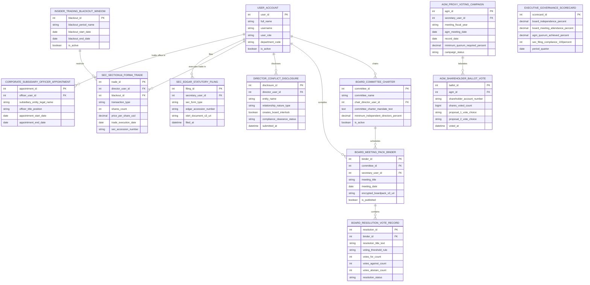

# Conceptual ERD — Corporate Governance System

## Mermaid Code

## Entity Description Table | Bảng mô tả Entity

| # | Entity Name | Vietnamese Name | Description | Key Attributes | Main Relationships |
|---|-------------|-----------------|-------------|----------------|-------------------|
| 1 | USER_ACCOUNT | Tài khoản Nguời dùng | System credentials and access roles for corporate secretaries, board directors, shareholders, CLOs, and admins. | `user_id`, `username`, `user_role`, `department_code` | Chairs `BOARD_COMMITTEE_CHARTER`, compiles `BOARD_MEETING_PACK_BINDER`, discloses `DIRECTOR_CONFLICT_DISCLOSURE`, executes trade in `SEC_SECTION16_FORM4_TRADE`, files `SEC_EDGAR_STATUTORY_FILING`, holds office in `CORPORATE_SUBSIDIARY_OFFICER_APPOINTMENT`. |
| 2 | BOARD_COMMITTEE_CHARTER | Charter Ủy ban Hội đồng Quản trị | Board committee charter definition entity storing committee names (Audit, Compensation, Governance), chair user ID, and independence rules. | `committee_id`, `committee_name`, `chair_director_user_id`, `committee_charter_mandate_text`, `minimum_independent_directors_percent` | Schedules `BOARD_MEETING_PACK_BINDER`, chaired by `USER_ACCOUNT`. |
| 3 | BOARD_MEETING_PACK_BINDER | Binder Board Book Họp HĐQT | Encrypted board meeting binder record tracking meeting titles, dates, encrypted PDF S3 URIs, and publication status. | `binder_id`, `committee_id`, `secretary_user_id`, `meeting_title`, `meeting_date`, `encrypted_boardpack_s3_uri`, `is_published` | Belongs to `BOARD_COMMITTEE_CHARTER`, contains `BOARD_RESOLUTION_VOTE_RECORD`, compiled by `USER_ACCOUNT`. |
| 4 | BOARD_RESOLUTION_VOTE_RECORD | Bản ghi Vote Nghị quyết HĐQT | Board resolution vote log recording resolution titles, voting threshold rules, For/Against/Abstain counts, and resolution status (`PASSED/FAILED`). | `resolution_id`, `binder_id`, `resolution_title_text`, `voting_threshold_rule`, `votes_for_count`, `votes_against_count`, `resolution_status` | Belongs to `BOARD_MEETING_PACK_BINDER`. |
| 5 | DIRECTOR_CONFLICT_DISCLOSURE | Kê khai Xung đột Lợi ích Director | Director & Officer (D&O) conflict-of-interest disclosure log tracking outside entities, relationship nature, board interlocks, and clearance status. | `disclosure_id`, `director_user_id`, `entity_name`, `relationship_nature_type`, `creates_board_interlock`, `compliance_clearance_status` | Submitted by `USER_ACCOUNT`. |
| 6 | INSIDER_TRADING_BLACKOUT_WINDOW | Cửa sổ Blackout Insider Trading | Quarterly earnings insider trading blackout window record tracking blackout period names, start/end dates, and active flags. | `blackout_id`, `blackout_period_name`, `blackout_start_date`, `blackout_end_date`, `is_active` | Restricts `SEC_SECTION16_FORM4_TRADE`. |
| 7 | SEC_SECTION16_FORM4_TRADE | Giao dịch Insider SEC Form 4 | D&O insider equity transaction record tracking shares, price USD, trade execution dates, and SEC Form 4 EDGAR accession numbers. | `trade_id`, `director_user_id`, `blackout_id`, `transaction_type`, `shares_count`, `price_per_share_usd`, `sec_accession_number` | Restricted by `INSIDER_TRADING_BLACKOUT_WINDOW`, executed by `USER_ACCOUNT`. |
| 8 | AGM_PROXY_VOTING_CAMPAIGN | Chiến dịch Proxy Voting AGM | Annual General Meeting (AGM) proxy campaign record tracking fiscal year, AGM meeting date, record date, minimum quorum %, and campaign status. | `agm_id`, `secretary_user_id`, `meeting_fiscal_year`, `agm_meeting_date`, `record_date`, `minimum_quorum_required_percent` | Tabulates `AGM_SHAREHOLDER_BALLOT_VOTE`. |
| 9 | AGM_SHAREHOLDER_BALLOT_VOTE | Phiếu bầu Proxy Shareholder AGM | Shareholder proxy voting ballot log recording shareholder account number, shares voted count, proposal vote choices (For/Against), and timestamps. | `ballot_id`, `agm_id`, `shareholder_account_number`, `shares_voted_count`, `proposal_1_vote_choice`, `voted_at` | Belongs to `AGM_PROXY_VOTING_CAMPAIGN`. |
| 10 | SEC_EDGAR_STATUTORY_FILING | Filing Quy định SEC EDGAR | Electronic statutory SEC EDGAR filing log recording Form types (Form 8-K, DEF 14A, Form 4), accession numbers, iXBRL S3 URIs, and filing timestamps. | `filing_id`, `secretary_user_id`, `sec_form_type`, `edgar_accession_number`, `ixbrl_document_s3_uri`, `filed_at` | Filed by `USER_ACCOUNT`. |
| 11 | CORPORATE_SUBSIDIARY_OFFICER_APPOINTMENT | Bổ nhiệm Officer Công ty Con | Corporate subsidiary officer appointment record tracking legal entity names, officer positions, and appointment start/end dates. | `appointment_id`, `officer_user_id`, `subsidiary_entity_legal_name`, `officer_title_position`, `appointment_start_date` | Held by `USER_ACCOUNT`. |
| 12 | EXECUTIVE_GOVERNANCE_SCORECARD | Scorecard Executive Quản trị | Executive corporate governance scorecard aggregating board independence %, meeting attendance %, AGM quorum %, and 100% SEC compliance. | `scorecard_id`, `board_independence_percent`, `board_meeting_attendance_percent`, `agm_quorum_achieved_percent` | Standalone executive performance entity. |

## Relationship Description | Mô tả Quan hệ

| # | From Entity | Cardinality | To Entity | Label | Business Explanation |
|---|-------------|-------------|-----------|-------|----------------------|
| 1 | BOARD_COMMITTEE_CHARTER | 1 to 0..N | BOARD_MEETING_PACK_BINDER | schedules | A board committee charter schedules board meeting pack binders. |
| 2 | BOARD_MEETING_PACK_BINDER | 1 to 0..N | BOARD_RESOLUTION_VOTE_RECORD | contains | A board meeting pack binder contains board resolution vote records. |
| 3 | INSIDER_TRADING_BLACKOUT_WINDOW | 1 to 0..N | SEC_SECTION16_FORM4_TRADE | restricts | An insider trading blackout window restricts Section 16 Form 4 insider trades. |
| 4 | AGM_PROXY_VOTING_CAMPAIGN | 1 to 0..N | AGM_SHAREHOLDER_BALLOT_VOTE | tabulates | An AGM proxy voting campaign tabulates shareholder ballot votes. |
| 5 | USER_ACCOUNT | 1 to 0..N | BOARD_COMMITTEE_CHARTER | chairs | A director user account chairs board committee charters. |
| 6 | USER_ACCOUNT | 1 to 0..N | BOARD_MEETING_PACK_BINDER | compiles | A corporate secretary user account compiles board meeting binders. |
| 7 | USER_ACCOUNT | 1 to 0..N | DIRECTOR_CONFLICT_DISCLOSURE | discloses | A board director user account discloses conflict of interest records. |
| 8 | USER_ACCOUNT | 1 to 0..N | SEC_SECTION16_FORM4_TRADE | executes trade in | A D&O user account executes trades logged in Form 4 records. |
| 9 | USER_ACCOUNT | 1 to 0..N | SEC_EDGAR_STATUTORY_FILING | files | A corporate secretary user account files SEC EDGAR disclosures. |
| 10 | USER_ACCOUNT | 1 to 0..N | CORPORATE_SUBSIDIARY_OFFICER_APPOINTMENT | holds office in | An officer user account holds office in corporate subsidiary appointments. |
