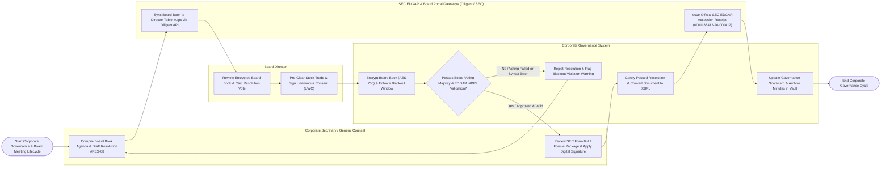

# Swimlane Diagram — Corporate Governance System

## Mermaid Code

## Flow Description | Mô tả luồng

| Lane | Actor | Role in Flow |
|------|-------|-------------|
| 1 | Board Director | Reviews encrypted board books on tablet apps, casts resolution votes (For/Against/Abstain), applies digital signatures to Unanimous Written Consents (UWC), and submits trade pre-clearance requests. |
| 2 | Corporate Secretary / General Counsel | Compiles board meeting binders, drafts resolutions, records corporate minutes, reviews D&O conflict disclosures, evaluates director independence, and approves statutory SEC filings. |
| 3 | Corporate Governance System | Applies AES-256 DRM encryption to board books, enforces quarterly insider trading blackout windows (SEC Rule 10b5-1), tabulates resolution votes against bylaws thresholds, converts documents to SEC iXBRL format, and updates governance scorecards. |
| 4 | SEC EDGAR & Board Portal Gateways (Diligent / SEC) | Syncs encrypted board books to directors' tablet devices via Diligent API, processes statutory filings on SEC EDGAR gateway, and issues official SEC Accession Receipts. |
