# Action Tree — Corporate Governance System

## Mermaid Code

```mermaid
graph TD
    Root["Corporate Governance System"]

    Root --> M1["Board Meeting & Encrypted Board Book Portal"]
    Root --> M2["Resolution Voting & Unanimous Consent (UWC)"]
    Root --> M3["Insider Trading Blackout & Section 16 Form 4"]
    Root --> M4["AGM Proxy Voting & Shareholder Tabulation"]
    Root --> M5["SEC EDGAR Filings (Form 8-K & DEF 14A Proxy)"]
    Root --> M6["Subsidiary Entities, D&O Audit & Scorecards"]

    M1 --> A11["Manage Board of Directors & Committee Roster Charters"]
    M1 --> A12["Compile Encrypted Board Meeting Binders (AES-256 DRM)"]
    M1 --> A13["Publish Board Packs to Mobile Devices via Diligent API"]
    M1 --> A14["Archive Official Board Meeting Minutes & Motion Seconders"]

    M2 --> A21["Execute Board Resolution Voting (For, Against, Abstain)"]
    M2 --> A22["Execute Cryptographic Unanimous Written Consent (UWC) Sign-Offs"]
    M2 --> A23["Verify Bylaws Resolution Voting Threshold Rules (Simple Majority)"]
    M2 --> A24["Recuse Conflicted Directors from Voting on Interlocked Resolutions"]

    M3 --> A31["Enforce Quarterly Earnings Insider Trading Blackout Windows (Rule 10b5-1)"]
    M3 --> A32["Process Director & Officer (D&O) Stock Trade Pre-Clearance Requests"]
    M3 --> A33["Track Pre-Scheduled SEC Rule 10b5-1 Trading Plan Executions"]
    M3 --> A34["Auto-Generate SEC Form 4 Filings within 2-Business-Day Statutory Deadline"]

    M4 --> A41["Distribute Annual General Meeting (AGM) Proxy Statements (DEF 14A)"]
    M4 --> A42["Ingest Shareholder Proxy Ballots via Broadridge API"]
    M4 --> A43["Calculate AGM Statutory Quorum Percentages (Minimum 50% Threshold)"]
    M4 --> A44["Tabulate Shareholder Resolution Votes for Director Elections & Say-on-Pay"]

    M5 --> A51["Convert Governance Disclosures into SEC Inline XBRL (iXBRL) Format"]
    M5 --> A52["Execute SEC EDGAR Pre-Filing Syntax & CIK/CCC Credential Validation"]
    M5 --> A53["Submit Electronic Form 8-K Current Reports for Item 5.02 Officer Events"]
    M5 --> A54["Auto-Publish SEC Filing Accession Receipts to Investor Relations Website"]

    M6 --> A61["Track Global Subsidiary Corporate Entities & Officer Appointments"]
    M6 --> A62["Audit Director Meeting Attendance Rates & Calculate Retainer Stipends"]
    M6 --> A63["Evaluate Director Independence Criteria under NYSE/Nasdaq Standards"]
    M6 --> A64["Export Executive Corporate Governance, D&O Audit & Risk Scorecards"]
```

## Module Description | Mô tả Module

| # | Module | Description | Actions |
|---|--------|-------------|---------|
| 1 | Board Meeting & Encrypted Board Book Portal | Manages board rosters/charters, compiles AES-256 DRM encrypted board packs, syncs to mobile devices via Diligent API, and archives minutes. | Manage Board Rosters & Committee Charters, Compile Encrypted Board Meeting Binders, Publish Board Packs via Diligent API, Archive Board Meeting Minutes. |
| 2 | Resolution Voting & Unanimous Consent (UWC) | Manages resolution voting, executes cryptographic Unanimous Written Consent (UWC) sign-offs, checks voting thresholds, and recuses conflicted directors. | Execute Board Resolution Voting, Execute Cryptographic UWC Sign-Offs, Verify Bylaws Resolution Voting Thresholds, Recuse Conflicted Directors from Voting. |
| 3 | Insider Trading Blackout & Section 16 Form 4 | Enforces Rule 10b5-1 blackout windows, processes D&O trade pre-clearances, tracks 10b5-1 trading plans, and auto-generates SEC Form 4 filings in 2 days. | Enforce Insider Trading Blackout Windows, Process D&O Trade Pre-Clearance Requests, Track Rule 10b5-1 Trading Plans, Auto-Generate SEC Form 4 Filings. |
| 4 | AGM Proxy Voting & Shareholder Tabulation | Distributes proxy statements (DEF 14A), ingests ballots via Broadridge API, calculates statutory quorum (50%), and tabulates shareholder votes. | Distribute AGM Proxy Statements, Ingest Shareholder Proxy Ballots via Broadridge, Calculate AGM Statutory Quorum Percentages, Tabulate Shareholder Votes for Elections. |
| 5 | SEC EDGAR Filings (Form 8-K & DEF 14A Proxy) | Converts disclosures to iXBRL format, validates EDGAR credentials, submits Form 8-K filings for Item 5.02 events in 4 days, and publishes receipts to IR site. | Convert Governance Disclosures to iXBRL Format, Execute SEC EDGAR Pre-Filing Validation, Submit Form 8-K Current Reports for Officer Events, Auto-Publish SEC Receipts to IR Website. |
| 6 | Subsidiary Entities, D&O Audit & Scorecards | Tracks global subsidiary officer appointments, audits director meeting attendance (> 75%), evaluates director independence, and exports scorecards. | Track Subsidiary Entities & Officer Appointments, Audit Director Meeting Attendance & Stipends, Evaluate Director Independence Criteria, Export Executive Governance Scorecards. |
