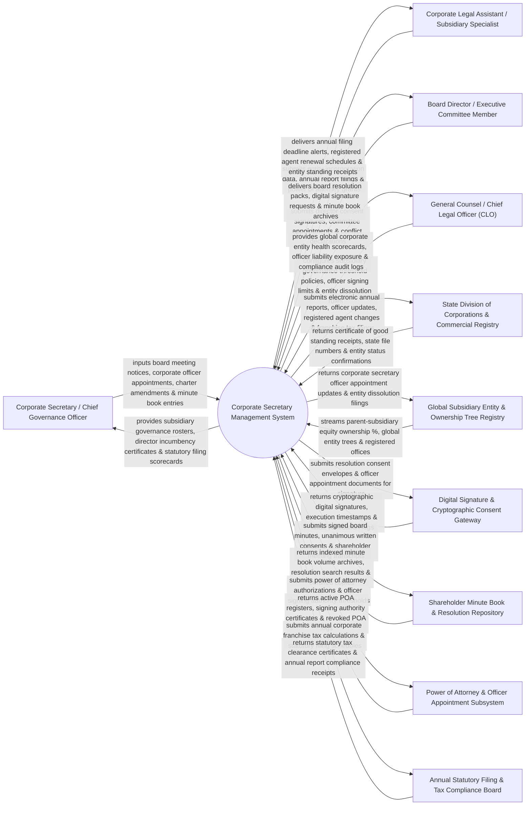

# Context Diagram — Corporate Secretary Management System

## Mermaid Code

## Actor & Interaction Table | Bảng Actor & Tương tác

| # | Actor | Actor Type | Data Sent TO System | Data Received FROM System | Notes |
|---|-------|------------|---------------------|---------------------------|-------|
| 1 | Corporate Secretary / Chief Governance Officer | Primary | Board meeting notices, corporate officer appointments, charter amendments, minute book entries, director incumbency certificates. | Subsidiary governance rosters, director incumbency certificates, statutory filing scorecards, minute book logs. | Corporate Secretary managing corporate governance, officer appointments, minute books, and entity compliance. |
| 2 | Corporate Legal Assistant / Subsidiary Specialist | Primary | Entity incorporation data, state annual report filings, power of attorney grants, registered agent updates. | Annual filing deadline alerts, registered agent renewal schedules, Certificates of Good Standing receipts. | Legal assistant managing subsidiary filings, state registered agents, and power of attorney registries. |
| 3 | Board Director / Executive Committee Member | Primary | Director consent signatures, committee appointment acceptances, annual conflict-of-interest declarations. | Board resolution packs, digital signature requests, corporate minute book archives, incumbency logs. | Director approving subsidiary resolutions, signing unanimous written consents, and accepting officer roles. |
| 4 | CLO | Primary | Subsidiary governance threshold policies, officer signing limits, entity dissolution guidelines, risk limits. | Global corporate entity health scorecards, officer liability exposure, compliance audit logs, entity risk metrics. | Executive supervising global subsidiary governance, entity rationalization, and officer liability risk. |
| 5 | State Division of Corporations & Commercial Registry | Supporting | Certificate of Good Standing receipts, state file numbers (Delaware SOS File #), entity status confirmations (Active/In Good Standing). | Electronic annual reports, officer/director update filings, registered agent changes, franchise tax payments. | State corporate registries (Delaware Secretary of State, UK Companies House) receiving statutory corporate filings. |
| 6 | Global Subsidiary Entity & Ownership Tree Registry | Supporting | Parent-subsidiary equity ownership percentages, global corporate entity trees, registered office addresses. | Corporate secretary officer appointment updates, entity incorporation data, entity dissolution logs. | Enterprise registry tracking corporate legal entities, parent-subsidiary ownership hierarchies, and equity splits. |
| 7 | Digital Signature & Cryptographic Consent Gateway | Supporting | Cryptographic digital signatures, execution timestamps, IP address audit logs, signature verification tokens. | Resolution consent envelopes, officer appointment documents, power of attorney grants for execution. | Digital signature platform (DocuSign / Adobe Sign API) capturing legally binding signatures on corporate consents. |
| 8 | Shareholder Minute Book & Resolution Repository | Supporting | Indexed minute book volume archives, resolution search results, certified minute copies, seal stamps. | Signed board meeting minutes, unanimous written consents (UWC), shareholder meeting transcripts, charter files. | Repository securing official corporate minute books, board resolutions, and historical corporate seals. |
| 9 | Power of Attorney & Officer Appointment Subsystem | Supporting | Active Power of Attorney (POA) registers, officer signing authority certificates, revoked POA logs. | Power of Attorney authorization requests, officer signing authority threshold rules, officer lists. | Subsystem managing corporate Power of Attorney (POA) grants, officer signing limits, and banking authorizations. |
| 10 | Annual Statutory Filing & Tax Compliance Board | Supporting / Regulatory | Statutory tax clearance certificates, annual report compliance receipts, franchise tax payment confirmations. | Annual corporate franchise tax calculations, statutory filing schedules, entity tax registration IDs. | Regulatory body collecting annual corporate franchise taxes and statutory compliance filings. |

## System Boundary Description | Mô tả Phạm vi Hệ thống

The **Corporate Secretary Management System** is an enterprise subsidiary entity management, corporate minute book archive, officer appointment registry, Power of Attorney (POA) tracking, state annual report filing, and Certificate of Good Standing platform.

**Inside System Scope:**
- Corporate minute book curation, board resolution archive, and unanimous written consent (UWC) execution.
- Integration with Delaware Secretary of State and UK Companies House APIs for electronic annual report filings.
- Tracking of global subsidiary entities, parent-subsidiary ownership trees, and registered agent renewals.
- Power of Attorney (POA) registry tracking officer signing authority limits and revocation schedules.
- Automatic generation of official Incumbency Certificates, Secretarial Certificates, and Certificates of Good Standing.

**Outside System Scope:**
- Direct physical hosting of corporate shareholder annual galas (handled by Event Operations).
- Direct physical custody of embossed metal corporate seals (handled by Vault Custodians).
- Direct physical tax audit representation before IRS state auditors (handled by Tax Accounting Directors).
