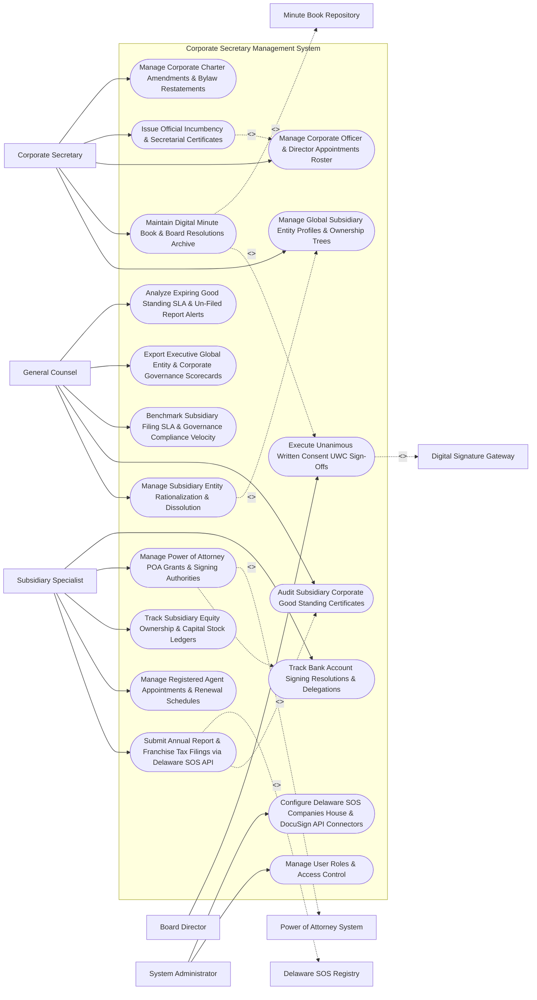

# Use Case Diagram — Corporate Secretary Management System

## Mermaid Code

## Actor Table | Bảng Actor

| # | Actor | Actor Type | Role Description | Related Use Cases |
|---|-------|------------|------------------|-------------------|
| 1 | Corporate Secretary | Primary | Chief Governance Officer managing global subsidiary entity profiles, digital minute books, officer rosters, incumbency certificates, and bylaws. | UC01, UC02, UC03, UC08, UC09 |
| 2 | Subsidiary Specialist | Primary | Corporate legal assistant filing annual reports, managing registered agents, tracking stock ledgers, and overseeing POAs. | UC05, UC06, UC07, UC10, UC11 |
| 3 | Board Director | Primary | Director approving unanimous written consents (UWC) and signing subsidiary board resolutions. | UC04 |
| 4 | General Counsel | Primary | Executive overseeing entity rationalization, corporate good standing, filing SLAs, governance velocity, and scorecards. | UC12, UC13, UC14, UC15, UC18 |
| 5 | System Administrator | Primary | IT admin managing user security roles, Delaware SOS API credentials, and DocuSign API connectors. | UC16, UC17 |
| 6 | Delaware SOS Registry | System (Secondary) | Government corporate registry (Delaware Secretary of State, UK Companies House) receiving electronic annual report filings. | UC05 |
| 7 | Digital Signature Gateway | System (Secondary) | Signature platform (DocuSign / Adobe Sign) executing cryptographic signatures on unanimous written consents. | UC04 |
| 8 | Minute Book Repository | System (Secondary) | Enterprise vault securing official digital minute books, resolutions, and historical corporate seals. | UC02 |
| 9 | Power of Attorney System | System (Secondary) | Subsystem managing Power of Attorney (POA) grants, officer signing thresholds, and bank authorizations. | UC10 |

## Use Case Table | Bảng Use Case

| # | UC ID | Use Case Name | Primary Actor | Secondary Actor | Description | Priority |
|---|-------|---------------|---------------|-----------------|-------------|----------|
| 1 | UC01 | Manage Global Subsidiary Entity Profiles & Ownership Trees | Secretary | None | Maintains global legal entity registry, tracking parent-subsidiary ownership hierarchies, incorporation states, and active status. | Critical |
| 2 | UC02 | Maintain Digital Minute Book & Board Resolutions Archive | Secretary | MinuteBook | Archives official corporate minute books, board resolutions, shareholder meeting transcripts, and corporate seals. | Critical |
| 3 | UC03 | Manage Corporate Officer & Director Appointments Roster | Secretary | None | Tracks corporate director and officer (D&O) appointments across all global subsidiaries, enforcing term limits and vacancies. | Critical |
| 4 | UC04 | Execute Unanimous Written Consent UWC Sign-Offs | Director | DigitalSig | Manages unanimous written consent (UWC) board resolutions, capturing cryptographic digital signatures from subsidiary board members. | Critical |
| 5 | UC05 | Submit Annual Report & Franchise Tax Filings via Delaware SOS API | Specialist | StateRegistry | Transmits statutory electronic annual reports and franchise tax payments directly to the Delaware Division of Corporations API. | Critical |
| 6 | UC06 | Manage Registered Agent Appointments & Renewal Schedules | Specialist | None | Tracks third-party registered agents (CT Corporation / CSC) across all operating states, managing service of process address logs. | High |
| 7 | UC07 | Track Subsidiary Equity Ownership & Capital Stock Ledgers | Specialist | None | Manages subsidiary capital stock ledgers, authorized vs. issued shares, stock certificate issuances, and intra-group equity transfers. | High |
| 8 | UC08 | Issue Official Incumbency & Secretarial Certificates | Secretary | None | Auto-generates certified Incumbency Certificates, Secretarial Certificates, and Officer Listing Statements with digital seals. | Critical |
| 9 | UC09 | Manage Corporate Charter Amendments & Bylaw Restatements | Secretary | None | Tracks Certificate of Incorporation amendments, amended bylaws, and shareholder voting approvals. | High |
| 10 | UC10 | Manage Power of Attorney POA Grants & Signing Authorities | Specialist | POASys | Maintains central registry of Power of Attorney (POA) grants, specifying officer signing authority monetary thresholds ($> \$100\text{k}$). | Critical |
| 11 | UC11 | Track Bank Account Signing Resolutions & Delegations | Specialist | None | Tracks corporate bank account opening resolutions, authorized bank signatories, and bank signing limit tiers. | High |
| 12 | UC12 | Manage Subsidiary Entity Rationalization & Dissolution | CLO | None | Executes entity rationalization workflows to merge, liquidate, or dissolve dormant global corporate subsidiaries. | High |
| 13 | UC13 | Audit Subsidiary Corporate Good Standing Certificates | CLO | None | Automatically audits and retrieves Certificates of Good Standing from state corporate registries, detecting lapse risks. | Critical |
| 14 | UC14 | Benchmark Subsidiary Filing SLA & Governance Compliance Velocity | CLO | None | Measures annual report filing completion velocity, registered agent response times, and governance compliance SLAs. | High |
| 15 | UC15 | Export Executive Global Entity & Corporate Governance Scorecards | CLO | None | Renders executive scorecards detailing active subsidiary entity counts, good standing %, active POAs, and corporate costs. | High |
| 16 | UC16 | Manage User Roles & Access Control | Admin | None | Controls user login credentials, RBAC permissions, and confidential corporate minute book access clearances. | High |
| 17 | UC17 | Configure Delaware SOS Companies House & DocuSign API Connectors | Admin | None | Configures API connection parameters for Delaware SOS, UK Companies House, CT Corporation, and DocuSign. | High |
| 18 | UC18 | Analyze Expiring Good Standing SLA & Un-Filed Report Alerts | CLO | None | Dispatches urgent notifications when a subsidiary is within 30 days of losing good standing status or missing an annual filing. | High |

## Use Case Specification | Đặc tả Use Case

---

### UC02 — Maintain Digital Minute Book & Board Resolutions Archive

| Field | Detail |
|-------|--------|
| **UC ID** | UC02 |
| **Use Case Name** | Maintain Digital Minute Book & Board Resolutions Archive |
| **Actor(s)** | Primary: Corporate Secretary   Secondary: Shareholder Minute Book & Resolution Repository |
| **Description** | Archives, indexes, and secures official corporate minute books, board meeting minutes, unanimous written consents (UWC), and corporate seals, providing a tamper-proof audit trail for corporate governance. |
| **Precondition** | 1. Board meeting or unanimous written consent resolution is executed (UC04).   2. Digital minute book repository and AES-256 encryption engine are active. |
| **Main Flow** | 1. Corporate Secretary opens "Digital Minute Book Studio" for Subsidiary `Acme Europe BV` (Netherlands).   2. Secretary compiles Minute Book Volume: `Volume IX (Fiscal Year 2026 Board Resolutions)`.   3. Secretary attaches Certified Governance Documents:   &nbsp;&nbsp;&nbsp;&nbsp; a. Document 1: `Minutes_of_Annual_Board_Meeting_Oct2026.pdf` (Signed by Chair & Secretary).   &nbsp;&nbsp;&nbsp;&nbsp; b. Document 2: `Unanimous_Written_Consent_RES-2026-12.pdf` (UC04).   &nbsp;&nbsp;&nbsp;&nbsp; c. Document 3: `Amended_Articles_of_Association.pdf`.   4. System applies Cryptographic Corporate Seal Watermark & Timestamp Anchor:   &nbsp;&nbsp;&nbsp;&nbsp; a. Applies Digital Embossed Corporate Seal Stamp: `Acme Europe BV - Official Corporate Seal`.   &nbsp;&nbsp;&nbsp;&nbsp; b. Anchors hash to immutable audit log (`SHA-256 Hash`).   5. System indexes minute book in Minute Book Repository, updating full-text search index by date, entity name, resolution number, and director names.   6. Secretary exports "Certified Digital Minute Book Binder PDF" for external bank or regulatory audit. |
| **Alternative Flow** | **AF1** — Historical Minute Book Paper Ingestion: Secretary scans physical 1985 minute book volume; System runs OCR text recognition, indexing historical scanned PDF into digital minute book. |
| **Exception Flow** | **EX1** — Un-Signed Resolution Ingestion Block: Secretary attempts to archive unsigned draft minutes; System blocks entry (`UNSIGNED_RESOLUTION_ERROR`), requiring executed digital signature before minute book archiving. |
| **Postcondition** | Board minutes and resolutions are compiled, corporate seal watermark applies, cryptographic audit hash anchors, and digital minute book indexes. |
| **Business Rule** | **BR1**: Corporate minute book entries MUST contain executed digital signatures and cryptographic seal stamps before formal archiving. |

---

### UC05 — Submit Annual Report & Franchise Tax Filings via Delaware SOS API

| Field | Detail |
|-------|--------|
| **UC ID** | UC05 |
| **Use Case Name** | Submit Annual Report & Franchise Tax Filings via Delaware SOS API |
| **Actor(s)** | Primary: Corporate Legal Assistant / Subsidiary Specialist   Secondary: State Division of Corporations & Commercial Registry (Delaware SOS API) |
| **Description** | Transmits statutory electronic annual reports, officer/director lists, and franchise tax payments directly to the Delaware Division of Corporations API to maintain corporate good standing. |
| **Precondition** | 1. Subsidiary entity (`Acme Global Inc`) is incorporated in Delaware (File #884120).   2. Annual report deadline (March 1 for Corporations / June 1 for LLCs) is active.   3. Delaware SOS API connector and franchise tax payment gateway are online. |
| **Main Flow** | 1. System runs annual statutory filing schedule check and identifies Upcoming Filing:   &nbsp;&nbsp;&nbsp;&nbsp; a. Entity Name: `Acme Global Inc (Delaware General Corporation)`.   &nbsp;&nbsp;&nbsp;&nbsp; b. Delaware State File #: `884120`.   &nbsp;&nbsp;&nbsp;&nbsp; c. Statutory Deadline: `March 01, 2027`.   2. Subsidiary Specialist opens "Delaware Annual Filing Desk".   3. System auto-populates Annual Report Metadata:   &nbsp;&nbsp;&nbsp;&nbsp; a. Principal Office Address: `100 Corporate Parkway, Wilmington, DE`.   &nbsp;&nbsp;&nbsp;&nbsp; b. Registered Agent Name & Address: `CT Corporation System, 1200 N Market St, Wilmington, DE`.   &nbsp;&nbsp;&nbsp;&nbsp; c. Active Officers & Directors Roster (UC03): CEO Jane Doe, CFO John Smith, Director Sarah Jenkins.   &nbsp;&nbsp;&nbsp;&nbsp; d. Authorized Shares: 10,000,000 Common Stock ($0.0001 Par Value) | Gross Assets: $50,000,000.00.   4. System calculates Franchise Tax Method (Assessed Par Value Method vs. Recalculated Authorized Shares Method):   &nbsp;&nbsp;&nbsp;&nbsp; a. Recalculated Authorized Shares Method Tax: `$450.00 Minimum Tax + $50.00 Annual Report Fee` -> `$500.00 Total Fee`.   5. Specialist reviews data, signs filing as Authorized Officer, and clicks "Submit Filing to Delaware SOS".   6. System dispatches HTTPS REST API payload to Delaware Division of Corporations E-Filing API.   7. Delaware SOS API accepts filing and returns Official Filing Receipt:   &nbsp;&nbsp;&nbsp;&nbsp; a. Delaware Filing Confirmation #: `DE-2027-884120`.   &nbsp;&nbsp;&nbsp;&nbsp; b. Entity Status: `GOOD_STANDING_ACTIVE`.   8. System ingests receipt, attaches Certificate of Good Standing (UC13), and updates entity scorecard. |
| **Alternative Flow** | **AF1** — UK Companies House Annual Confirmation Statement: Entity is a UK subsidiary (`Acme UK Ltd`); System formats filing per UK Companies House API schema, paying £13 fee and obtaining Confirmation Receipt. |
| **Exception Flow** | **EX1** — Franchise Tax Calculation Discrepancy: Assessed Par Value method calculates $250,000 tax due to high share count; System auto-switches to Recalculated Authorized Shares method ($500 tax), saving $249,500. |
| **Postcondition** | Annual report metadata is populated, franchise tax is calculated and paid, filing payload transmits to Delaware SOS, and Good Standing status updates. |
| **Business Rule** | **BR1**: Delaware corporate annual report filings MUST calculate both tax methods to ensure the corporation pays the minimum statutory tax. |

---

### UC08 — Issue Official Incumbency & Secretarial Certificates

| Field | Detail |
|-------|--------|
| **UC ID** | UC08 |
| **Use Case Name** | Issue Official Incumbency & Secretarial Certificates |
| **Actor(s)** | Primary: Corporate Secretary   Secondary: Global Subsidiary Entity & Ownership Tree Registry |
| **Description** | Automatically generates official, certified Incumbency Certificates and Secretarial Certificates listing active corporate officers, sample signatures, and board resolution authorizations for banking and M&A transactions. |
| **Precondition** | 1. Corporate officer roster and sample signatures (UC03) are updated in system.   2. Corporate Secretary digital signature and corporate seal watermark are configured. |
| **Main Flow** | 1. Commercial bank requests an Incumbency Certificate for Subsidiary `Acme Operations LLC` to open a new credit facility.   2. Corporate Secretary opens "Incumbency Certificate Generator".   3. System retrieves Active Corporate Officers for `Acme Operations LLC`:   &nbsp;&nbsp;&nbsp;&nbsp; a. President / CEO: `Jane Doe` (Appointed Oct 15, 2024).   &nbsp;&nbsp;&nbsp;&nbsp; b. Vice President & Treasurer: `John Smith` (Appointed Jan 10, 2025).   &nbsp;&nbsp;&nbsp;&nbsp; c. Secretary: `Sarah Jenkins` (Appointed Nov 01, 2023).   4. System attaches Specimen Signature Records: Pulls verified digital specimen signatures of Jane Doe and John Smith from officer profile.   5. System auto-generates Legal Incumbency Certificate Document:   &nbsp;&nbsp;&nbsp;&nbsp; a. Formats legal preamble certifying that listed officers are duly elected, qualified, and acting officers.   &nbsp;&nbsp;&nbsp;&nbsp; b. Displays 3-column table: Officer Name, Title, Specimen Signature.   6. Corporate Secretary signs certificate using Cryptographic Digital Signature and applies Corporate Seal Watermark.   7. System outputs Certified Incumbency Certificate PDF `#INC-2026-88412` and logs issuance event in Corporate Register. |
| **Alternative Flow** | **AF1** — Secretarial Certificate for Board Resolution: Bank requests certification that Board Resolution #RES-2026-08 was duly adopted; System formats Secretarial Certificate attaching certified resolution text. |
| **Exception Flow** | **EX1** — Expired Officer Appointment Warning: Officer John Smith's term expired 5 days ago; System flags `EXPIRED_OFFICER_TERM`, blocking certificate generation until Secretary extends appointment in UC03. |
| **Postcondition** | Official Incumbency Certificate is auto-generated, specimen signatures attach, Corporate Secretary signs with digital seal, and certificate PDF exports. |
| **Business Rule** | **BR1**: Incumbency Certificates MUST include verified officer specimen signatures and be certified by the Corporate Secretary under digital corporate seal. |

---

### UC10 — Manage Power of Attorney (POA) Grants & Signing Authorities

| Field | Detail |
|-------|--------|
| **UC ID** | UC10 |
| **Use Case Name** | Manage Power of Attorney (POA) Grants & Signing Authorities |
| **Actor(s)** | Primary: Corporate Legal Assistant / Subsidiary Specialist, Corporate Secretary   Secondary: Power of Attorney & Officer Appointment Subsystem |
| **Description** | Maintains a centralized registry of Power of Attorney (POA) grants, specifying authorized attorneys-in-fact, signing monetary threshold limits ($> \$100\text{k}$), expiration dates, and revocation tracking. |
| **Precondition** | 1. Corporate officer or commercial manager requires formal POA signing authority.   2. Power of Attorney policy limits (monetary thresholds, scope) are set. |
| **Main Flow** | 1. Subsidiary Specialist opens "Power of Attorney (POA) Governance Desk".   2. Specialist creates New Power of Attorney Grant Request:   &nbsp;&nbsp;&nbsp;&nbsp; a. Grantee / Attorney-in-Fact: `Carlos Mendez (LATAM Regional Managing Director)`.   &nbsp;&nbsp;&nbsp;&nbsp; b. Granting Entity: `Acme Brazil Participações Ltda`.   &nbsp;&nbsp;&nbsp;&nbsp; c. Scope of Authority: `Commercial Customer Contracts & Local Regulatory Filings`.   &nbsp;&nbsp;&nbsp;&nbsp; d. Monetary Signing Limit: `$250,000.00 USD per contract`.   &nbsp;&nbsp;&nbsp;&nbsp; e. Effective Date: `November 01, 2026` | Expiration Date: `October 31, 2027` (1-Year Term).   3. System checks Policy Authority Thresholds:   &nbsp;&nbsp;&nbsp;&nbsp; a. Limit $250k > $100k Standard Limit -> `REQUIRES_CLO_APPROVAL`.   4. Corporate Secretary and CLO review request and apply digital signatures to formal POA Instrument.   5. System registers active POA `#POA-2026-884` in POA Registry and issues Certified POA Copy.   6. System initializes Expiration Warning Timer (triggers 30 days prior to Oct 31, 2027). |
| **Alternative Flow** | **AF1** — Formal Revocation of Power of Attorney: Attorney-in-Fact leaves company; Specialist clicks "Revoke POA", generating formal Notice of Revocation, updating registry to `REVOKED`, and notifying local notarization agents. |
| **Exception Flow** | **EX1** — Exceeded Signing Limit Attempt: Attorney-in-Fact attempts to sign contract for $500,000 (exceeding $250k POA limit); System blocks e-signature (`POA_MONETARY_LIMIT_EXCEEDED`), requiring Board resolution. |
| **Postcondition** | Power of Attorney grant is reviewed, monetary limits enforce, digital signatures apply, active POA is registered, and expiration timers initialize. |
| **Business Rule** | **BR1**: Power of Attorney (POA) grants MUST specify explicit monetary signing caps and expiration dates not exceeding 12 months without formal renewal. |

---

### UC12 — Manage Subsidiary Entity Rationalization & Dissolution

| Field | Detail |
|-------|--------|
| **UC ID** | UC12 |
| **Use Case Name** | Manage Subsidiary Entity Rationalization & Dissolution |
| **Actor(s)** | Primary: General Counsel / CLO, Corporate Secretary   Secondary: Global Subsidiary Entity & Ownership Tree Registry |
| **Description** | Executes global corporate entity rationalization workflows to merge, liquidate, or dissolve dormant, redundant, or non-operating corporate subsidiaries to eliminate compliance overhead. |
| **Precondition** | 1. Corporate entity rationalization review identifies dormant subsidiary `Acme Logistics UK Ltd`.   2. Legal, tax, and accounting clearance approvals are satisfied. |
| **Main Flow** | 1. General Counsel opens "Entity Rationalization & Dissolution Studio".   2. General Counsel initiates Dissolution Workflow for Inactive Entity: `Acme Logistics UK Ltd` (Company #0994120).   3. System dispatches Pre-Dissolution Compliance Clearance Checklist:   &nbsp;&nbsp;&nbsp;&nbsp; a. Tax Clearance: Tax Department verifies zero outstanding tax liabilities -> `TAX_CLEARED`.   &nbsp;&nbsp;&nbsp;&nbsp; b. Debt & Creditor Clearance: Accounting verifies all creditors paid -> `CREDITORS_CLEARED`.   &nbsp;&nbsp;&nbsp;&nbsp; c. Asset Transfer Check: Remaining assets transferred to parent company -> `ASSETS_TRANSFERRED`.   &nbsp;&nbsp;&nbsp;&nbsp; d. Litigation Check: Legal verifies zero pending court lawsuits -> `NO_LITIGATION_PENDING`.   4. System auto-generates Dissolution Resolution & Articles of Dissolution:   &nbsp;&nbsp;&nbsp;&nbsp; a. Generates Shareholder Dissolution Resolution & Form DS-1 (Voluntary Dissolution).   5. Corporate Secretary and Board Directors execute unanimous dissolution consent.   6. System dispatches electronic dissolution filing payload to UK Companies House API (UC05).   7. Companies House issues Official Certificate of Dissolution / Strike-Off Notice.   8. System updates Global Subsidiary Entity Tree (UC01), marking entity status as `DISSOLVED_STUCK_OFF` and saving $15,000 annual compliance maintenance fees. |
| **Alternative Flow** | **AF1** — Short-Form Corporate Merger: Subsidiary is merged into parent entity via short-form merger; System generates Articles of Merger, submits state filing, and consolidates equity ledgers. |
| **Exception Flow** | **EX1** — Active Creditor Claim Dissolution Block: Accounting flags unresolved $45,000 vendor liability; System blocks dissolution (`PENDING_LIABILITY_BLOCKED`), requiring liability settlement prior to strike-off. |
| **Postcondition** | Pre-dissolution tax and legal clearances pass, dissolution resolutions execute, state/country strike-off files, and entity tree updates to dissolved. |
| **Business Rule** | **BR1**: Subsidiary entity dissolutions MUST pass automated tax, creditor, and litigation clearance checks prior to executing statutory strike-off filings. |
