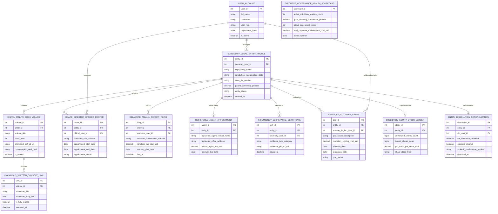

# Conceptual ERD — Corporate Secretary Management System

## Mermaid Code

## Entity Description Table | Bảng mô tả Entity

| # | Entity Name | Vietnamese Name | Description | Key Attributes | Main Relationships |
|---|-------------|-----------------|-------------|----------------|-------------------|
| 1 | USER_ACCOUNT | Tài khoản Nguời dùng | System credentials and access roles for corporate secretaries, subsidiary specialists, directors, and CIPOs. | `user_id`, `username`, `user_role`, `department_code` | Manages `SUBSIDIARY_LEGAL_ENTITY_PROFILE`, serves on `BOARD_DIRECTOR_OFFICER_ROSTER`, holds authority in `POWER_OF_ATTORNEY_GRANT`. |
| 2 | SUBSIDIARY_LEGAL_ENTITY_PROFILE | Profile Công ty Con Subsidiary | Central subsidiary legal entity record tracking company names, incorporation states, state file #, parent ownership %, and status (`ACTIVE/DISSOLVED`). | `entity_id`, `secretary_user_id`, `legal_entity_name`, `jurisdiction_incorporation_state`, `state_file_number`, `parent_ownership_percent`, `entity_status` | Contains `DIGITAL_MINUTE_BOOK_VOLUME`, appoints `BOARD_DIRECTOR_OFFICER_ROSTER`, filed in `DELAWARE_ANNUAL_REPORT_FILING`, serviced by `REGISTERED_AGENT_APPOINTMENT`, certified in `INCUMBENCY_SECRETARIAL_CERTIFICATE`, authorizes `POWER_OF_ATTORNEY_GRANT`, capitalized via `SUBSIDIARY_EQUITY_STOCK_LEDGER`, dissolved via `ENTITY_DISSOLUTION_RATIONALIZATION`, managed by `USER_ACCOUNT`. |
| 3 | DIGITAL_MINUTE_BOOK_VOLUME | Volume Sổ Biên bản Digital | Digital corporate minute book volume record storing volume titles, fiscal years, encrypted PDF URIs, cryptographic seal hashes, and sealed flags. | `volume_id`, `entity_id`, `volume_title`, `fiscal_year`, `encrypted_pdf_s3_uri`, `cryptographic_seal_hash`, `is_sealed` | Belongs to `SUBSIDIARY_LEGAL_ENTITY_PROFILE`, includes `UNANIMOUS_WRITTEN_CONSENT_UWC`. |
| 4 | BOARD_DIRECTOR_OFFICER_ROSTER | Roster Director & Officer Appointed | Corporate officer and director appointment record tracking titles, start/end dates, and appointment status (`ACTIVE/EXPIRED`). | `roster_id`, `entity_id`, `official_user_id`, `corporate_title_position`, `appointment_start_date`, `appointment_end_date`, `appointment_status` | Belongs to `SUBSIDIARY_LEGAL_ENTITY_PROFILE`, served by `USER_ACCOUNT`. |
| 5 | UNANIMOUS_WRITTEN_CONSENT_UWC | Nghị quyết Unanimous Consent UWC | Unanimous Written Consent (UWC) board resolution record storing resolution titles, resolution body text, fully signed flags, and execution timestamps. | `uwc_id`, `volume_id`, `resolution_title`, `resolution_body_text`, `is_fully_signed`, `executed_at` | Belongs to `DIGITAL_MINUTE_BOOK_VOLUME`. |
| 6 | DELAWARE_ANNUAL_REPORT_FILING | Filing Báo cáo Thường niên Delaware | Delaware annual report and franchise tax filing log recording confirmation numbers, franchise tax paid USD, due dates, and filing timestamps. | `filing_id`, `entity_id`, `specialist_user_id`, `delaware_confirmation_number`, `franchise_tax_paid_usd`, `statutory_due_date`, `filed_at` | Belongs to `SUBSIDIARY_LEGAL_ENTITY_PROFILE`. |
| 7 | REGISTERED_AGENT_APPOINTMENT | Registered Agent Đại diện | Third-party registered agent appointment record tracking vendor names (CT Corp/CSC), office addresses, annual agent fees USD, and renewal dates. | `agent_id`, `entity_id`, `registered_agent_vendor_name`, `registered_office_address`, `annual_agent_fee_usd`, `renewal_due_date` | Belongs to `SUBSIDIARY_LEGAL_ENTITY_PROFILE`. |
| 8 | INCUMBENCY_SECRETARIAL_CERTIFICATE | Certificate Incumbency & Secretarial | Official Incumbency and Secretarial Certificate record tracking certificate categories, PDF S3 URIs, secretary user IDs, and issuance timestamps. | `cert_id`, `entity_id`, `secretary_user_id`, `certificate_type_category`, `certificate_pdf_s3_uri`, `issued_at` | Belongs to `SUBSIDIARY_LEGAL_ENTITY_PROFILE`. |
| 9 | POWER_OF_ATTORNEY_GRANT | Power of Attorney POA Grant | Power of Attorney (POA) grant record tracking attorney-in-fact user IDs, scope descriptions, monetary signing limits USD, effective/expiration dates, and status. | `poa_id`, `entity_id`, `attorney_in_fact_user_id`, `poa_scope_description`, `monetary_signing_limit_usd`, `effective_date`, `expiration_date`, `poa_status` | Belongs to `SUBSIDIARY_LEGAL_ENTITY_PROFILE`, held by `USER_ACCOUNT`. |
| 10 | SUBSIDIARY_EQUITY_STOCK_LEDGER | Ledger Cổ phần Công ty Con | Subsidiary capital stock ledger record tracking authorized shares, issued shares, par value USD, and share class types (Common/Preferred). | `stock_id`, `entity_id`, `authorized_shares_count`, `issued_shares_count`, `par_value_per_share_usd`, `share_class_type` | Belongs to `SUBSIDIARY_LEGAL_ENTITY_PROFILE`. |
| 11 | ENTITY_DISSOLUTION_RATIONALIZATION | Giải thể Công ty Con Dissolution | Subsidiary entity dissolution log recording tax clearance flags, creditor clearance flags, strike-off confirmation numbers, and dissolution timestamps. | `dissolution_id`, `entity_id`, `clo_user_id`, `tax_clearance_obtained`, `creditors_cleared`, `strikeoff_confirmation_number`, `dissolved_at` | Belongs to `SUBSIDIARY_LEGAL_ENTITY_PROFILE`. |
| 12 | EXECUTIVE_GOVERNANCE_HEALTH_SCORECARD | Scorecard Health Corporate Governance | Executive corporate governance scorecard aggregating active subsidiary counts, good standing compliance %, active POA count, and maintenance spend. | `scorecard_id`, `active_subsidiary_entities_count`, `good_standing_compliance_percent`, `active_poa_grants_count`, `total_corporate_maintenance_cost_usd` | Standalone executive performance entity. |

## Relationship Description | Mô tả Quan hệ

| # | From Entity | Cardinality | To Entity | Label | Business Explanation |
|---|-------------|-------------|-----------|-------|----------------------|
| 1 | SUBSIDIARY_LEGAL_ENTITY_PROFILE | 1 to 0..N | DIGITAL_MINUTE_BOOK_VOLUME | contains | A subsidiary legal entity profile contains digital minute book volumes. |
| 2 | SUBSIDIARY_LEGAL_ENTITY_PROFILE | 1 to 0..N | BOARD_DIRECTOR_OFFICER_ROSTER | appoints | A subsidiary legal entity profile appoints board directors and officers. |
| 3 | SUBSIDIARY_LEGAL_ENTITY_PROFILE | 1 to 0..N | DELAWARE_ANNUAL_REPORT_FILING | filed in | A subsidiary legal entity profile is filed in annual report filings. |
| 4 | SUBSIDIARY_LEGAL_ENTITY_PROFILE | 1 to 0..1 | REGISTERED_AGENT_APPOINTMENT | serviced by | A subsidiary legal entity profile is serviced by a registered agent appointment. |
| 5 | SUBSIDIARY_LEGAL_ENTITY_PROFILE | 1 to 0..N | INCUMBENCY_SECRETARIAL_CERTIFICATE | certified in | A subsidiary legal entity profile is certified in incumbency certificates. |
| 6 | SUBSIDIARY_LEGAL_ENTITY_PROFILE | 1 to 0..N | POWER_OF_ATTORNEY_GRANT | authorizes | A subsidiary legal entity profile authorizes Power of Attorney (POA) grants. |
| 7 | SUBSIDIARY_LEGAL_ENTITY_PROFILE | 1 to 0..1 | SUBSIDIARY_EQUITY_STOCK_LEDGER | capitalized via | A subsidiary legal entity profile is capitalized via equity stock ledgers. |
| 8 | SUBSIDIARY_LEGAL_ENTITY_PROFILE | 1 to 0..1 | ENTITY_DISSOLUTION_RATIONALIZATION | dissolved via | A subsidiary legal entity profile is dissolved via entity dissolution records. |
| 9 | DIGITAL_MINUTE_BOOK_VOLUME | 1 to 0..N | UNANIMOUS_WRITTEN_CONSENT_UWC | includes | A digital minute book volume includes unanimous written consent (UWC) resolutions. |
| 10 | USER_ACCOUNT | 1 to 0..N | SUBSIDIARY_LEGAL_ENTITY_PROFILE | manages | A corporate secretary user account manages subsidiary legal entity profiles. |
| 11 | USER_ACCOUNT | 1 to 0..N | BOARD_DIRECTOR_OFFICER_ROSTER | serves on | A director user account serves on board director and officer rosters. |
| 12 | USER_ACCOUNT | 1 to 0..N | POWER_OF_ATTORNEY_GRANT | holds authority in | An attorney-in-fact user account holds authority in POA grants. |
