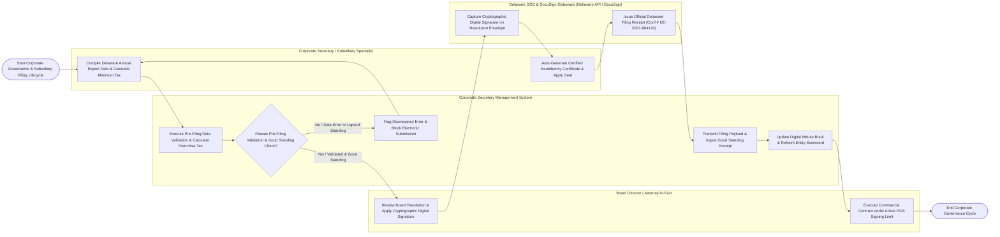

# Swimlane Diagram — Corporate Secretary Management System

## Mermaid Code

## Flow Description | Mô tả luồng

| Lane | Actor | Role in Flow |
|------|-------|-------------|
| 1 | Board Director / Attorney-in-Fact | Reviews subsidiary board resolutions, applies cryptographic digital signatures to unanimous written consents (UWC), and executes commercial contracts within POA monetary signing caps. |
| 2 | Corporate Secretary / Subsidiary Specialist | Compiles annual report metadata, calculates Delaware franchise tax using minimum-tax algorithms, manages registered agent renewals, issues certified Incumbency Certificates, and applies corporate seal stamps. |
| 3 | Corporate Secretary Management System | Executes pre-filing validation checks, calculates franchise tax methods, transmits electronic annual report payloads to state registries via API, tracks Power of Attorney (POA) expiration dates, archives digital minute books, and updates global entity scorecards. |
| 4 | Delaware SOS & DocuSign Gateways (Delaware API / DocuSign) | Captures legally binding digital signatures on resolution envelopes via DocuSign API, processes state annual report filings and franchise tax payments, and issues official Certificates of Good Standing receipts. |
