# Action Tree — Corporate Secretary Management System

## Mermaid Code

```mermaid
graph TD
    Root["Corporate Secretary Management System"]

    Root --> M1["Subsidiary Entity Registry & Ownership Trees"]
    Root --> M2["Digital Minute Books & Resolution Archives"]
    Root --> M3["Delaware SOS Annual Reports & Franchise Tax"]
    Root --> M4["Incumbency & Secretarial Certificates"]
    Root --> M5["Power of Attorney (POA) & Bank Signatories"]
    Root --> M6["Subsidiary Dissolution & Governance Scorecards"]

    M1 --> A11["Maintain Global Corporate Subsidiary Profiles & Incorporation Details"]
    M1 --> A12["Render Interactive Parent-Subsidiary Equity Ownership Tree Maps"]
    M1 --> A13["Track Corporate Director & Officer (D&O) Appointment Rosters"]
    M1 --> A14["Manage Third-Party Registered Agent Appointments & Service Addresses"]

    M2 --> A21["Compile & Archive Digital Minute Book Volumes with AES-256 Encryption"]
    M2 --> A22["Execute Unanimous Written Consent (UWC) Sign-Offs via DocuSign API"]
    M2 --> A23["Apply Cryptographic Digital Corporate Seal Watermarks & Timestamps"]
    M2 --> A24["Index Board Meeting Minutes & Resolutions for Full-Text Search"]

    M3 --> A31["Auto-Populate Annual Report Metadata (Officers, Directors, Registered Agent)"]
    M3 --> A32["Calculate Delaware Franchise Tax using Recalculated Authorized Shares Method"]
    M3 --> A33["Transmit Electronic Annual Reports to Delaware Division of Corporations API"]
    M3 --> A34["Audit & Ingest Official Certificates of Good Standing from State Registries"]

    M4 --> A41["Auto-Generate Legal Incumbency Certificates with Verified Officer Roster"]
    M4 --> A42["Attach Specimen Digital Signatures & Corporate Secretary Certification"]
    M4 --> A43["Issue Certified Secretarial Certificates for Board Resolution Verification"]
    M4 --> A44["Maintain Immutable Corporate Certificate Issuance Audit Registers"]

    M5 --> A51["Register Active Power of Attorney (POA) Grants & Authorized Grantees"]
    M5 --> A52["Enforce Monetary Signing Limit Caps ($> $100k Threshold Rules)"]
    M5 --> A53["Track Corporate Bank Account Opening Resolutions & Signatory Tiers"]
    M5 --> A54["Execute Formal Revocation of Power of Attorney Instruments & Notices"]

    M6 --> A61["Execute Pre-Dissolution Tax, Creditor & Litigation Clearance Checks"]
    M6 --> A62["File Voluntary Subsidiary Strike-Off Filings with UK Companies House API"]
    M6 --> A63["Benchmark Subsidiary Filing Compliance Velocity & Good Standing SLAs"]
    M6 --> A64["Export Executive Global Entity Health, POA & Governance Scorecards"]
```

## Module Description | Mô tả Module

| # | Module | Description | Actions |
|---|--------|-------------|---------|
| 1 | Subsidiary Entity Registry & Ownership Trees | Maintains legal entity profiles, renders parent-subsidiary equity ownership trees, tracks D&O rosters, and manages registered agent contracts. | Maintain Global Subsidiary Profiles, Render Parent-Subsidiary Equity Ownership Trees, Track D&O Appointment Rosters, Manage Registered Agent Appointments. |
| 2 | Digital Minute Books & Resolution Archives | Compiles encrypted digital minute books, executes unanimous written consents via DocuSign API, applies digital corporate seal stamps, and indexes resolutions. | Compile & Archive Digital Minute Books, Execute Unanimous Written Consents (UWC), Apply Digital Corporate Seal Watermarks, Index Minutes & Resolutions for Search. |
| 3 | Delaware SOS Annual Reports & Franchise Tax | Auto-populates annual reports, calculates Delaware franchise taxes using minimum tax algorithms, submits filings via API, and audits Certificates of Good Standing. | Auto-Populate Annual Report Metadata, Calculate Delaware Franchise Taxes, Transmit Annual Reports to Delaware SOS API, Audit Certificates of Good Standing. |
| 4 | Incumbency & Secretarial Certificates | Auto-generates certified Incumbency Certificates, attaches specimen signatures, applies secretarial seals, and maintains issuance registers. | Auto-Generate Legal Incumbency Certificates, Attach Specimen Signatures & Secretarial Seals, Issue Certified Secretarial Certificates, Maintain Certificate Issuance Audit Registers. |
| 5 | Power of Attorney (POA) & Bank Signatories | Registers active POA grants, enforces monetary signing limits ($> \$100\text{k}$), tracks bank account signing resolutions, and executes formal POA revocations. | Register Active Power of Attorney Grants, Enforce Monetary Signing Limit Caps, Track Bank Account Signatory Tiers, Execute Formal POA Revocations. |
| 6 | Subsidiary Dissolution & Governance Scorecards | Runs pre-dissolution tax/creditor clearance checks, files voluntary strike-offs via UK Companies House API, benchmarks filing SLAs, and exports scorecards. | Execute Pre-Dissolution Clearance Checks, File Subsidiary Strike-Offs via Companies House API, Benchmark Filing Compliance Velocity & SLAs, Export Executive Global Entity Scorecards. |
