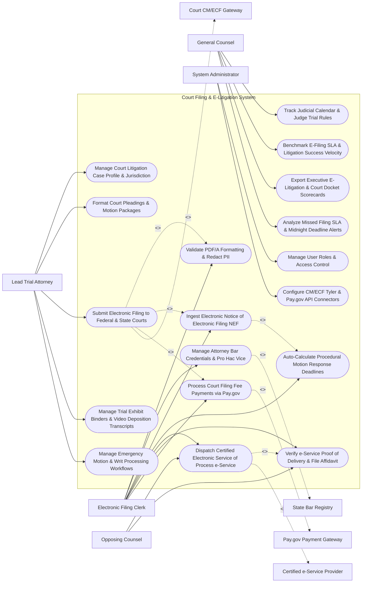

# Use Case Diagram — Court Filing & E-Litigation System

## Mermaid Code

## Actor Table | Bảng Actor

| # | Actor | Actor Type | Role Description | Related Use Cases |
|---|-------|------------|------------------|-------------------|
| 1 | Lead Trial Attorney | Primary | Lead litigator opening case files, formatting pleadings, submitting e-filings, managing trial exhibits, and handling emergency writs. | UC01, UC04, UC05, UC10, UC11 |
| 2 | Electronic Filing Clerk | Primary | Legal assistant validating PDF/A files, managing bar credentials, ingesting NEFs, dispatching e-service, and settling filing fees. | UC02, UC03, UC06, UC07, UC08, UC09, UC12 |
| 3 | Opposing Counsel | Primary | External counsel receiving certified electronic service of process, verifying proof of delivery, and exchanging motions. | UC08, UC09 |
| 4 | General Counsel | Primary | Executive monitoring judicial calendars, e-filing SLAs, court litigation spend, and executive scorecards. | UC13, UC14, UC15, UC18 |
| 5 | System Administrator | Primary | IT admin managing user security roles, court CM/ECF API credentials, and Pay.gov payment gateways. | UC16, UC17 |
| 6 | Court CM/ECF Gateway | System (Secondary) | Government court portal (Federal CM/ECF, Tyler Odyssey) processing electronic filings and issuing NEF receipts. | UC05 |
| 7 | Certified e-Service Provider | System (Secondary) | Certified service provider (One Legal) executing electronic service of process under civil procedure rules. | UC08 |
| 8 | Pay.gov Payment Gateway | System (Secondary) | Government payment settlement gateway processing court filing fees and credit card authorizations. | UC12 |
| 9 | State Bar Registry | System (Secondary) | Judicial bar registry verifying attorney active standing and pro hac vice admission credentials. | UC03 |

## Use Case Table | Bảng Use Case

| # | UC ID | Use Case Name | Primary Actor | Secondary Actor | Description | Priority |
|---|-------|---------------|---------------|-----------------|-------------|----------|
| 1 | UC01 | Manage Court Litigation Case Profile & Jurisdiction | Attorney | None | Opens court case files, linking court jurisdiction (Federal/State), case docket number, judge, and parties. | Critical |
| 2 | UC02 | Validate PDF/A Formatting & Redact PII | Clerk | None | Validates PDF/A-1b compliance, 1-inch page margins, embedded fonts, and un-redacted PII (SSNs, Bank Accounts). | Critical |
| 3 | UC03 | Manage Attorney Bar Credentials & Pro Hac Vice | Clerk | BarRegistry | Maintains attorney bar registration numbers, state active standing certifications, and pro hac vice admission tokens. | High |
| 4 | UC04 | Format Court Pleadings & Motion Packages | Attorney | None | Formats court pleading packages, cover sheets, motion to dismiss briefs, declarations, and proposed orders. | Critical |
| 5 | UC05 | Submit Electronic Filing to Federal & State Courts | Attorney | CMECF | Dispatches electronic PDF/A pleading packages to Federal CM/ECF and State Court E-Filing gateways. | Critical |
| 6 | UC06 | Ingest Electronic Notice of Electronic Filing NEF | Clerk | None | Parses official Notice of Electronic Filing (NEF) receipts, extracting court docket entry numbers and filing timestamps. | Critical |
| 7 | UC07 | Auto-Calculate Procedural Motion Response Deadlines | Clerk | None | Auto-dockets procedural response deadlines based on Rules of Civil Procedure (e.g., Opposition Due in 14 Days). | Critical |
| 8 | UC08 | Dispatch Certified Electronic Service of Process e-Service | Clerk | EService | Dispatches certified electronic service of process payloads to opposing counsel, tracking certified email delivery. | Critical |
| 9 | UC09 | Verify e-Service Proof of Delivery & File Affidavit | Clerk | None | Generates court-compliant Proof of Electronic Service affidavits, filing affidavits automatically on the court docket. | Critical |
| 10 | UC10 | Manage Trial Exhibit Binders & Video Deposition Transcripts | Attorney | None | Prepares indexed trial exhibit binders, synchronized video deposition transcripts, and courtroom presentation decks. | High |
| 11 | UC11 | Manage Emergency Motion & Writ Processing Workflows | Attorney | None | Operates fast-track emergency workflow channels for TRO (Temporary Restraining Orders) and preliminary injunction writs. | High |
| 12 | UC12 | Process Court Filing Fee Payments via Pay.gov | Clerk | PayGov | Integrates with Pay.gov and merchant gateways to process court filing fees and motion fees. | Critical |
| 13 | UC13 | Track Judicial Calendar & Judge Trial Rules | CLO | None | Tracks judge-specific standing orders, court oral argument calendars, pre-trial conferences, and trial dates. | High |
| 14 | UC14 | Benchmark E-Filing SLA & Litigation Success Velocity | CLO | None | Measures average e-filing submission speed, rejection rate %, motion win/loss ratios, and unit costs. | High |
| 15 | UC15 | Export Executive E-Litigation & Court Docket Scorecards | CLO | None | Renders executive scorecards detailing active court case count, upcoming filing deadlines, and e-litigation spend. | High |
| 16 | UC16 | Manage User Roles & Access Control | Admin | None | Controls user login credentials, RBAC permissions, and confidential court pleading access clearances. | High |
| 17 | UC17 | Configure CM/ECF Tyler & Pay.gov API Connectors | Admin | None | Configures API connection parameters for Federal ECF, Tyler Odyssey, One Legal, and Pay.gov. | High |
| 18 | UC18 | Analyze Missed Filing SLA & Midnight Deadline Alerts | CLO | None | Dispatches urgent alerts when a court filing deadline is within 2 hours of midnight or an e-filing rejection occurs. | High |

## Use Case Specification | Đặc tả Use Case

---

### UC02 — Validate PDF/A Formatting & Redact PII

| Field | Detail |
|-------|--------|
| **UC ID** | UC02 |
| **Use Case Name** | Validate PDF/A Formatting & Redact PII |
| **Actor(s)** | Primary: Electronic Filing Clerk, Lead Trial Attorney   Secondary: Legal Redaction & PDF/A Technical Validation Engine |
| **Description** | Validates court PDF documents against statutory PDF/A-1b archiving rules, 1-inch page margin requirements, embedded font constraints, and scans for un-redacted Personally Identifiable Information (PII). |
| **Precondition** | 1. Court pleading PDF or exhibit attachment is uploaded.   2. PDF/A-1b validation engine and PII regex scanner are active. |
| **Main Flow** | 1. Filing Clerk uploads draft court pleading `Motion_to_Dismiss_Brief.pdf` (35 pages).   2. System dispatches file to Legal Redaction & PDF/A Technical Validation Engine.   3. Validation Engine executes Technical Compliance Audit:   &nbsp;&nbsp;&nbsp;&nbsp; a. PDF Standard Check: Validates PDF/A-1b ISO 19005-1 compliance -> `VALID`.   &nbsp;&nbsp;&nbsp;&nbsp; b. Margin Check: Verifies $1.0\text{-inch}$ top/bottom/side page margins on all 35 pages -> `VALID`.   &nbsp;&nbsp;&nbsp;&nbsp; c. Font Embedding Check: Verifies all fonts (Times New Roman, Arial) are 100% embedded -> `VALID`.   &nbsp;&nbsp;&nbsp;&nbsp; d. Fast Web View Check: Verifies linearized PDF for fast browser viewing -> `VALID`.   4. Validation Engine executes PII & Financial Redaction Scan (Federal Rule of Civil Procedure 5.2):   &nbsp;&nbsp;&nbsp;&nbsp; a. Scans for Social Security Numbers, Financial Account Numbers, Birth Dates, Minor Names.   &nbsp;&nbsp;&nbsp;&nbsp; b. Detects Un-Redacted Financial Account: Page 14 contains full bank account `#402-88412-09` -> `UNREDACTED_PII_DETECTED`.   5. System displays PII Redaction Prompt, highlighting bank account number in red.   6. Clerk selects "Apply Automated PII Mask", truncating bank account to last 4 digits (`xxxx-xxxx-1209`).   7. Validation Engine burns in redaction mask, re-validates PDF/A-1b compliance, and marks file `COURT_FILING_READY`. |
| **Alternative Flow** | **AF1** — Automated Sealed Document Classification: Pleading is marked "Filed Under Seal" per protective order; Validation Engine applies digital seal watermark and bypasses public PII redaction rules. |
| **Exception Flow** | **EX1** — Non-Embedded Font Conversion Error: PDF contains non-embedded proprietary font; Validation Engine auto-distills PDF, re-embedding standard fonts and converting file to compliant PDF/A-1b. |
| **Postcondition** | Court pleading PDF is validated against PDF/A-1b standards, page margins and fonts verify, PII is redacted, and file certifies for court e-filing. |
| **Business Rule** | **BR1**: Court e-filings MUST be formatted as PDF/A-1b compliant documents with verified PII redaction under Federal Rule 5.2 prior to filing. |

---

### UC05 — Submit Electronic Filing to Federal & State Courts

| Field | Detail |
|-------|--------|
| **UC ID** | UC05 |
| **Use Case Name** | Submit Electronic Filing to Federal & State Courts |
| **Actor(s)** | Primary: Lead Trial Attorney, Electronic Filing Clerk   Secondary: Government Court CM/ECF E-Filing Gateway (Federal ECF / State Tyler Odyssey APIs) |
| **Description** | Assembles final PDF/A court pleading packages, attaches exhibits, calculates filing fees via Pay.gov, applies attorney bar certificate digital signatures, and transmits electronic filings to court gateways. |
| **Precondition** | 1. Pleading package is validated for PDF/A compliance and PII redactions (UC02).   2. Court CM/ECF or Tyler Odyssey e-filing API credentials and bar registration numbers are authenticated. |
| **Main Flow** | 1. Litigator opens "Court E-Filing Desk" for Matter `#CASE-2026-88412` (`Acme vs. Nexus`).   2. System retrieves Final Pleading Package:   &nbsp;&nbsp;&nbsp;&nbsp; a. Main Motion: `Motion_to_Dismiss_Brief_PDFA.pdf`.   &nbsp;&nbsp;&nbsp;&nbsp; b. Exhibit A: `Declaration_of_Sarah_Jenkins.pdf`.   &nbsp;&nbsp;&nbsp;&nbsp; c. Proposed Order: `Proposed_Order_Granting_Dismissal.pdf`.   3. Litigator inputs Filing Metadata:   &nbsp;&nbsp;&nbsp;&nbsp; a. Target Jurisdiction: `U.S. District Court, Southern District of New York (SDNY)`.   &nbsp;&nbsp;&nbsp;&nbsp; b. Event Category: `Motions -> Motion to Dismiss`.   &nbsp;&nbsp;&nbsp;&nbsp; c. Filer Representation: `Acme Corporation (Defendant)`.   4. System processes Court Filing Fee Payment ($50.00 Motion Fee) via Pay.gov API (UC12).   5. Litigator signs package using Cryptographic Bar Certificate Digital Signature.   6. System transmits HTTPS REST API payload to Federal CM/ECF Gateway (`POST /cmecf/v1/filings`).   7. Court Gateway accepts filing and issues Official Notice of Electronic Filing (NEF) Receipt:   &nbsp;&nbsp;&nbsp;&nbsp; a. Court Docket Entry #: `Docket Item #42`.   &nbsp;&nbsp;&nbsp;&nbsp; b. Official Filing Timestamp: `October 30, 2026 at 11:58:12 PM EST` (Midnight Deadline Compliant).   &nbsp;&nbsp;&nbsp;&nbsp; c. NEF Accession Number: `SDNY-2026-NEF-88412`.   8. System ingests NEF (UC06), auto-dockets 14-day procedural response deadline (UC07), and dispatches certified e-service to opposing counsel (UC08). |
| **Alternative Flow** | **AF1** — State Court Tyler Odyssey Filing: Target court is a State Superior Court; System formats filing payload per EFM XML standard, transmitting to Tyler Odyssey File & Serve API. |
| **Exception Flow** | **EX1** — Court Gateway Midnight Outage Error: CM/ECF gateway is offline at 11:55 PM EST; System logs gateway outage timestamp, dispatches emergency outage proof affidavit, and retries transmission. |
| **Postcondition** | Pleading package is submitted to court e-filing gateway, filing fee clears via Pay.gov, official NEF docket receipt is issued, and e-service initializes. |
| **Business Rule** | **BR1**: Submitting an electronic court filing MUST generate an official Notice of Electronic Filing (NEF) receipt containing court docket item numbers and timestamps. |

---

### UC08 — Dispatch Certified Electronic Service of Process (e-Service)

| Field | Detail |
|-------|--------|
| **UC ID** | UC08 |
| **Use Case Name** | Dispatch Certified Electronic Service of Process (e-Service) |
| **Actor(s)** | Primary: Electronic Filing Clerk, Opposing Counsel   Secondary: Certified Electronic Service of Process Provider (One Legal / InfoTrack API) |
| **Description** | Dispatches certified electronic service of process (e-service) payloads to registered opposing counsel upon court filing, tracking certified email delivery and generating court-compliant Proof of Service affidavits. |
| **Precondition** | 1. Court pleading is filed and NEF receipt is issued (UC05).   2. Registered opposing counsel email addresses and e-service consent parameters are cataloged. |
| **Main Flow** | 1. System receives NEF confirmation for Docket Item `#42` (`Motion to Dismiss`).   2. System retrieves Certified E-Service Recipient List:   &nbsp;&nbsp;&nbsp;&nbsp; a. Opposing Lead Counsel: `Attorney Robert Vance - rvance@vancelaw.com`.   &nbsp;&nbsp;&nbsp;&nbsp; b. Opposing Co-Counsel: `Attorney Lisa Ray - lray@vancelaw.com`.   3. System compiles Certified E-Service Package:   &nbsp;&nbsp;&nbsp;&nbsp; a. Filed Motion Package: `Motion_to_Dismiss_Filed.pdf` (with court docket #42 stamp).   &nbsp;&nbsp;&nbsp;&nbsp; b. Official Court NEF Receipt PDF.   4. System dispatches API payload to Certified E-Service Provider (One Legal API).   5. E-Service Provider transmits certified trackable email package to recipient email addresses.   6. E-Service Provider monitors delivery telemetry:   &nbsp;&nbsp;&nbsp;&nbsp; a. Recipient `rvance@vancelaw.com`: SMTP Delivered `Oct 30 at 11:59 PM` | Email Opened `Oct 31 at 08:15 AM`.   7. E-Service Provider generates Certified Proof of Electronic Service Affidavit (Form POS-050).   8. System automatically files Proof of Service Affidavit on court docket (UC05), satisfying statutory service requirements. |
| **Alternative Flow** | **AF1** — Direct Court NEF E-Service: In Federal Court, CM/ECF system auto-dispatches NEF e-service to all registered ECF users; System ingests NEF e-service receipt, updating proof of service ledger. |
| **Exception Flow** | **EX1** — E-Service Email Bounce Error: Opposing counsel email bounces (`550 User Unknown`); System alerts filing clerk, prompting clerk to dispatch physical certified mail service within 24 hours. |
| **Postcondition** | Certified e-service package is delivered to opposing counsel, email open telemetry is tracked, and Proof of Electronic Service affidavit is filed on court docket. |
| **Business Rule** | **BR1**: Certified electronic service of process MUST track delivery telemetry and generate a court-compliant Proof of Service affidavit for docket filing. |

---

### UC10 — Manage Trial Exhibit Binders & Video Deposition Transcripts

| Field | Detail |
|-------|--------|
| **UC ID** | UC10 |
| **Use Case Name** | Manage Trial Exhibit Binders & Video Deposition Transcripts |
| **Actor(s)** | Primary: Lead Trial Attorney, Senior Forensic Analyst   Secondary: Trial Exhibit & Witness Deposition Subsystem |
| **Description** | Prepares digital trial exhibit binders, synchronized video deposition transcripts, and courtroom presentation decks, enabling attorneys to present Bates-stamped evidence seamlessly during trial. |
| **Precondition** | 1. Case is scheduled for trial (UC01, UC13).   2. Discovery evidence (Bates-stamped documents, deposition videos/transcripts) is finalized. |
| **Main Flow** | 1. Trial Attorney opens "Digital Trial Exhibit Studio" for Trial `#TRI-2026-402`.   2. Attorney compiles Trial Exhibit List:   &nbsp;&nbsp;&nbsp;&nbsp; a. Plaintiff Exhibit 101: `Technical Specifications (Bates ACME-000100 to 000125)`.   &nbsp;&nbsp;&nbsp;&nbsp; b. Plaintiff Exhibit 102: `Internal Email Thread (Bates ACME-000450)`.   3. Attorney imports Witness Deposition Transcript & Video: `Deposition_John_Doe_Oct2026.LEF` (Legal Transcript Format) + `Deposition_Video.mp4`.   4. System executes Video-Transcript Synchronization Engine:   &nbsp;&nbsp;&nbsp;&nbsp; a. Synchronizes text transcript line numbers with video timestamp markers down to the millisecond.   5. Attorney selects key deposition testimony clip (Page 42, Lines 10-25) and creates "Trial Video Clip Segment #1".   6. System generates Courtroom Presentation Deck:   &nbsp;&nbsp;&nbsp;&nbsp; a. Integrates exhibit PDFs, callout zoom boxes, side-by-side document comparisons, and video clips.   7. Attorney exports "Master Trial Exhibit Book PDF" and syncs courtroom presentation deck to trial laptop tablet.   8. During trial examination, Attorney clicks "Play Clip #1"; System displays video deposition clip with live scrolling transcript subtitles on courtroom presentation monitors. |
| **Alternative Flow** | **AF1** — Impeachment Clip Execution: Witness contradicts deposition testimony on trial stand; Attorney clicks "Instant Impeachment Search", typing keyword; System retrieves video clip in 3 seconds for immediate courtroom playback. |
| **Exception Flow** | **EX1** — Transcript Video Desync Error: Video and transcript text are out of sync by 2 seconds; System allows manual timestamp adjustment, re-aligning video and text subtitle tracks. |
| **Postcondition** | Digital trial exhibit binder is indexed, video deposition transcript is synchronized to video timestamps, and courtroom presentation deck is ready for trial. |
| **Business Rule** | **BR1**: Trial exhibit binders MUST contain Bates-stamped evidence numbers matching pre-trial court exhibit disclosure lists. |

---

### UC12 — Process Court Filing Fee Payments via Pay.gov

| Field | Detail |
|-------|--------|
| **UC ID** | UC12 |
| **Use Case Name** | Process Court Filing Fee Payments via Pay.gov |
| **Actor(s)** | Primary: Electronic Filing Clerk   Secondary: Court Filing Fee Payment Gateway (Pay.gov / Tyler Payments API) |
| **Description** | Integrates with US Federal Pay.gov and state court payment gateways to process case filing fees, motion fees, and pro hac vice fees electronically during court e-filing submissions. |
| **Precondition** | 1. Court e-filing submission requires a statutory filing fee (UC05).   2. Pay.gov / Merchant credit card or ACH account credentials are authenticated. |
| **Main Flow** | 1. System prepares e-filing package for `Motion for Summary Judgment` in SDNY Federal Court.   2. System queries Court Fee Schedule API:   &nbsp;&nbsp;&nbsp;&nbsp; a. Motion Fee: `$50.00`.   &nbsp;&nbsp;&nbsp;&nbsp; b. Pro Hac Vice Motion Fee: `$200.00`.   &nbsp;&nbsp;&nbsp;&nbsp; c. Total Statutory Court Fee: `$250.00`.   3. Filing Clerk verifies Firm Operating Account Payment Profile: `Visa Ending in #4012 (Law Firm Operating Card)`.   4. System dispatches HTTPS REST API payload to Pay.gov Payment Gateway API (`POST /paygov/v1/authorize`).   5. Pay.gov Gateway authorizes transaction and settles $250.00 fee with US Treasury / Court Account.   6. Pay.gov Gateway returns Transaction Clearing Receipt:   &nbsp;&nbsp;&nbsp;&nbsp; a. Pay.gov Tracking ID: `PAYGOV-2026-88412`.   &nbsp;&nbsp;&nbsp;&nbsp; b. Agency Tracking ID: `SDNY-FEE-99412`.   &nbsp;&nbsp;&nbsp;&nbsp; c. Authorization Status: `SUCCESS_CLEARED`.   7. System injects Pay.gov payment clearing token into CM/ECF e-filing submission payload (UC05).   8. System logs fee disbursement in Law Firm Accounting Subsystem (System #872), assigning $250.00 expense to Client `#CLI-402` as a billable court disbursement. |
| **Alternative Flow** | **AF1** — In Forma Pauperis Fee Waiver: Client qualifies for fee waiver; Clerk attaches court-approved *In Forma Pauperis* order PDF; System bypasses Pay.gov payment step. |
| **Exception Flow** | **EX1** — Pay.gov Card Authorization Decline: Credit card is declined due to expired date; Pay.gov API returns `DECLINED_EXPIRED_CARD`, blocking e-filing transmission until clerk selects active card. |
| **Postcondition** | Statutory court filing fees are calculated, payment is settled via Pay.gov, clearing receipt is logged, and fee token attaches to e-filing submission. |
| **Business Rule** | **BR1**: Court e-filings requiring statutory fees MUST obtain cleared Pay.gov authorization tokens prior to final docket submission. |
