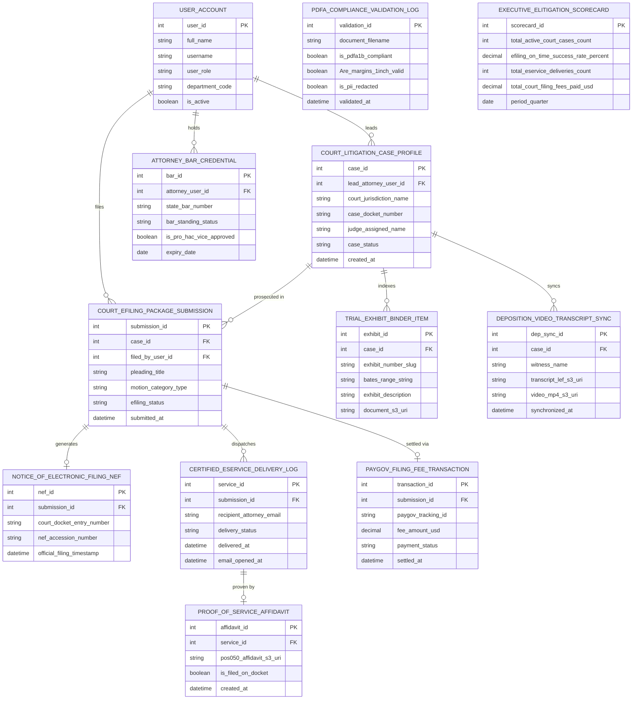

# Conceptual ERD — Court Filing & E-Litigation System

## Mermaid Code

## Entity Description Table | Bảng mô tả Entity

| # | Entity Name | Vietnamese Name | Description | Key Attributes | Main Relationships |
|---|-------------|-----------------|-------------|----------------|-------------------|
| 1 | USER_ACCOUNT | Tài khoản Nguời dùng | System credentials and access roles for trial attorneys, filing clerks, opposing counsel, and admins. | `user_id`, `username`, `user_role`, `department_code` | Leads `COURT_LITIGATION_CASE_PROFILE`, holds `ATTORNEY_BAR_CREDENTIAL`, files `COURT_EFILING_PACKAGE_SUBMISSION`. |
| 2 | COURT_LITIGATION_CASE_PROFILE | Profile Case Tranh tụng Tòa án | Central court litigation case record tracking jurisdiction names, docket numbers, assigned judges, and case status (`ACTIVE/CLOSED`). | `case_id`, `lead_attorney_user_id`, `court_jurisdiction_name`, `case_docket_number`, `judge_assigned_name`, `case_status` | Prosecuted in `COURT_EFILING_PACKAGE_SUBMISSION`, indexes `TRIAL_EXHIBIT_BINDER_ITEM`, syncs `DEPOSITION_VIDEO_TRANSCRIPT_SYNC`, led by `USER_ACCOUNT`. |
| 3 | ATTORNEY_BAR_CREDENTIAL | Thẻ Thẻ Luật sư Bar | Attorney bar credential record tracking state bar numbers, standing status (`ACTIVE`), pro hac vice approvals, and expiration dates. | `bar_id`, `attorney_user_id`, `state_bar_number`, `bar_standing_status`, `is_pro_hac_vice_approved`, `expiry_date` | Belongs to `USER_ACCOUNT`. |
| 4 | PDFA_COMPLIANCE_VALIDATION_LOG | Nhật ký Validation PDF/A | PDF compliance audit log recording PDF/A-1b compliance, 1-inch page margin checks, PII redaction verification, and timestamps. | `validation_id`, `document_filename`, `is_pdfa1b_compliant`, `Are_margins_1inch_valid`, `is_pii_redacted` | Standalone technical validation entity. |
| 5 | COURT_EFILING_PACKAGE_SUBMISSION | Package Nộp E-Filing Tòa án | Court e-filing submission record tracking pleading titles, motion categories, e-filing status (`SUBMITTED/ACCEPTED`), and timestamps. | `submission_id`, `case_id`, `filed_by_user_id`, `pleading_title`, `motion_category_type`, `efiling_status` | Belongs to `COURT_LITIGATION_CASE_PROFILE`, generates `NOTICE_OF_ELECTRONIC_FILING_NEF`, dispatches `CERTIFIED_ESERVICE_DELIVERY_LOG`, settled via `PAYGOV_FILING_FEE_TRANSACTION`, filed by `USER_ACCOUNT`. |
| 6 | NOTICE_OF_ELECTRONIC_FILING_NEF | Giấy báo NEF Điện tử Tòa án | Official Notice of Electronic Filing (NEF) record storing court docket entry numbers (Entry #42), NEF accession numbers, and filing timestamps. | `nef_id`, `submission_id`, `court_docket_entry_number`, `nef_accession_number`, `official_filing_timestamp` | Belongs to `COURT_EFILING_PACKAGE_SUBMISSION`. |
| 7 | CERTIFIED_ESERVICE_DELIVERY_LOG | Nhật ký Gửi e-Service Chứng thực | Certified electronic service of process log recording recipient emails, delivery status (`DELIVERED`), SMTP timestamps, and email open timestamps. | `service_id`, `submission_id`, `recipient_attorney_email`, `delivery_status`, `delivered_at`, `email_opened_at` | Belongs to `COURT_EFILING_PACKAGE_SUBMISSION`, proven by `PROOF_OF_SERVICE_AFFIDAVIT`. |
| 8 | PROOF_OF_SERVICE_AFFIDAVIT | Tuyên thệ Proof of Service | Court-compliant Proof of Electronic Service affidavit record storing POS-050 PDF S3 URIs and docket filing status. | `affidavit_id`, `service_id`, `pos050_affidavit_s3_uri`, `is_filed_on_docket` | Belongs to `CERTIFIED_ESERVICE_DELIVERY_LOG`. |
| 9 | PAYGOV_FILING_FEE_TRANSACTION | Transaction Phí Tòa án Pay.gov | Government filing fee transaction record tracking Pay.gov tracking IDs, fee amounts USD, payment status (`CLEARED`), and settlement timestamps. | `transaction_id`, `submission_id`, `paygov_tracking_id`, `fee_amount_usd`, `payment_status`, `settled_at` | Belongs to `COURT_EFILING_PACKAGE_SUBMISSION`. |
| 10 | TRIAL_EXHIBIT_BINDER_ITEM | Mục Binder Exhibit Phiên tòa | Digital trial exhibit binder record tracking exhibit numbers (`PX-101`), Bates range strings, description titles, and document S3 URIs. | `exhibit_id`, `case_id`, `exhibit_number_slug`, `bates_range_string`, `exhibit_description`, `document_s3_uri` | Belongs to `COURT_LITIGATION_CASE_PROFILE`. |
| 11 | DEPOSITION_VIDEO_TRANSCRIPT_SYNC | Sync Transcripts Video Deposition | Synchronized video deposition record tracking witness names, LEF transcript S3 URIs, MP4 video S3 URIs, and synchronization timestamps. | `dep_sync_id`, `case_id`, `witness_name`, `transcript_lef_s3_uri`, `video_mp4_s3_uri`, `synchronized_at` | Belongs to `COURT_LITIGATION_CASE_PROFILE`. |
| 12 | EXECUTIVE_ELITIGATION_SCORECARD | Scorecard Executive E-Litigation | Executive e-litigation scorecard aggregating active court cases, e-filing on-time success %, certified e-service deliveries, and court fees paid. | `scorecard_id`, `total_active_court_cases_count`, `efiling_on_time_success_rate_percent`, `total_eservice_deliveries_count`, `total_court_filing_fees_paid_usd` | Standalone executive performance entity. |

## Relationship Description | Mô tả Quan hệ

| # | From Entity | Cardinality | To Entity | Label | Business Explanation |
|---|-------------|-------------|-----------|-------|----------------------|
| 1 | COURT_LITIGATION_CASE_PROFILE | 1 to 0..N | COURT_EFILING_PACKAGE_SUBMISSION | prosecuted in | A court litigation case profile is prosecuted in e-filing package submissions. |
| 2 | COURT_LITIGATION_CASE_PROFILE | 1 to 0..N | TRIAL_EXHIBIT_BINDER_ITEM | indexes | A court litigation case profile indexes digital trial exhibit binder items. |
| 3 | COURT_LITIGATION_CASE_PROFILE | 1 to 0..N | DEPOSITION_VIDEO_TRANSCRIPT_SYNC | syncs | A court litigation case profile syncs video deposition transcript records. |
| 4 | COURT_EFILING_PACKAGE_SUBMISSION | 1 to 1 | NOTICE_OF_ELECTRONIC_FILING_NEF | generates | An e-filing submission generates an official Notice of Electronic Filing (NEF). |
| 5 | COURT_EFILING_PACKAGE_SUBMISSION | 1 to 0..N | CERTIFIED_ESERVICE_DELIVERY_LOG | dispatches | An e-filing submission dispatches certified electronic service of process logs. |
| 6 | COURT_EFILING_PACKAGE_SUBMISSION | 1 to 0..1 | PAYGOV_FILING_FEE_TRANSACTION | settled via | An e-filing submission is settled via Pay.gov filing fee transactions. |
| 7 | CERTIFIED_ESERVICE_DELIVERY_LOG | 1 to 1 | PROOF_OF_SERVICE_AFFIDAVIT | proven by | A certified e-service delivery log is proven by a Proof of Service affidavit. |
| 8 | USER_ACCOUNT | 1 to 0..N | COURT_LITIGATION_CASE_PROFILE | leads | A lead trial attorney user account leads court litigation case profiles. |
| 9 | USER_ACCOUNT | 1 to 0..N | ATTORNEY_BAR_CREDENTIAL | holds | A litigator user account holds attorney bar credentials. |
| 10 | USER_ACCOUNT | 1 to 0..N | COURT_EFILING_PACKAGE_SUBMISSION | files | An electronic filing clerk user account files e-filing package submissions. |
