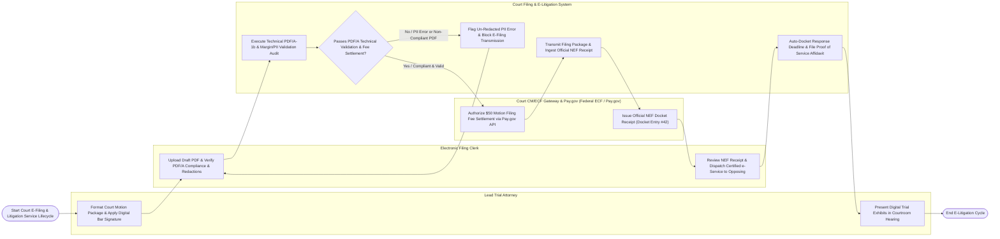

# Swimlane Diagram — Court Filing & E-Litigation System

## Mermaid Code

## Flow Description | Mô tả luồng

| Lane | Actor | Role in Flow |
|------|-------|-------------|
| 1 | Lead Trial Attorney | Formats court motion packages, applies cryptographic bar certificate digital signatures, presents indexed digital trial exhibits in courtroom hearings, and executes emergency writs. |
| 2 | Electronic Filing Clerk | Uploads draft pleading PDFs, verifies PDF/A compliance and PII redactions, reviews official NEF docket receipts, and dispatches certified e-service to opposing counsel. |
| 3 | Court Filing & E-Litigation System | Executes technical PDF/A-1b, margin, and PII redaction validation audits, calculates court filing fees, dispatches electronic filing payloads to CM/ECF, ingests NEF receipts, auto-dockets procedural motion response deadlines, tracks certified e-service email delivery, and generates Proof of Service affidavits. |
| 4 | Court CM/ECF Gateway & Pay.gov (Federal ECF / Pay.gov) | Settles statutory court filing fees via Pay.gov API, processes electronic PDF/A pleading packages, and issues official Notice of Electronic Filing (NEF) docket receipts (`Docket Entry #42`). |
