# Action Tree — Court Filing & E-Litigation System

## Mermaid Code

```mermaid
graph TD
    Root["Court Filing & E-Litigation System"]

    Root --> M1["Pleading Formatting & PDF/A Validation"]
    Root --> M2["Court CM/ECF E-Filing & NEF Ingestion"]
    Root --> M3["Certified Electronic Service of Process (e-Service)"]
    Root --> M4["Pay.gov Court Fee Settlement & Financials"]
    Root --> M5["Trial Exhibit Binders & Deposition Video Sync"]
    Root --> M6["Procedural Docketing & Executive Scorecards"]

    M1 --> A11["Format Court Pleadings, Cover Sheets & Motion Packages"]
    M1 --> A12["Validate PDF/A-1b ISO 19005-1 Compliance & 1-Inch Page Margins"]
    M1 --> A13["Scan & Redact Un-Redacted PII (SSNs, Financial Accounts under Rule 5.2)"]
    M1 --> A14["Apply Cryptographic Attorney Bar Certificate Digital Signatures"]

    M2 --> A21["Transmit Electronic Pleading Packages to Federal CM/ECF Gateway API"]
    M2 --> A22["Transmit State Court Filings to Tyler Odyssey File & Serve API"]
    M2 --> A23["Ingest Official Notice of Electronic Filing (NEF) Docket Receipts"]
    M2 --> A24["Operate Emergency Fast-Track Workflows for TROs & Injunction Writs"]

    M3 --> A31["Dispatch Certified Electronic Service of Process Payloads to Opposing Counsel"]
    M3 --> A32["Track Certified E-Service Delivery Telemetry & Email Open Timestamps"]
    M3 --> A33["Generate Court-Compliant Proof of Electronic Service Affidavits (POS-050)"]
    M3 --> A34["Auto-File Certified Proof of Service Affidavits on Court Docket"]

    M4 --> A41["Query Statutory Court Fee Schedules for Motion & Complaint Filing Fees"]
    M4 --> A42["Authorize & Settle Court Fees via Pay.gov API / Merchant Gateways"]
    M4 --> A43["Process In Forma Pauperis Statutory Court Fee Waiver Certificates"]
    M4 --> A44["Log Cleared Pay.gov Receipts in Law Firm Billing Subsystem as Billable Items"]

    M5 --> A51["Compile Indexed Digital Trial Exhibit Binders with Bates Range Tags"]
    M5 --> A52["Synchronize Video Deposition MP4 Files with LEF Transcript Lines"]
    M5 --> A53["Extract Deposition Video Clips for Real-Time Courtroom Playback"]
    M5 --> A54["Export Interactive Courtroom Presentation Decks with Zoom Callouts"]

    M6 --> A61["Auto-Calculate Procedural Motion Response Deadlines via Rules of Civil Procedure"]
    M6 --> A62["Track Judge Standing Orders, Pre-Trial Conferences & Trial Calendars"]
    M6 --> A63["Benchmark E-Filing Submission Speed, Rejection Rates & Motion Win Ratios"]
    M6 --> A64["Export Executive E-Litigation, Court Docket & Spend Scorecard PDFs"]
```

## Module Description | Mô tả Module

| # | Module | Description | Actions |
|---|--------|-------------|---------|
| 1 | Pleading Formatting & PDF/A Validation | Formats pleading packages, validates PDF/A-1b compliance and 1-inch margins, scans and redacts PII under Federal Rule 5.2, and applies digital bar signatures. | Format Court Pleadings & Motion Packages, Validate PDF/A-1b Compliance & Margins, Scan & Redact Un-Redacted PII (Rule 5.2), Apply Bar Certificate Digital Signatures. |
| 2 | Court CM/ECF E-Filing & NEF Ingestion | Submits filings to Federal CM/ECF and State Tyler Odyssey APIs, ingests official NEF receipts (Entry #42), and operates emergency TRO workflows. | Transmit Electronic Filings to Federal CM/ECF, Transmit State Filings to Tyler Odyssey API, Ingest Official NEF Docket Receipts, Operate Emergency TRO & Injunction Workflows. |
| 3 | Certified Electronic Service of Process (e-Service) | Dispatches certified e-service to opposing counsel, tracks email delivery/open telemetry, generates POS-050 affidavits, and auto-files affidavits on dockets. | Dispatch Certified e-Service to Opposing Counsel, Track Certified e-Service Delivery Telemetry, Generate Proof of Service Affidavits (POS-050), Auto-File Proof of Service Affidavits on Docket. |
| 4 | Pay.gov Court Fee Settlement & Financials | Queries court fee schedules, settles fees via Pay.gov API, processes In Forma Pauperis waivers, and logs cleared fee receipts into law firm billing. | Query Statutory Court Fee Schedules, Authorize Court Fees via Pay.gov API, Process In Forma Pauperis Fee Waivers, Log Pay.gov Receipts in Law Firm Billing. |
| 5 | Trial Exhibit Binders & Deposition Video Sync | Compiles indexed trial exhibit binders, synchronizes MP4 videos with LEF transcripts down to the millisecond, extracts clips, and exports trial presentation decks. | Compile Digital Trial Exhibit Binders, Synchronize Video Depositions with LEF Transcripts, Extract Deposition Video Clips for Courtroom Playback, Export Interactive Presentation Decks. |
| 6 | Procedural Docketing & Executive Scorecards | Auto-calculates procedural response deadlines (Rules of Civil Procedure), tracks judge standing orders, benchmarks e-filing SLAs, and exports scorecards. | Auto-Calculate Procedural Motion Response Deadlines, Track Judge Standing Orders & Trial Calendars, Benchmark E-Filing Submission Speed & Win Ratios, Export Executive E-Litigation Scorecards. |
