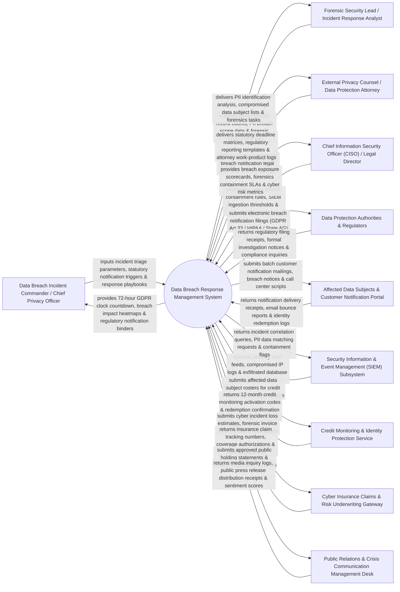

# Context Diagram — Data Breach Response Management System

## Mermaid Code

## Actor & Interaction Table | Bảng Actor & Tương tác

| # | Actor | Actor Type | Data Sent TO System | Data Received FROM System | Notes |
|---|-------|------------|---------------------|---------------------------|-------|
| 1 | Data Breach Incident Commander / Chief Privacy Officer | Primary | Incident triage parameters, statutory notification triggers (GDPR 72-Hour Rule), response playbooks, escalation decisions. | 72-hour GDPR clock countdown, breach impact heatmaps, regulatory notification binders, triage status. | Executive commanding data breach response, privacy compliance, and statutory notification timelines. |
| 2 | Forensic Security Lead / Incident Response Analyst | Primary | Compromised record counts, PII breach scope data, exfiltrated database schemas, forensic containment logs. | PII identification analysis, compromised data subject lists, forensic investigation task assignments. | Security analyst investigating cyber breach forensics, exfiltrated records, and PII containment. |
| 3 | External Privacy Counsel / Data Protection Attorney | Primary | Multi-jurisdictional breach notification legal opinions, privilege logs, regulatory reporting strategies. | Statutory deadline matrices (72h GDPR / 60d HIPAA / 30d State AG), regulatory filing draft packages. | External privacy attorney evaluating breach notification obligations across global jurisdictions. |
| 4 | CISO | Primary | Cyber breach containment rules, SIEM alert ingestion thresholds, executive alert escalation rules. | Breach exposure scorecards, forensics containment SLAs, cyber risk metrics, legal liability estimates. | Executive supervising cyber security containment, SIEM alert ingestion, and C-Suite breach escalations. |
| 5 | Data Protection Authorities & Regulators | Supporting | Regulatory filing receipts, formal investigation notices, regulatory inquiry letters, compliance orders. | Electronic breach notification filings (GDPR Art 33 / HIPAA Breach Report / US State AG notifications). | Data protection regulators (EU DPAs, US FTC, HHS OCR, State Attorneys General) receiving breach notifications. |
| 6 | Affected Data Subjects & Customer Notification Portal | Supporting | Notification delivery receipts, email bounce reports, identity protection redemption logs, opt-out requests. | Batch customer notification emails, formal breach notice letters (PDF), call center FAQ scripts. | Portal executing mass notification mailings to affected customers whose PII was compromised. |
| 7 | Security Information & Event Management (SIEM) Subsystem | Supporting | Real-time security alert feeds, compromised IP logs, exfiltrated database schemas, endpoint telemetry. | Incident correlation queries, PII data matching requests, SIEM containment flags. | External SIEM platform (Splunk / CrowdStrike) feeding security alerts and exfiltration logs to the system. |
| 8 | Credit Monitoring & Identity Protection Service | Supporting | 12-month credit monitoring activation codes, redemption confirmation logs, fraud alert receipts. | Affected data subject rosters, credit monitoring code generation requests, campaign parameters. | Identity protection vendor (Experian / Equifax) issuing credit monitoring activation codes for breach victims. |
| 9 | Cyber Insurance Claims & Risk Underwriting Gateway | Supporting | Insurance claim tracking numbers, coverage authorizations, forensic reimbursement payout logs. | Cyber incident loss estimates, forensic invoice proofs, ransom payout logs, breach claim notifications. | Cyber insurance carrier API (AIG / Chubb) processing breach response costs and insurance claims. |
| 10 | Public Relations & Crisis Communication Management Desk | Supporting / Operations | Media inquiry logs, public press release distribution receipts, public sentiment analysis scores. | Approved public holding statements, executive Q&A briefs, breach response press release drafts. | Corporate PR team managing public messaging, press releases, and media inquiries during a breach crisis. |

## System Boundary Description | Mô tả Phạm vi Hệ thống

The **Data Breach Response Management System** is an enterprise cyber incident response, 72-hour GDPR clock tracking, PII exfiltration analysis, multi-jurisdictional regulatory notification, mass customer notification, and cyber insurance claim platform.

**Inside System Scope:**
- Active 72-hour GDPR countdown timer enforcing strict statutory notification deadlines for EU DPAs.
- PII & PHI exfiltration analysis engine parsing compromised database schemas to identify affected data subjects.
- Multi-jurisdictional notification matrix evaluating breach laws across 50 US States, HIPAA, and international DPAs.
- Automated mass customer breach notification generator with Experian credit monitoring code integration.
- Cyber insurance claim tracker consolidating forensic costs, legal counsel fees, and notification expenses.

**Outside System Scope:**
- Direct physical technical containment of malware on infected servers (handled by SOC Security Engineers).
- Direct physical negotiation with ransomware extortion threat actors (handled by Specialized Extortion Negotiators).
- Direct physical credit report score updates on individual consumer credit files (handled by Credit Bureaus).
