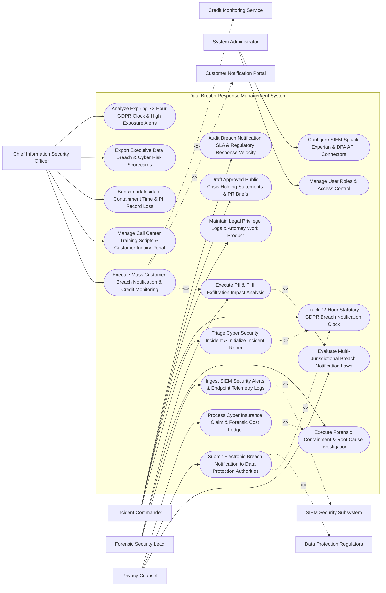

# Use Case Diagram — Data Breach Response Management System

## Mermaid Code

## Actor Table | Bảng Actor

| # | Actor | Actor Type | Role Description | Related Use Cases |
|---|-------|------------|------------------|-------------------|
| 1 | Incident Commander | Primary | Chief Privacy Officer leading breach incident rooms, tracking 72-hour clocks, managing privilege logs, and PR holding statements. | UC01, UC02, UC07, UC09, UC13 |
| 2 | Forensic Security Lead | Primary | Security analyst ingesting SIEM logs, executing forensic containment, and analyzing exfiltrated PII records. | UC03, UC04, UC05 |
| 3 | Privacy Counsel | Primary | External privacy attorney evaluating multi-jurisdictional breach laws, submitting DPA notifications, and managing cyber insurance claims. | UC06, UC08, UC12 |
| 4 | Chief Information Security Officer | Primary | Executive overseeing mass customer notifications, call center scripts, containment velocity, and cyber risk scorecards. | UC10, UC11, UC14, UC15, UC18 |
| 5 | System Administrator | Primary | IT admin managing user security roles, SIEM Splunk connectors, Experian APIs, and regulatory DPA gateways. | UC16, UC17 |
| 6 | Data Protection Regulators | System (Secondary) | Government privacy regulators (EU DPAs, US HHS OCR, State AGs) receiving statutory breach notification filings. | UC08 |
| 7 | Customer Notification Portal | System (Secondary) | Mass messaging platform executing customer breach notification mailings and tracking delivery telemetry. | UC10 |
| 8 | SIEM Security Subsystem | System (Secondary) | SIEM security platform (Splunk / CrowdStrike) feeding security alert logs and exfiltrated database schemas. | UC03 |
| 9 | Credit Monitoring Service | System (Secondary) | Identity protection vendor (Experian) issuing 12-month credit monitoring codes for compromised data subjects. | UC10 |

## Use Case Table | Bảng Use Case

| # | UC ID | Use Case Name | Primary Actor | Secondary Actor | Description | Priority |
|---|-------|---------------|---------------|-----------------|-------------|----------|
| 1 | UC01 | Triage Cyber Security Incident & Initialize Incident Room | Commander | None | Triages security alerts, determines potential breach confirmation, and initializes encrypted incident response room. | Critical |
| 2 | UC02 | Track 72-Hour Statutory GDPR Breach Notification Clock | Commander | None | Activates and displays a real-time 72-hour countdown clock enforced by GDPR Article 33 for DPA notifications. | Critical |
| 3 | UC03 | Ingest SIEM Security Alerts & Endpoint Telemetry Logs | Forensic | SIEM | Ingests real-time security alerts, exfiltration indicators, and endpoint telemetry logs from Splunk and CrowdStrike. | Critical |
| 4 | UC04 | Execute Forensic Containment & Root Cause Investigation | Forensic | None | Logs forensic containment actions, network isolation steps, vector root causes, and IOC (Indicators of Compromise) logs. | Critical |
| 5 | UC05 | Execute PII & PHI Exfiltration Impact Analysis | Forensic | None | Parses exfiltrated database schemas, identifying specific compromised PII/PHI data elements and total affected record counts. | Critical |
| 6 | UC06 | Evaluate Multi-Jurisdictional Breach Notification Laws | Counsel | None | Runs automated notification matrix evaluating breach laws across 50 US States, HIPAA (60 days), and international DPAs. | Critical |
| 7 | UC07 | Maintain Legal Privilege Logs & Attorney Work Product | Commander | None | Enforces attorney-client privilege protection on forensic investigation notes, legal drafts, and incident communications. | High |
| 8 | UC08 | Submit Electronic Breach Notification to Data Protection Authorities | Counsel | DPA | Assembles statutory breach notifications (GDPR Art 33 / HHS OCR / State AG), transmitting electronic filings to regulators. | Critical |
| 9 | UC09 | Draft Approved Public Crisis Holding Statements & PR Briefs | Commander | None | Manages approved public holding statements, press releases, executive Q&A briefs, and customer communication FAQs. | High |
| 10 | UC10 | Execute Mass Customer Breach Notification & Credit Monitoring | CISO | NotificationPortal | Dispatches mass customer notification emails/letters, incorporating 12-month Experian credit monitoring redemption codes. | Critical |
| 11 | UC11 | Manage Call Center Training Scripts & Customer Inquiry Portal | CISO | None | Provides trained call center agents with updated breach FAQ scripts and tracks customer call volume and sentiment. | High |
| 12 | UC12 | Process Cyber Insurance Claim & Forensic Cost Ledger | Counsel | None | Tracks forensic investigation costs, legal fees, notification expenses, and ransomware losses for cyber insurance claim recovery. | High |
| 13 | UC13 | Audit Breach Notification SLA & Regulatory Response Velocity | Commander | None | Measures statutory notification SLA compliance %, average hours to DPA notification, and customer delivery success %. | High |
| 14 | UC14 | Benchmark Incident Containment Time & PII Record Loss | CISO | None | Measures mean time to detect (MTTD), mean time to contain (MTTC), and total exfiltrated PII records per incident. | High |
| 15 | UC15 | Export Executive Data Breach & Cyber Risk Scorecards | CISO | None | Renders executive scorecards detailing active incidents, 72-hour clock status, total breach costs, and regulatory exposure. | High |
| 16 | UC16 | Manage User Roles & Access Control | Admin | None | Controls user login credentials, RBAC permissions, and confidential incident room access clearances. | High |
| 17 | UC17 | Configure SIEM Splunk Experian & DPA API Connectors | Admin | None | Configures API connectors for Splunk SIEM, CrowdStrike, Experian, EU DPA portals, and HHS OCR portal. | High |
| 18 | UC18 | Analyze Expiring 72-Hour GDPR Clock & High Exposure Alerts | CISO | None | Dispatches urgent notifications when the 72-hour DPA clock has under 12 hours remaining or exfiltrated records exceed 100k. | High |

## Use Case Specification | Đặc tả Use Case

---

### UC02 — Track 72-Hour Statutory GDPR Breach Notification Clock

| Field | Detail |
|-------|--------|
| **UC ID** | UC02 |
| **Use Case Name** | Track 72-Hour Statutory GDPR Breach Notification Clock |
| **Actor(s)** | Primary: Data Breach Incident Commander, Chief Privacy Officer   Secondary: External Privacy Counsel |
| **Description** | Activates and displays a real-time, high-priority 72-hour countdown timer enforced by GDPR Article 33, tracking statutory deadlines for notifying lead Data Protection Authorities (DPAs) upon breach confirmation. |
| **Precondition** | 1. Cyber security incident is confirmed to involve personal data of EU data subjects (UC01).   2. Breach confirmation timestamp is logged. |
| **Main Flow** | 1. Incident Commander confirms data breach involving 45,000 EU customer records on `October 30, 2026 at 02:00:00 PM EST`.   2. System initializes GDPR Article 33 Statutory Countdown Timer:   &nbsp;&nbsp;&nbsp;&nbsp; a. Start Timestamp: `October 30, 2026 at 02:00:00 PM EST`.   &nbsp;&nbsp;&nbsp;&nbsp; b. Statutory 72-Hour Deadline: `November 02, 2026 at 02:00:00 PM EST`.   &nbsp;&nbsp;&nbsp;&nbsp; c. Target Lead DPA: `Irish Data Protection Commission (DPC)`.   3. System renders Real-Time 72-Hour Clock Widget on Incident Room Dashboard, displaying remaining time down to the second (`71 Hours 59 Minutes 50 Seconds`).   4. System configures Automated Milestone Warning Escalations:   &nbsp;&nbsp;&nbsp;&nbsp; a. Milestone 1 (48 Hours Remaining): Email notification to Privacy Counsel.   &nbsp;&nbsp;&nbsp;&nbsp; b. Milestone 2 (24 Hours Remaining): Dashboard alert to Incident Commander & CISO.   &nbsp;&nbsp;&nbsp;&nbsp; c. Milestone 3 (12 Hours Remaining): High-priority SMS & phone call alert to CPO and General Counsel.   5. On `November 01, 2026 at 10:00:00 AM EST` (44 hours post-confirmation), Privacy Counsel submits electronic DPA notification (UC08).   6. System ingests official DPA filing receipt, stops 72-hour countdown clock (`CLOCK_STOPPED_IN_44_HOURS`), and logs statutory compliance SLA (`SUCCESS_FILED_WITHIN_72_HOURS`). |
| **Alternative Flow** | **AF1** — Phased DPA Notification (Incomplete Information): Forensics cannot determine full scope within 72 hours; System prepares Initial Phased Notification under Art 33(4), locking initial filing and setting Phase 2 follow-up timer. |
| **Exception Flow** | **EX1** — 72-Hour Clock Expiration Warning: Clock reaches 12 hours remaining without DPA submission; System dispatches emergency alert, requiring Incident Commander to document "Reasonable Justification for Delay" under Art 33(1). |
| **Postcondition** | 72-hour GDPR clock is activated, milestone warnings trigger, DPA notification is filed within statutory limit, and clock stops upon filing. |
| **Business Rule** | **BR1**: Confirmed personal data breaches involving EU data subjects MUST activate an automated 72-hour countdown clock enforcing GDPR Article 33 DPA notification rules. |

---

### UC05 — Execute PII & PHI Exfiltration Impact Analysis

| Field | Detail |
|-------|--------|
| **UC ID** | UC05 |
| **Use Case Name** | Execute PII & PHI Exfiltration Impact Analysis |
| **Actor(s)** | Primary: Forensic Security Lead, Chief Privacy Officer   Secondary: Security Information & Event Management (SIEM) Subsystem |
| **Description** | Parses exfiltrated database schemas, server log files, and forensic artifacts to identify specific compromised PII/PHI data fields (SSN, Passwords, Financial Accounts, Medical Records) and calculate total affected records. |
| **Precondition** | 1. Forensic team isolates exfiltrated database tables or log files (UC04).   2. PII data classification regex dictionary and schema parser are active. |
| **Main Flow** | 1. Forensic Lead uploads exfiltrated database dump file `stolen_user_table_export.sql` (1.2 GB) recovered from dark web drop zone.   2. System dispatches SQL Schema & PII Exfiltration Analysis Engine.   3. PII Analysis Engine scans database columns and data rows:   &nbsp;&nbsp;&nbsp;&nbsp; a. Scans for Data Types: Names, Email Addresses, Hashed Passwords, Social Security Numbers (SSN), Credit Card Numbers (PAN), Driver's License Numbers, Medical Diagnosis Codes (PHI).   4. Engine generates Compromised Data Element Matrix:   &nbsp;&nbsp;&nbsp;&nbsp; a. Total Affected Data Subjects: `125,400 Unique Individuals`.   &nbsp;&nbsp;&nbsp;&nbsp; b. Compromised PII Fields: `Full Name (100%)`, `Email Address (100%)`, `Hashed Password (100%)`, `Social Security Number (18.4% - 23,073 records)`, `Credit Card Number (0% - Not Exfiltrated)`.   5. System correlates compromised records with User Geography Database:   &nbsp;&nbsp;&nbsp;&nbsp; a. US Residents: 80,000 (California: 25,000 | New York: 18,000 | Texas: 12,000).   &nbsp;&nbsp;&nbsp;&nbsp; b. EU Residents: 35,000 (Germany: 15,000 | France: 10,000 | Ireland: 10,000).   &nbsp;&nbsp;&nbsp;&nbsp; c. UK Residents: 10,400.   6. System generates PII Exfiltration Impact Report PDF, feeding data directly into UC06 (Multi-Jurisdictional Law Evaluation) and UC10 (Mass Customer Notification). |
| **Alternative Flow** | **AF1** — Encrypted Exfiltration Verification: Exfiltrated file is encrypted with AES-256 and key was not compromised; System marks risk level as `LOW_EXPOSURE_ENCRYPTED_DATA`, evaluating statutory encrypted data safe harbor provisions. |
| **Exception Flow** | **EX1** — Un-Structured PII Text File Processing: Exfiltrated file is un-structured log text; System deploys AI NLP PII Entity Extractor, identifying 12,000 un-structured SSNs and names. |
| **Postcondition** | Exfiltrated database file is parsed, compromised PII data elements and record counts are categorized by jurisdiction, and impact report renders. |
| **Business Rule** | **BR1**: PII exfiltration analysis MUST categorize compromised data elements down to individual state and country jurisdiction levels to drive statutory notification logic. |

---

### UC08 — Submit Electronic Breach Notification to Data Protection Authorities

| Field | Detail |
|-------|--------|
| **UC ID** | UC08 |
| **Use Case Name** | Submit Electronic Breach Notification to Data Protection Authorities |
| **Actor(s)** | Primary: Privacy Counsel, Data Breach Incident Commander   Secondary: Data Protection Authorities & Regulators (EU DPA Portals / HHS OCR / State AGs) |
| **Description** | Assembles statutory breach notification filings (GDPR Article 33, HIPAA 60-Day Notice, US State AG Notifications), transmitting electronic filings directly to regulatory portals. |
| **Precondition** | 1. 72-hour GDPR clock is active (UC02) or state notification statutory triggers are reached (UC06).   2. PII exfiltration impact report (UC05) is approved by Privacy Counsel. |
| **Main Flow** | 1. Privacy Counsel opens "Regulatory Breach Notification Desk" for Incident `#INC-2026-88412`.   2. System retrieves Pre-Populated Regulatory Filing Templates:   &nbsp;&nbsp;&nbsp;&nbsp; a. Filing 1: `EU GDPR Article 33 Notification (Irish DPC Portal)`.   &nbsp;&nbsp;&nbsp;&nbsp; b. Filing 2: `California Attorney General Breach Notice (Cal. Civ. Code § 1798.82)`.   &nbsp;&nbsp;&nbsp;&nbsp; c. Filing 3: `US HHS OCR HIPAA Breach Notification Portal`.   3. System auto-fills Regulatory Notification Fields:   &nbsp;&nbsp;&nbsp;&nbsp; a. Nature of Personal Data Breach: `Credential Stuffing & Unauthorized Exfiltration`.   &nbsp;&nbsp;&nbsp;&nbsp; b. Categories & Approximate Number of Data Subjects: `35,000 EU Data Subjects | 80,000 US Data Subjects`.   &nbsp;&nbsp;&nbsp;&nbsp; c. Likely Consequences of Breach: `Potential Identity Theft & Phishing Risk`.   &nbsp;&nbsp;&nbsp;&nbsp; d. Remediation & Containment Measures Taken: `Forced Password Reset, IP Block, SIEM Rule Update`.   &nbsp;&nbsp;&nbsp;&nbsp; e. Data Protection Officer (DPO) Contact Details.   4. Counsel reviews legal wording, applies Digital Attorney Signature, and selects "Submit Filings".   5. System dispatches HTTPS REST API payloads to regulatory gateways:   &nbsp;&nbsp;&nbsp;&nbsp; a. Irish DPC Portal API -> Accepted | Accession #: `IE-DPC-2026-88412`.   &nbsp;&nbsp;&nbsp;&nbsp; b. California AG Portal API -> Accepted | Accession #: `CAG-2026-99412`.   6. System ingests official filing receipts, stops 72-hour GDPR clock (UC02), and attaches receipts to Master Regulatory Binder. |
| **Alternative Flow** | **AF1** — Supplemental Regulatory Progress Update: Counsel submits follow-up Phase 2 report 14 days later with final forensic findings, updating initial DPA filing. |
| **Exception Flow** | **EX1** — Regulatory API Portal Down Error: State AG portal API is offline; System generates formatted PDF notification package, dispatching via certified electronic mail with proof of delivery. |
| **Postcondition** | Statutory breach notifications are filled, digitally signed, submitted to DPA/State AG APIs, filing receipts are ingested, and the 72-hour clock stops. |
| **Business Rule** | **BR1**: Statutory regulatory breach notifications MUST be submitted under attorney-client privilege review prior to transmission to regulatory portals. |

---

### UC10 — Execute Mass Customer Breach Notification & Credit Monitoring

| Field | Detail |
|-------|--------|
| **UC ID** | UC10 |
| **Use Case Name** | Execute Mass Customer Breach Notification & Credit Monitoring |
| **Actor(s)** | Primary: Chief Information Security Officer, Chief Privacy Officer   Secondary: Affected Data Subjects & Customer Notification Portal, Credit Monitoring Service (Experian API) |
| **Description** | Generates and dispatches mass breach notification emails/letters to affected customers, incorporating 12-month Experian credit monitoring activation codes and call center contact details. |
| **Precondition** | 1. Affected customer record list (125,400 individuals) is finalized (UC05).   2. Experian Credit Monitoring API connector is authenticated. |
| **Main Flow** | 1. CISO opens "Mass Customer Breach Notification Studio" for Incident `#INC-2026-88412`.   2. System dispatches API request to Experian Credit Monitoring Gateway API (`POST /v1/codes/generate`):   &nbsp;&nbsp;&nbsp;&nbsp; a. Generates 23,073 Unique 12-Month Experian CreditId Protect Codes (for customers whose SSN was compromised).   3. System compiles Personalized Breach Notification Email Package:   &nbsp;&nbsp;&nbsp;&nbsp; a. Customer Name: `John Smith`.   &nbsp;&nbsp;&nbsp;&nbsp; b. Compromised Data Elements Listed: `Name, Email, Social Security Number`.   &nbsp;&nbsp;&nbsp;&nbsp; c. Unique Credit Monitoring Code: `EXP-8841-2026-9941`.   &nbsp;&nbsp;&nbsp;&nbsp; d. Redemption Instructions: `https://www.experianidworks.com/3dcredit`.   &nbsp;&nbsp;&nbsp;&nbsp; e. Dedicated Breach Call Center #: `1-800-555-8841`.   4. CISO signs off on mass notification deployment.   5. System dispatches batch email delivery payload via Customer Notification Portal API (SendGrid / AWS SES API).   6. Notification Portal executes mass delivery, streaming real-time telemetry:   &nbsp;&nbsp;&nbsp;&nbsp; a. Delivered Emails: 122,800 (`97.9% Delivery Rate`).   &nbsp;&nbsp;&nbsp;&nbsp; b. Bounced Emails: 2,600 (`2.1% Bounce Rate` -> Auto-routes to Physical Mail Printing Desk for postal notice).   7. System updates Customer Notification Dashboard, tracking real-time Experian code redemption rates. |
| **Alternative Flow** | **AF1** — Physical Postal Mail Notification: For customers without valid email addresses, System formats PDF notice letters, sending print file to certified mail fulfillment center. |
| **Exception Flow** | **EX1** — Credit Monitoring Code Depletion: Experian code pool exhausts at 20,000 codes; System auto-issues API top-up request for 5,000 additional codes, preventing mailing delays. |
| **Postcondition** | Experian credit monitoring codes are generated, mass notification emails dispatch, bounce tracking routes to physical mail, and redemption metrics update. |
| **Business Rule** | **BR1**: Mass customer breach notifications involving compromised Social Security Numbers MUST include a unique 12-month credit monitoring redemption code. |

---

### UC12 — Process Cyber Insurance Claim & Forensic Cost Ledger

| Field | Detail |
|-------|--------|
| **UC ID** | UC12 |
| **Use Case Name** | Process Cyber Insurance Claim & Forensic Cost Ledger |
| **Actor(s)** | Primary: External Privacy Counsel, CISO   Secondary: Cyber Insurance Claims & Risk Underwriting Gateway (AIG / Chubb API) |
| **Description** | Consolidates forensic investigation costs, legal counsel retainer invoices, customer notification fees, and credit monitoring expenses into a cyber insurance claim package for carrier reimbursement. |
| **Precondition** | 1. Cyber insurance policy (e.g., $10M Aggregate Limit, $100k Retention Deductible) is active.   2. Breach incident expenses are logged in system cost ledger. |
| **Main Flow** | 1. Privacy Counsel opens "Cyber Insurance Claim Desk" for Incident `#INC-2026-88412`.   2. System retrieves Itemized Incident Expense Ledger:   &nbsp;&nbsp;&nbsp;&nbsp; a. Forensic Investigation Invoices (Mandiant): `$185,000.00`.   &nbsp;&nbsp;&nbsp;&nbsp; b. External Legal Counsel Fees (Gibson Dunn): `$140,000.00`.   &nbsp;&nbsp;&nbsp;&nbsp; c. Mass Customer Notification & Mailings (SendGrid/Postal): `$45,000.00`.   &nbsp;&nbsp;&nbsp;&nbsp; d. Experian Credit Monitoring Activation Codes (23k Codes): `$115,000.00`.   &nbsp;&nbsp;&nbsp;&nbsp; e. Dedicated Call Center Operations (30 Days): `$65,000.00`.   &nbsp;&nbsp;&nbsp;&nbsp; f. Total Gross Incident Loss: `$$550,000.00`.   3. System applies Cyber Insurance Policy Terms:   &nbsp;&nbsp;&nbsp;&nbsp; a. Policy Retention Deductible: `-$100,000.00`.   &nbsp;&nbsp;&nbsp;&nbsp; b. Net Reimbursable Insurance Claim: `$$450,000.00`.   4. Counsel compiles Cyber Insurance Claim Package:   &nbsp;&nbsp;&nbsp;&nbsp; a. Attaches Proof of Forensics Invoices, Legal Fee Summaries, and Vendor Statements.   5. System dispatches HTTPS REST API payload to Cyber Insurance Gateway API (AIG / Chubb Claims API).   6. Insurance Gateway accepts claim submission and returns Claim Tracking ID `#INS-CLAIM-88412`.   7. System updates Insurance Reimbursement Ledger, tracking carrier review status and payout disbursements. |
| **Alternative Flow** | **AF1** — Ransomware Extortion Reimbursement Submission: Incident involved extortion payment; Counsel attaches threat actor dialogue logs, cryptocurrency transfer hash, and OFAC clearance proof to claim. |
| **Exception Flow** | **EX1** — Un-Approved Forensic Vendor Rejection: Insurer rejects forensic invoice because vendor was not on pre-approved panel; Counsel submits panel waiver request, proving emergency necessity. |
| **Postcondition** | Incident expenses are itemized, deductible applies, cyber insurance claim package is submitted to carrier API, and reimbursement tracking initializes. |
| **Business Rule** | **BR1**: Cyber insurance claims MUST consolidate all forensic, legal, notification, and credit monitoring invoices into a unified loss binder. |
