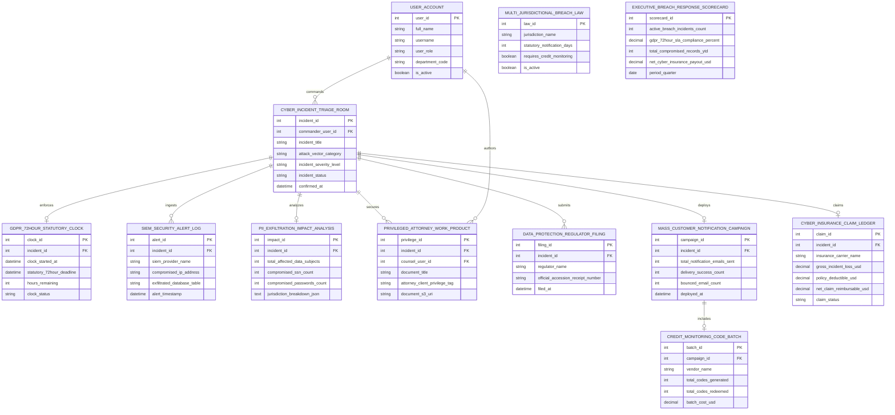

# Conceptual ERD — Data Breach Response Management System

## Mermaid Code

## Entity Description Table | Bảng mô tả Entity

| # | Entity Name | Vietnamese Name | Description | Key Attributes | Main Relationships |
|---|-------------|-----------------|-------------|----------------|-------------------|
| 1 | USER_ACCOUNT | Tài khoản Nguời dùng | System credentials and access roles for incident commanders, forensic leads, privacy counsel, CISOs, and admins. | `user_id`, `username`, `user_role`, `department_code` | Commands `CYBER_INCIDENT_TRIAGE_ROOM`, authors `PRIVILEGED_ATTORNEY_WORK_PRODUCT`. |
| 2 | CYBER_INCIDENT_TRIAGE_ROOM | Room Incident Triage Cyber | Central cyber incident response room record tracking incident titles, attack vectors, severity levels, and status (`TRIAGED/CONTAINED`). | `incident_id`, `commander_user_id`, `incident_title`, `attack_vector_category`, `incident_severity_level`, `incident_status`, `confirmed_at` | Enforces `GDPR_72HOUR_STATUTORY_CLOCK`, ingests `SIEM_SECURITY_ALERT_LOG`, analyzes `PII_EXFILTRATION_IMPACT_ANALYSIS`, secures `PRIVILEGED_ATTORNEY_WORK_PRODUCT`, submits `DATA_PROTECTION_REGULATOR_FILING`, deploys `MASS_CUSTOMER_NOTIFICATION_CAMPAIGN`, claims `CYBER_INSURANCE_CLAIM_LEDGER`, commanded by `USER_ACCOUNT`. |
| 3 | GDPR_72HOUR_STATUTORY_CLOCK | Clock 72-Hour Statutory GDPR | GDPR Article 33 statutory 72-hour countdown clock record tracking clock start timestamps, 72-hour deadlines, remaining hours, and status. | `clock_id`, `incident_id`, `clock_started_at`, `statutory_72hour_deadline`, `hours_remaining`, `clock_status` | Belongs to `CYBER_INCIDENT_TRIAGE_ROOM`. |
| 4 | SIEM_SECURITY_ALERT_LOG | Nhật ký Alert Security SIEM | SIEM security alert log recording provider names (Splunk/CrowdStrike), compromised IP addresses, exfiltrated database tables, and timestamps. | `alert_id`, `incident_id`, `siem_provider_name`, `compromised_ip_address`, `exfiltrated_database_table`, `alert_timestamp` | Belongs to `CYBER_INCIDENT_TRIAGE_ROOM`. |
| 5 | PII_EXFILTRATION_IMPACT_ANALYSIS | Phân tích Impact Exfiltration PII | PII/PHI exfiltration impact analysis record storing total affected data subjects, compromised SSN counts, password counts, and jurisdiction breakdown JSON. | `impact_id`, `incident_id`, `total_affected_data_subjects`, `compromised_ssn_count`, `compromised_passwords_count`, `jurisdiction_breakdown_json` | Belongs to `CYBER_INCIDENT_TRIAGE_ROOM`. |
| 6 | MULTI_JURISDICTIONAL_BREACH_LAW | Luật Notification Breach | Multi-jurisdictional breach law rule entity storing jurisdiction names (50 US States / EU / HIPAA), statutory notification days, and credit monitoring rules. | `law_id`, `jurisdiction_name`, `statutory_notification_days`, `requires_credit_monitoring`, `is_active` | Standalone breach rule entity. |
| 7 | PRIVILEGED_ATTORNEY_WORK_PRODUCT | Document Privilege Attorney | Encrypted attorney-client privileged document record storing document titles, privilege tags, counsel user IDs, and document S3 URIs. | `privilege_id`, `incident_id`, `counsel_user_id`, `document_title`, `attorney_client_privilege_tag`, `document_s3_uri` | Belongs to `CYBER_INCIDENT_TRIAGE_ROOM`, authored by `USER_ACCOUNT`. |
| 8 | DATA_PROTECTION_REGULATOR_FILING | Filing Regulator DPA | Statutory regulatory breach notification filing log recording regulator names (Irish DPA / HHS OCR / State AG), accession receipts, and timestamps. | `filing_id`, `incident_id`, `regulator_name`, `official_accession_receipt_number`, `filed_at` | Belongs to `CYBER_INCIDENT_TRIAGE_ROOM`. |
| 9 | MASS_CUSTOMER_NOTIFICATION_CAMPAIGN | Campaign Notification Customer | Mass customer breach notification campaign record tracking notification email counts, delivery success counts, bounced counts, and deployment timestamps. | `campaign_id`, `incident_id`, `total_notification_emails_sent`, `delivery_success_count`, `bounced_email_count`, `deployed_at` | Belongs to `CYBER_INCIDENT_TRIAGE_ROOM`, includes `CREDIT_MONITORING_CODE_BATCH`. |
| 10 | CREDIT_MONITORING_CODE_BATCH | Batch Code Credit Monitoring | Credit monitoring activation code batch record tracking vendor names (Experian), total codes generated, total codes redeemed, and batch costs USD. | `batch_id`, `campaign_id`, `vendor_name`, `total_codes_generated`, `total_codes_redeemed`, `batch_cost_usd` | Belongs to `MASS_CUSTOMER_NOTIFICATION_CAMPAIGN`. |
| 11 | CYBER_INSURANCE_CLAIM_LEDGER | Ledger Claim Cyber Insurance | Cyber insurance claim ledger record tracking carrier names, gross incident losses USD, policy deductibles USD, net reimbursable claims USD, and status. | `claim_id`, `incident_id`, `insurance_carrier_name`, `gross_incident_loss_usd`, `policy_deductible_usd`, `net_claim_reimbursable_usd`, `claim_status` | Belongs to `CYBER_INCIDENT_TRIAGE_ROOM`. |
| 12 | EXECUTIVE_BREACH_RESPONSE_SCORECARD | Scorecard Executive Breach | Executive data breach response scorecard aggregating active incidents, GDPR 72-hour SLA compliance %, total compromised records YTD, and net insurance payouts. | `scorecard_id`, `active_breach_incidents_count`, `gdpr_72hour_sla_compliance_percent`, `total_compromised_records_ytd`, `net_cyber_insurance_payout_usd` | Standalone executive performance entity. |

## Relationship Description | Mô tả Quan hệ

| # | From Entity | Cardinality | To Entity | Label | Business Explanation |
|---|-------------|-------------|-----------|-------|----------------------|
| 1 | CYBER_INCIDENT_TRIAGE_ROOM | 1 to 1 | GDPR_72HOUR_STATUTORY_CLOCK | enforces | A cyber incident triage room enforces a 72-hour statutory GDPR countdown clock. |
| 2 | CYBER_INCIDENT_TRIAGE_ROOM | 1 to 0..N | SIEM_SECURITY_ALERT_LOG | ingests | A cyber incident triage room ingests SIEM security alert logs. |
| 3 | CYBER_INCIDENT_TRIAGE_ROOM | 1 to 1 | PII_EXFILTRATION_IMPACT_ANALYSIS | analyzes | A cyber incident triage room analyzes PII/PHI exfiltration impact reports. |
| 4 | CYBER_INCIDENT_TRIAGE_ROOM | 1 to 0..N | PRIVILEGED_ATTORNEY_WORK_PRODUCT | secures | A cyber incident triage room secures privileged attorney work-product documents. |
| 5 | CYBER_INCIDENT_TRIAGE_ROOM | 1 to 0..N | DATA_PROTECTION_REGULATOR_FILING | submits | A cyber incident triage room submits regulatory breach filings. |
| 6 | CYBER_INCIDENT_TRIAGE_ROOM | 1 to 0..1 | MASS_CUSTOMER_NOTIFICATION_CAMPAIGN | deploys | A cyber incident triage room deploys mass customer notification campaigns. |
| 7 | CYBER_INCIDENT_TRIAGE_ROOM | 1 to 0..1 | CYBER_INSURANCE_CLAIM_LEDGER | claims | A cyber incident triage room claims expenses in cyber insurance ledgers. |
| 8 | MASS_CUSTOMER_NOTIFICATION_CAMPAIGN | 1 to 1 | CREDIT_MONITORING_CODE_BATCH | includes | A customer notification campaign includes a credit monitoring code batch. |
| 9 | USER_ACCOUNT | 1 to 0..N | CYBER_INCIDENT_TRIAGE_ROOM | commands | An incident commander user account commands cyber incident triage rooms. |
| 10 | USER_ACCOUNT | 1 to 0..N | PRIVILEGED_ATTORNEY_WORK_PRODUCT | authors | A privacy counsel user account authors privileged attorney work-product documents. |
