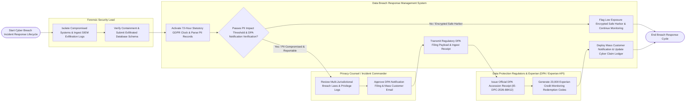

# Swimlane Diagram — Data Breach Response Management System

## Mermaid Code

## Flow Description | Mô tả luồng

| Lane | Actor | Role in Flow |
|------|-------|-------------|
| 1 | Forensic Security Lead | Isolates compromised network systems, ingests SIEM security alert logs, conducts forensic root cause analysis, and submits exfiltrated database schemas. |
| 2 | Privacy Counsel / Incident Commander | Evaluates multi-jurisdictional breach notification laws across 50 US States and GDPR, maintains attorney-client privilege logs, approves DPA notification filings, and signs off on mass customer notices. |
| 3 | Data Breach Response Management System | Activates real-time 72-hour statutory GDPR countdown clocks, parses exfiltrated database schemas to categorize compromised PII fields by jurisdiction, formats DPA filings, transmits electronic payloads via API, ingests Experian credit monitoring codes, deploys mass customer notifications, and calculates cyber insurance claim ledgers. |
| 4 | Data Protection Regulators & Experian (DPA / Experian API) | Ingests electronic breach notifications, issues official DPA accession receipts (`IE-DPC-2026-88412`), and generates 12-month Experian credit monitoring redemption codes for affected data subjects. |
