# Action Tree — Data Breach Response Management System

## Mermaid Code

```mermaid
graph TD
    Root["Data Breach Response Management System"]

    Root --> M1["Incident Triage & 72-Hour GDPR Clock Tracking"]
    Root --> M2["SIEM Ingestion & PII/PHI Exfiltration Analysis"]
    Root --> M3["Multi-Jurisdictional Legal Rules & Privilege Logs"]
    Root --> M4["Regulatory DPA Filings & Public Crisis PR"]
    Root --> M5["Mass Customer Notification & Credit Monitoring"]
    Root --> M6["Cyber Insurance Claims & Executive Risk Scorecards"]

    M1 --> A11["Triage Cyber Security Incidents & Initialize Encrypted Response Rooms"]
    M1 --> A12["Activate Real-Time 72-Hour GDPR Article 33 Statutory Countdown Clocks"]
    M1 --> A13["Configure Milestone Escalation Alerts (48h, 24h, 12h Warnings to CPO/CISO)"]
    M1 --> A14["Stop 72-Hour Statutory Clock upon Official Regulatory Filing Ingestion"]

    M2 --> A21["Ingest Real-Time SIEM Security Alerts & Exfiltration Logs (Splunk / CrowdStrike)"]
    M2 --> A22["Parse Exfiltrated Database Schemas for PII Data Elements (SSN, Passwords, PHI)"]
    M2 --> A23["Correlate Compromised User Records with Geography Databases across 50 US States"]
    M2 --> A24["Evaluate Encrypted Data Safe Harbor Exceptions & Exfiltration Scope Reports"]

    M3 --> A31["Evaluate Breach Notification Laws across US States, HIPAA (60d) & EU DPAs"]
    M3 --> A32["Maintain Encrypted Attorney-Client Privilege Logs & Work-Product Binders"]
    M3 --> A33["Assess Statutory Notification Triggers based on Harm Threshold Regulations"]
    M3 --> A34["Manage Phased Notification Schedules for Incomplete Forensic Investigations"]

    M4 --> A41["Auto-Populate Regulatory Breach Notification Forms (GDPR Art 33 / HHS OCR)"]
    M4 --> A42["Submit Electronic Filings to Lead EU DPA & US State AG Regulatory Portals"]
    M4 --> A43["Draft Approved Crisis Communication Holding Statements & Press Release Briefs"]
    M4 --> A44["Ingest Regulatory Accession Receipts & Formal Investigation Notices"]

    M5 --> A51["Generate Batch Experian 12-Month Credit Monitoring Redemption Codes via API"]
    M5 --> A52["Dispatch Mass Customer Breach Notification Emails with Unique Credit Codes"]
    M5 --> A53["Route Bounced Customer Emails to Physical Postal Notice Print Fulfillment"]
    M5 --> A54["Maintain Call Center Agent FAQ Scripts & Customer Inquiry Tracking Portals"]

    M6 --> A61["Itemize Incident Response Expenses (Forensics, Legal Fees, Notifications)"]
    M6 --> A62["Apply Policy Retention Deductibles & Submit Claims to Cyber Insurers"]
    M6 --> A63["Benchmark Mean Time to Detect (MTTD) & Mean Time to Contain (MTTC)"]
    M6 --> A64["Export Executive Data Breach Risk, Regulatory Exposure & Cyber Scorecards"]
```

## Module Description | Mô tả Module

| # | Module | Description | Actions |
|---|--------|-------------|---------|
| 1 | Incident Triage & 72-Hour GDPR Clock Tracking | Triages security incidents, initializes response rooms, activates real-time 72-hour GDPR Article 33 countdown clocks, dispatches warnings, and stops clocks upon filing. | Triage Cyber Security Incidents, Activate Real-Time 72-Hour GDPR Countdown Clocks, Configure Milestone Warning Alerts, Stop 72-Hour Clock upon Regulatory Filing. |
| 2 | SIEM Ingestion & PII/PHI Exfiltration Analysis | Ingests SIEM logs (Splunk/CrowdStrike), parses exfiltrated database schemas for SSNs/passwords/PHI, maps geographical demographics, and evaluates safe harbors. | Ingest Real-Time SIEM Alerts & Exfiltration Logs, Parse Exfiltrated Database Schemas for PII, Correlate Compromised User Records by Geography, Evaluate Encrypted Data Safe Harbors. |
| 3 | Multi-Jurisdictional Legal Rules & Privilege Logs | Evaluates breach notification laws across 50 US States, HIPAA (60d), and EU DPAs, maintains privilege logs, assesses harm thresholds, and manages phased notifications. | Evaluate Breach Notification Laws across 50 US States & HIPAA, Maintain Encrypted Attorney-Client Privilege Logs, Assess Statutory Notification Harm Triggers, Manage Phased Notification Schedules. |
| 4 | Regulatory DPA Filings & Public Crisis PR | Auto-fills regulatory notification templates, submits electronic filings to DPA/State AG portals via API, drafts crisis holding statements, and ingests filing receipts. | Auto-Populate Regulatory Breach Notification Forms, Submit Electronic Filings to EU DPA & State AG Portals, Draft Approved Crisis PR Holding Statements, Ingest Regulatory Accession Receipts. |
| 5 | Mass Customer Notification & Credit Monitoring | Generates Experian credit monitoring codes via API, dispatches mass notification emails/letters, routes bounced emails to postal print desks, and manages call center scripts. | Generate Batch Experian Credit Monitoring Codes via API, Dispatch Mass Customer Breach Notification Emails, Route Bounced Emails to Postal Print Fulfillment, Maintain Call Center Agent FAQ Scripts. |
| 6 | Cyber Insurance Claims & Executive Risk Scorecards | Itemizes forensic/legal expenses, applies deductibles, submits claims to cyber insurers via API, benchmarks MTTD/MTTC, and exports executive scorecards. | Itemize Incident Response Expenses, Apply Policy Deductibles & Submit Claims to Insurers, Benchmark Mean Time to Detect (MTTD) & Contain (MTTC), Export Executive Data Breach Scorecards. |
