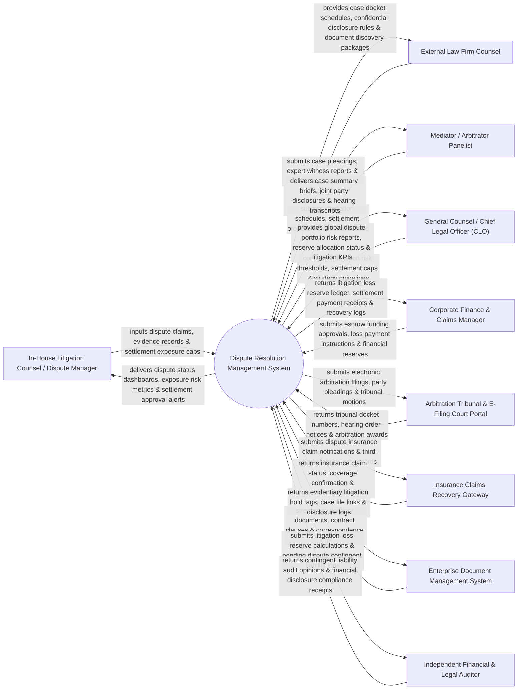

# Context Diagram — Dispute Resolution Management System

## Mermaid Code

## Actor & Interaction Table | Bảng Actor & Tương tác

| # | Actor | Actor Type | Data Sent TO System | Data Received FROM System | Notes |
|---|-------|------------|---------------------|---------------------------|-------|
| 1 | In-House Litigation Counsel / Dispute Manager | Primary | Dispute claims, evidence records, settlement exposure caps, negotiation strategies. | Dispute status dashboards, exposure risk metrics, settlement approval alerts, case dockets. | Corporate attorney managing active commercial disputes, arbitrations, and litigation claims. |
| 2 | External Law Firm Counsel | Primary | Case pleadings, expert witness reports, litigation fee invoices, court motions. | Case docket schedules, confidential disclosure rules, document discovery packages, witness lists. | Outside legal counsel retained to represent the corporation in court or arbitration proceedings. |
| 3 | Mediator / Arbitrator Panelist | Primary | Mediation schedules, settlement proposals, tribunal orders, final arbitration awards. | Case summary briefs, joint party disclosures, hearing transcripts, claim statements. | Neutral third-party mediator or arbitration tribunal panelist managing dispute resolution. |
| 4 | General Counsel / CLO | Primary | Litigation risk thresholds, settlement authorization caps, governance strategy guidelines. | Global dispute portfolio risk reports, reserve allocation status, litigation KPIs, executive summary. | Senior legal executive approving major litigation settlements and contingent liability reserves. |
| 5 | Corporate Finance & Claims Manager | Supporting | Escrow funding approvals, loss payment instructions, financial reserve adjustments. | Litigation loss reserve ledger, settlement payment receipts, recovery logs, financial impact reports. | Corporate treasury/finance manager handling escrow accounts and contingent liability accounting. |
| 6 | Arbitration Tribunal & E-Filing Court Portal | Supporting | Tribunal docket numbers, hearing order notices, arbitration awards, court service notices. | Electronic arbitration filings, party pleadings, tribunal motions, evidentiary filings. | Electronic court portal (AAA, ICC, LCIA, or State Court) processing arbitration and lawsuit filings. |
| 7 | Insurance Gateway | Supporting | Insurance claim status, coverage confirmation, reimbursement receipts, policy loss limits. | Dispute insurance claim notifications, third-party liability loss records, defense cost statements. | Commercial liability insurance portal handling claims recovery for litigated liabilities. |
| 8 | Enterprise Document Management System | Supporting | Evidentiary documents, contract clauses, email correspondence logs, transactional records. | Evidentiary litigation hold tags, case file links, disclosure logs, exhibit manifests. | Corporate document vault storing contracts, communications, and evidentiary materials. |
| 9 | Independent Financial & Legal Auditor | Supporting / Regulatory | Contingent liability audit opinions, financial disclosure compliance receipts, audit notes. | Litigation loss reserve calculations, pending dispute contingent liability logs, case exposure summaries. | Financial auditor auditing pending litigation contingent liabilities for GAAP/IFRS disclosures. |

## System Boundary Description | Mô tả Phạm vi Hệ thống

The **Dispute Resolution Management System** is an enterprise litigation portfolio management, mediation, arbitration tracking, financial loss exposure modeling, and settlement escrow management platform.

**Inside System Scope:**
- Centralized tracking of commercial disputes, breach of contract claims, regulatory proceedings, and arbitrations.
- Financial loss exposure estimation engine computing best-case, worst-case, and expected monetary loss scenarios.
- Mediation and arbitration workflow management, docket tracking, and settlement term enforcement.
- Integration with court e-filing portals (AAA, ICC) and corporate ERP financial reserve accounting.
- External counsel fee tracking, case strategy repository, and litigation hold evidentiary linkage.

**Outside System Scope:**
- Direct physical courtroom oral arguments (handled by litigation counsel in court).
- Direct physical custody of original physical evidence exhibits (handled by Evidence Custodian).
- General non-dispute commercial contract drafting (handled by Contract Lifecycle Management).
