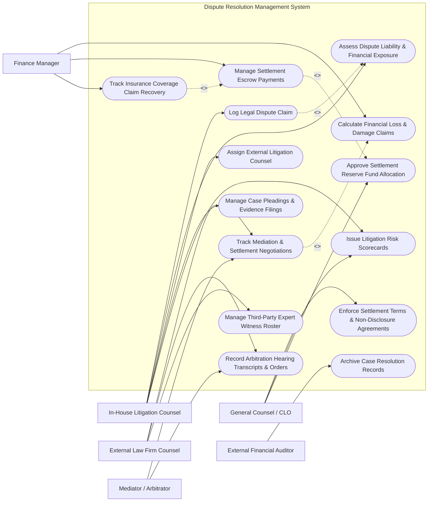

# Use Case Diagram — Dispute Resolution Management System

## Mermaid Code

## Actor Table | Bảng Actor

| # | Actor | Actor Type | Role Description | Related Use Cases |
|---|-------|------------|------------------|-------------------|
| 1 | In-House Litigation Counsel | Primary | Manages corporate dispute logging, case strategy, liability risk exposure, and mediation workflows. | UC01, UC02, UC03, UC05, UC10 |
| 2 | External Law Firm Counsel | Primary | Submits case pleadings, expert reports, witness testimony, and trial defense motions. | UC04, UC07, UC11 |
| 3 | Mediator / Arbitrator | Primary | Neutral panelist conducting mediation sessions, reviewing joint proposals, and issuing binding arbitration awards. | UC05, UC07 |
| 4 | General Counsel / CLO | Primary | Reviews litigation portfolio risk, approves settlement amounts exceeding threshold, and enforces settlement contracts. | UC09, UC10, UC14 |
| 5 | Finance Manager | Supporting | Handles financial loss reserve accounting, settlement escrow disbursements, and insurance recovery tracking. | UC06, UC08, UC13 |
| 6 | External Financial Auditor | Secondary | Audits litigation reserves, contingent liability notes, and resolved case payout logs for GAAP/IFRS disclosures. | UC12 |

## Use Case Table | Bảng Use Case

| # | UC ID | Use Case Name | Primary Actor | Secondary Actor | Description | Priority |
|---|-------|---------------|---------------|-----------------|-------------|----------|
| 1 | UC01 | Log Legal Dispute Claim | In-House Counsel | None | Creates a new dispute case record detailing claimant, defendant, dispute nature, and monetary demand. | High |
| 2 | UC02 | Assess Dispute Liability & Financial Exposure | In-House Counsel | Finance Manager | Calculates estimated legal liability, best-case/worst-case loss projections, and litigation success probability. | High |
| 3 | UC03 | Assign External Litigation Counsel | In-House Counsel | External Counsel | Selects external law firm, defines retention agreement scope, billing caps, and case counsel team. | High |
| 4 | UC04 | Manage Case Pleadings & Evidence Filings | External Counsel | In-House Counsel | Archives court motions, statements of claim, affidavits, defense pleadings, and evidentiary exhibits. | High |
| 5 | UC05 | Track Mediation & Settlement Negotiations | In-House Counsel | Mediator | Logs offer-counteroffer history, mediation session notes, term sheets, and settlement progress metrics. | High |
| 6 | UC06 | Calculate Financial Loss & Damage Claims | Finance Manager | In-House Counsel | Computes direct financial damages, legal fee accruals, interest charges, and statutory penalty calculations. | Medium |
| 7 | UC07 | Record Arbitration Hearing Transcripts & Orders | Mediator | External Counsel | Uploads tribunal hearing minutes, interim procedural orders, and final binding arbitration awards. | Medium |
| 8 | UC08 | Manage Settlement Escrow Payments | Finance Manager | In-House Counsel | Executes wire transfers into escrow accounts, releases settlement funds, and logs payment confirmation. | High |
| 9 | UC09 | Enforce Settlement Terms & Non-Disclosure Agreements | General Counsel | In-House Counsel | Tracks post-settlement compliance obligations, NDA clauses, non-disparagement, and release triggers. | High |
| 10 | UC10 | Issue Litigation Risk Scorecards | General Counsel | In-House Counsel | Generates executive risk scorecards evaluating global dispute portfolio exposure and litigation trends. | Medium |
| 11 | UC11 | Manage Third-Party Expert Witness Roster | External Counsel | In-House Counsel | Maintains expert witness directory, fee rates, testimony history, and conflict-of-interest declarations. | Low |
| 12 | UC12 | Archive Case Resolution Records | External Auditor | In-House Counsel | Permanently archives closed dispute files, dismissal orders, and financial settlement releases for audit. | Medium |
| 13 | UC13 | Track Insurance Coverage Claim Recovery | Finance Manager | Insurance Gateway | Files claim for indemnification under commercial liability insurance policies and tracks reimbursement. | Medium |
| 14 | UC14 | Approve Settlement Reserve Fund Allocation | General Counsel | Finance Manager | Grants formal executive authorization to allocate corporate loss reserves for pending settlement payouts. | High |

## Use Case Specification | Đặc tả Use Case

---

### UC01 — Log Legal Dispute Claim

| Field | Detail |
|-------|--------|
| **UC ID** | UC01 |
| **Use Case Name** | Log Legal Dispute Claim |
| **Actor(s)** | Primary: In-House Litigation Counsel   Secondary: None |
| **Description** | Records a newly identified commercial dispute, customer complaint escalation, breach of contract notice, or formal demand letter into the centralized dispute management repository. |
| **Precondition** | 1. In-House Counsel is authenticated into the Dispute Resolution platform.   2. Initial notice of claim or demand letter document is received. |
| **Main Flow** | 1. In-House Counsel selects "Create New Dispute Record".   2. System prompts for dispute details (Dispute Title, Forum Type [Litigation / Arbitration / Mediation], Claimant, Defendant, Legal Grounds).   3. In-House Counsel inputs claimed monetary damages amount and relevant contract references.   4. System checks for related existing cases or underlying contract IDs.   5. Counsel uploads scanned notice of claim or demand letter.   6. System creates master dispute record, assigns unique Case ID (e.g., DISP-2026-0887), and sets initial status to "PENDING INTAKE ASSESSMENT". |
| **Alternative Flow** | **AF1** — Pre-Litigation Warning: If dispute is an informal threat of legal action without formal service, system flags record as "PRE-LITIGATION DISPUTE" with 60-day review reminder. |
| **Exception Flow** | **EX1** — Conflict of Interest Flag: If named opposing party is an active corporate partner, system triggers an immediate Legal Conflict Warning to General Counsel. |
| **Postcondition** | New dispute record is saved and visible in active dispute dashboard. |
| **Business Rule** | **BR1**: All formal demand letters or court filings received by corporate entities must be logged in the system within 48 hours of receipt. |

---

### UC02 — Assess Dispute Liability & Financial Exposure

| Field | Detail |
|-------|--------|
| **UC ID** | UC02 |
| **Use Case Name** | Assess Dispute Liability & Financial Exposure |
| **Actor(s)** | Primary: In-House Litigation Counsel   Secondary: Finance Manager |
| **Description** | Evaluates the legal merits of the dispute, estimates liability probability, and calculates financial exposure ranges to establish contingent financial loss reserves. |
| **Precondition** | 1. Dispute case record exists in PENDING ASSESSMENT state.   2. Preliminary legal analysis of claims and defenses is conducted. |
| **Main Flow** | 1. In-House Counsel opens target dispute record and selects "Perform Liability & Risk Exposure Assessment".   2. System displays quantitative exposure modeling fields (Best Case, Likely Case, Worst Case Loss).   3. Counsel inputs estimated probability of adverse ruling (e.g., 35% probability of loss).   4. System computes Expected Monetary Value (EMV) loss: `EMV = Likely Loss Amount * Loss Probability`.   5. Counsel inputs estimated external legal fees and expert witness expenses.   6. System calculates total recommended Contingent Reserve Allocation and routes proposal to Finance Manager for ledger posting. |
| **Alternative Flow** | **AF1** — High Exposure Escalation: If worst-case exposure exceeds $1,000,000, system automatically triggers an instant notification to General Counsel and Chief Financial Officer. |
| **Exception Flow** | **EX1** — Missing Financial Data: System alerts counsel if probability percentage is entered without corresponding damage estimate. |
| **Postcondition** | Financial reserve recommendation is calculated and submitted for financial reserve allocation. |
| **Business Rule** | **BR1**: Loss probability assessments exceeding 50% must trigger mandatory financial reserve booking in accordance with ASC 450 / IAS 37 accounting rules. |

---

### UC05 — Track Mediation & Settlement Negotiations

| Field | Detail |
|-------|--------|
| **UC ID** | UC05 |
| **Use Case Name** | Track Mediation & Settlement Negotiations |
| **Actor(s)** | Primary: In-House Litigation Counsel   Secondary: Mediator / Arbitrator |
| **Description** | Manages offer-counteroffer cycles, mediation session records, term sheet negotiations, and settlement progression. |
| **Precondition** | 1. Dispute case is active and parties have agreed to mediation or informal settlement talks. |
| **Main Flow** | 1. In-House Counsel selects "Record Settlement Negotiation Event".   2. System prompts for event details (Date, Negotiation Phase, Offering Party, Monetary Demand / Counter-Offer Amount).   3. Counsel inputs non-monetary settlement conditions (e.g., contract amendment, mutual release, NDA requirement).   4. System updates Settlement History Timeline and compares current offer against approved settlement authorization threshold.   5. Counsel logs Mediator notes and key agreed points.   6. If parties reach agreement, counsel uploads executed Settlement Term Sheet and sets status to "SETTLEMENT AGREED - PENDING FINAL EXECUTION". |
| **Alternative Flow** | **AF1** — Settlement Impasse: If negotiations fail, counsel flags status as "MEDIATION IMPASSE - PROCEED TO TRIAL/ARBITRATION" and updates case litigation timeline. |
| **Exception Flow** | **EX1** — Offer Exceeds Authority Cap: If counteroffer exceeds Counsel's pre-approved settlement limit, system blocks settlement confirmation and prompts for General Counsel sign-off. |
| **Postcondition** | Negotiation history is logged and case status reflects current settlement stage. |
| **Business Rule** | **BR1**: All settlement offers extended to opposing parties must be logged in the system with timestamp and settlement limit verification. |

---

### UC08 — Manage Settlement Escrow Payments

| Field | Detail |
|-------|--------|
| **UC ID** | UC08 |
| **Use Case Name** | Manage Settlement Escrow Payments |
| **Actor(s)** | Primary: Finance Manager   Secondary: In-House Litigation Counsel |
| **Description** | Processes settlement payout disbursements into designated third-party escrow accounts or claimant accounts upon full execution of releases. |
| **Precondition** | 1. Settlement agreement and mutual release documents are fully executed and uploaded.   2. Settlement reserve fund is approved by General Counsel. |
| **Main Flow** | 1. Finance Manager receives automated settlement disbursement task.   2. System displays executed settlement agreement, payment breakdown, wire instructions, and tax W-9/W-8 forms.   3. Finance Manager verifies banking details against approved escrow agreement.   4. Finance Manager executes financial payment transaction and inputs bank transaction wire reference number.   5. System logs financial payment disbursement, reduces contingent reserve balance, and issues payment confirmation receipt to In-House Counsel. |
| **Alternative Flow** | **AF1** — Installment Payout Schedule: If settlement specifies multi-tranche payments, system generates recurring payout schedule with milestone verification tasks. |
| **Exception Flow** | **EX1** — Missing Tax W-9 Form: System halts payment disbursement if required IRS tax identification form is missing from settlement package. |
| **Postcondition** | Settlement disbursement is executed, reserve balance is cleared, and financial transaction is logged. |
| **Business Rule** | **BR1**: Payouts shall only be disbursed after full execution of mutual liability releases signed by all opposing claimants. |

---

### UC10 — Issue Litigation Risk Scorecards

| Field | Detail |
|-------|--------|
| **UC ID** | UC10 |
| **Use Case Name** | Issue Litigation Risk Scorecards |
| **Actor(s)** | Primary: General Counsel / CLO   Secondary: In-House Litigation Counsel |
| **Description** | Generates executive risk dashboards and portfolio scorecards reporting corporate dispute volume, aggregate loss reserves, external counsel costs, and risk win/loss ratios. |
| **Precondition** | 1. Active disputes have populated risk exposure and financial reserve metrics. |
| **Main Flow** | 1. General Counsel navigates to Litigation Analytics & Risk Reporting module.   2. General Counsel filters by business unit, dispute category (e.g., IP, Employment, Commercial), or geographical region.   3. System aggregates total active dispute cases, aggregate financial exposure, total legal fees spent, and average settlement resolution cycle time.   4. System renders visual executive risk scorecard with exposure heatmaps and risk trends.   5. General Counsel exports executive summary deck in PDF format for Board Audit Committee. |
| **Alternative Flow** | **AF1** — Trend Comparison: Counsel compares current year dispute exposure against prior year metrics to evaluate legal risk mitigation effectiveness. |
| **Exception Flow** | **EX1** — Unreserved High-Risk Case: System flags any active lawsuit marked "High Loss Probability" lacking an assigned financial loss reserve. |
| **Postcondition** | Risk scorecard is rendered and exported for board governance oversight. |
| **Business Rule** | **BR1**: Litigation risk scorecards must be compiled quarterly for presentation to the Board of Directors Audit Committee. |
