# Conceptual ERD — Dispute Resolution Management System

## Mermaid Code

```mermaid
erDiagram
    DISPUTE_CASE {
        int case_id PK
        string case_number
        string title
        string forum_type
        date dispute_date
        string status
        decimal amount_demanded
    }

    CLAIMANT_PARTY {
        int claimant_id PK
        int case_id FK
        string party_name
        string party_type
        string legal_representative
        string contact_email
    }

    DEFENDANT_PARTY {
        int defendant_id PK
        int case_id FK
        string party_name
        string party_type
        string legal_representative
        string contact_email
    }

    EXTERNAL_COUNSEL {
        int counsel_id PK
        int case_id FK
        string law_firm_name
        string lead_attorney
        decimal hourly_rate
        decimal retention_cap_amount
    }

    MEDIATION_SESSION {
        int session_id PK
        int case_id FK
        date session_date
        string mediator_name
        string venue_location
        string session_outcome
    }

    SETTLEMENT_AGREEMENT {
        int settlement_id PK
        int case_id FK
        decimal agreed_settlement_amount
        date execution_date
        string nda_clause_status
        string release_type
    }

    EVIDENCE_RECORD {
        int evidence_id PK
        int case_id FK
        string title
        string category
        date collection_date
        string exhibit_number
    }

    FINANCIAL_EXPOSURE_RESERVE {
        int reserve_id PK
        int case_id FK
        decimal best_case_loss
        decimal worst_case_loss
        decimal expected_loss_amount
        decimal approved_reserve_amount
        date allocation_date
    }

    TRIBUNAL_ARBITRATOR {
        int tribunal_id PK
        int case_id FK
        string tribunal_institution
        string panelist_names
        string award_summary
        date award_date
    }

    INSURANCE_RECOVERY_CLAIM {
        int insurance_claim_id PK
        int case_id FK
        string insurer_name
        string policy_number
        decimal claimed_reimbursement
        decimal recovered_amount
        string claim_status
    }

    DISPUTE_CASE ||--o{ CLAIMANT_PARTY : "involves_claimant"
    DISPUTE_CASE ||--o{ DEFENDANT_PARTY : "involves_defendant"
    DISPUTE_CASE ||--o{ EXTERNAL_COUNSEL : "retains"
    DISPUTE_CASE ||--o{ MEDIATION_SESSION : "conducts"
    DISPUTE_CASE ||--o{ SETTLEMENT_AGREEMENT : "resolves_with"
    DISPUTE_CASE ||--o{ EVIDENCE_RECORD : "contains"
    DISPUTE_CASE ||--o{ FINANCIAL_EXPOSURE_RESERVE : "allocates"
    DISPUTE_CASE ||--o{ TRIBUNAL_ARBITRATOR : "adjudicated_by"
    DISPUTE_CASE ||--o{ INSURANCE_RECOVERY_CLAIM : "submits_to"
```

## Entity Description Table | Bảng mô tả Entity

| # | Entity Name | Vietnamese Name | Description | Key Attributes | Main Relationships |
|---|-------------|-----------------|-------------|----------------|-------------------|
| 1 | DISPUTE_CASE | Vụ việc Tranh chấp | Master record tracking legal dispute case details, forum, legal grounds, and overall status. | case_id, case_number, title, forum_type, status | Primary entity; relates to all dispute sub-entities. |
| 2 | CLAIMANT_PARTY | Bên Nguyên đơn / Khiếu nại | Stores details of initiating claimants, demand amounts, and legal representatives. | claimant_id, party_name, party_type, legal_representative | Belongs to DISPUTE_CASE. |
| 3 | DEFENDANT_PARTY | Bên Bị đơn | Records details of defendant entities, response pleadings, and legal representation. | defendant_id, party_name, party_type, legal_representative | Belongs to DISPUTE_CASE. |
| 4 | EXTERNAL_COUNSEL | Luật sư / Công ty Luật Ngoài | Tracks retained external law firms, lead counsel billing rates, and fee caps. | counsel_id, law_firm_name, lead_attorney, retention_cap_amount | Belongs to DISPUTE_CASE. |
| 5 | MEDIATION_SESSION | Phiên Hòa giải | Logs mediation hearing dates, mediators, counter-offers, and negotiation outcomes. | session_id, session_date, mediator_name, session_outcome | Belongs to DISPUTE_CASE. |
| 6 | SETTLEMENT_AGREEMENT | Thỏa thuận Hòa giải / Đền bù | Stores executed settlement terms, payout amounts, release scopes, and NDA constraints. | settlement_id, agreed_settlement_amount, execution_date, release_type | Belongs to DISPUTE_CASE. |
| 7 | EVIDENCE_RECORD | Bằng chứng & Hồ sơ Tố tụng | Archives evidentiary documents, contract clauses, email exchanges, and exhibit numbers. | evidence_id, title, category, exhibit_number | Belongs to DISPUTE_CASE. |
| 8 | FINANCIAL_EXPOSURE_RESERVE | Dự phòng Tổn thất Tài chính | Stores best-case/worst-case loss estimations and approved corporate loss reserve allocations. | reserve_id, expected_loss_amount, approved_reserve_amount | Belongs to DISPUTE_CASE. |
| 9 | TRIBUNAL_ARBITRATOR | Hội đồng Trọng tài | Records arbitration court institutions (AAA, ICC), panelists, procedural orders, and final awards. | tribunal_id, tribunal_institution, award_summary, award_date | Belongs to DISPUTE_CASE. |
| 10 | INSURANCE_RECOVERY_CLAIM | Yêu cầu Bồi thường Bảo hiểm | Tracks commercial liability insurance policy claims, defense cost coverage, and recoveries. | insurance_claim_id, policy_number, claimed_reimbursement, recovered_amount | Belongs to DISPUTE_CASE. |

## Relationship Description | Mô tả Quan hệ

| # | From Entity | Cardinality | To Entity | Relationship Label | Business Explanation |
|---|-------------|-------------|-----------|-------------------|----------------------|
| 1 | DISPUTE_CASE | one-to-many | CLAIMANT_PARTY | involves_claimant | A dispute case involves one or more claimant parties. |
| 2 | DISPUTE_CASE | one-to-many | DEFENDANT_PARTY | involves_defendant | A dispute case involves one or more defendant parties. |
| 3 | DISPUTE_CASE | one-to-many | EXTERNAL_COUNSEL | retains | A dispute case retains one or more external law firm teams. |
| 4 | DISPUTE_CASE | one-to-many | MEDIATION_SESSION | conducts | A dispute case conducts one or more mediation sessions. |
| 5 | DISPUTE_CASE | one-to-many | SETTLEMENT_AGREEMENT | resolves_with | A dispute case resolves with one or more settlement terms. |
| 6 | DISPUTE_CASE | one-to-many | EVIDENCE_RECORD | contains | A dispute case contains multiple evidentiary documents and exhibits. |
| 7 | DISPUTE_CASE | one-to-many | FINANCIAL_EXPOSURE_RESERVE | allocates | A dispute case allocates financial loss reserve entries. |
| 8 | DISPUTE_CASE | one-to-many | TRIBUNAL_ARBITRATOR | adjudicated_by | A dispute case is adjudicated by an arbitration tribunal. |
| 9 | DISPUTE_CASE | one-to-many | INSURANCE_RECOVERY_CLAIM | submits_to | A dispute case submits claims to commercial insurance providers. |
