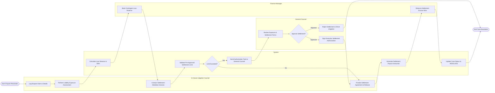

# Swimlane Diagram — Dispute Resolution Management System

## Mermaid Code

## Flow Description | Mô tả luồng

| Lane | Actor | Role in Flow |
|------|-------|-------------|
| 1 | In-House Litigation Counsel | Logs initial dispute claim, performs risk exposure analysis, conducts settlement negotiation sessions, and drafts final settlement release agreements. |
| 2 | System | Computes expected financial loss reserves, checks settlement authorization caps, routes executive sign-off tasks, triggers escrow wire tasks, and updates case audit history. |
| 3 | General Counsel | Reviews high-exposure dispute settlements, evaluates litigation strategy, grants executive approval or rejects settlements to proceed to court trial. |
| 4 | Finance Manager | Books GAAP/IFRS contingent loss reserves in corporate financial ledgers and executes wire payouts into third-party settlement escrow accounts. |
