# Action Tree — Dispute Resolution Management System

## Mermaid Code

```mermaid
graph TD
    Root["Dispute Resolution Management System"]

    Root --> M1["Dispute Claim Intake"]
    Root --> M2["Exposure & Loss Modeling"]
    Root --> M3["Mediation & Arbitration"]
    Root --> M4["Settlement & Escrow"]
    Root --> M5["Risk & Analytics Reporting"]

    M1 --> A1["Log New Commercial Dispute"]
    M1 --> A2["Classify Claim Forum Type"]
    M1 --> A3["Link Evidentiary Contracts"]
    M1 --> A4["Assign External Law Firm"]

    M2 --> B1["Calculate Expected Loss EMV"]
    M2 --> B2["Set Best & Worst Case Scenarios"]
    M2 --> B3["Track Legal Billing Accruals"]
    M2 --> B4["Submit GAAP Reserve Booking"]

    M3 --> C1["Log Offer & Counteroffer Cycles"]
    M3 --> C2["Schedule Mediation Hearing"]
    M3 --> C3["Record Tribunal Hearing Transcripts"]
    M3 --> C4["Archive Binding Arbitration Awards"]

    M4 --> D1["Draft Settlement Release Terms"]
    M4 --> D2["Request General Counsel Sign-Off"]
    M4 --> D3["Disburse Escrow Wire Payment"]
    M4 --> D4["Enforce Non-Disclosure Obligations"]

    M5 --> E1["Generate Executive Portfolio Scorecard"]
    M5 --> E2["Analyze External Counsel Win Rates"]
    M5 --> E3["Export Auditor Contingent Liability Report"]
    M5 --> E4["Track Insurance Claim Reimbursements"]
```

## Module Description | Mô tả Module

| # | Module | Description | Actions |
|---|--------|-------------|---------|
| 1 | Dispute Claim Intake | Centralized logging of commercial disputes, breach of contract notices, litigation forum classification, and external counsel retention. | Log New Commercial Dispute, Classify Claim Forum Type, Link Evidentiary Contracts, Assign External Law Firm |
| 2 | Exposure & Loss Modeling | Quantitative financial exposure estimation engine, legal fee tracking, and GAAP contingent loss reserve calculations. | Calculate Expected Loss EMV, Set Best & Worst Case Scenarios, Track Legal Billing Accruals, Submit GAAP Reserve Booking |
| 3 | Mediation & Arbitration | Negotiation offer tracking, mediation calendar management, tribunal transcript repository, and arbitration award logging. | Log Offer & Counteroffer Cycles, Schedule Mediation Hearing, Record Tribunal Hearing Transcripts, Archive Binding Arbitration Awards |
| 4 | Settlement & Escrow | Settlement agreement drafting, executive sign-off authorization, escrow wire payout execution, and NDA term enforcement. | Draft Settlement Release Terms, Request General Counsel Sign-Off, Disburse Escrow Wire Payment, Enforce Non-Disclosure Obligations |
| 5 | Risk & Analytics Reporting | Executive dispute risk scorecards, law firm billing efficiency analytics, auditor disclosure reports, and insurance recovery tracking. | Generate Executive Portfolio Scorecard, Analyze External Counsel Win Rates, Export Auditor Contingent Liability Report, Track Insurance Claim Reimbursements |
