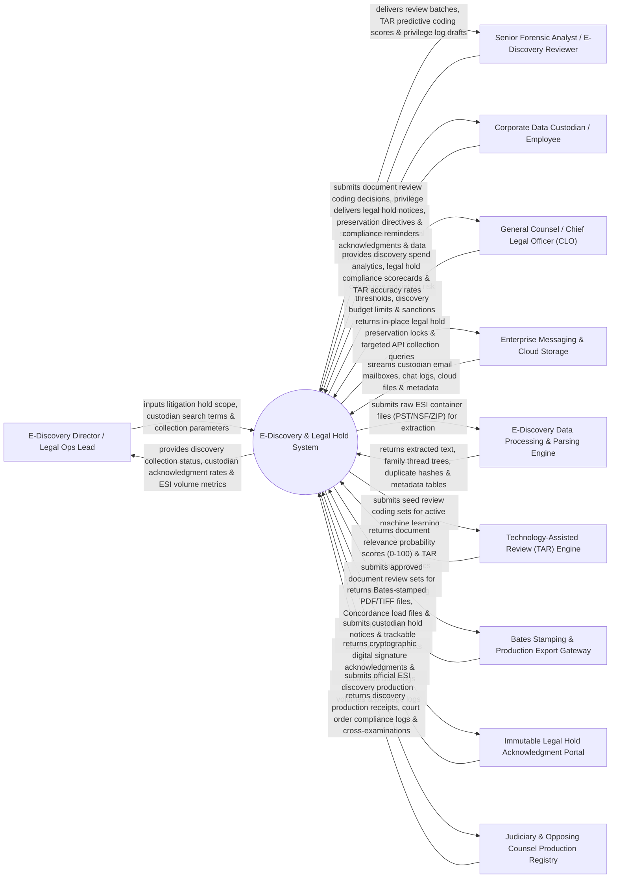

# Context Diagram — E-Discovery & Legal Hold System

## Mermaid Code

## Actor & Interaction Table | Bảng Actor & Tương tác

| # | Actor | Actor Type | Data Sent TO System | Data Received FROM System | Notes |
|---|-------|------------|---------------------|---------------------------|-------|
| 1 | E-Discovery Director / Legal Operations Lead | Primary | Legal hold scope definitions, custodian search keywords, date filters, targeted data collection rules. | Discovery collection status, custodian acknowledgment rates, Electronically Stored Information (ESI) volume metrics. | E-discovery director overseeing litigation holds, data collections, and discovery project budgets. |
| 2 | Senior Forensic Analyst / E-Discovery Reviewer | Primary | Document review coding decisions (Responsive / Non-Responsive), privilege tags, redaction masks, issue tags. | Review document batches, Technology-Assisted Review (TAR) predictive coding scores, privilege log drafts. | Forensic specialist reviewing collected documents, applying redactions, and coding for privilege. |
| 3 | Corporate Data Custodian / Employee | Primary | Legal hold digital acknowledgments, data location declarations, mobile device preservation verifications. | Legal hold notices, data preservation directives ("Do Not Delete"), re-certification prompts. | Employee holding relevant emails, files, or chat logs subject to a legally binding preservation order. |
| 4 | CLO | Primary | Spoliation risk thresholds, discovery budget caps, sanctions warnings, court order compliance targets. | Discovery spend analytics, legal hold compliance scorecards, TAR precision/recall accuracy rates, ESI cost metrics. | Executive monitoring spoliation risk, court sanctions prevention, and overall discovery expenditure. |
| 5 | Enterprise Messaging & Cloud Storage | Supporting | Custodian email mailboxes (Exchange / M365), Slack/Teams chat logs, Google Drive files, metadata. | In-place legal hold preservation locks via API, targeted data collection queries, custodian mailbox sync. | Enterprise IT systems (M365, Google Workspace, Slack) holding custodian ESI subject to preservation. |
| 6 | E-Discovery Data Processing & Parsing Engine | Supporting | Extracted text streams, email family thread trees, MD5/SHA-256 duplicate hashes, metadata tables. | Raw ESI container files (PST, MBOX, ZIP, MSG), OCR processing tasks, container extraction jobs. | Processing engine parsing complex ESI formats, de-duplicating files, and extracting metadata. |
| 7 | Technology-Assisted Review (TAR) Engine | Supporting | Document relevance probability scores (0 to 100), TAR elusion test results, precision/recall curves. | Seed review coding sets, active machine learning training iterations, statistical validation queries. | Machine learning TAR (predictive coding / CAL) engine prioritizing relevant documents for review. |
| 8 | Bates Stamping & Production Export Gateway | Supporting | Bates-stamped PDF/TIFF image files, Concordance OPT load files, DAT metadata files, extracted text files. | Approved document review sets, Bates prefix formatting parameters, redaction burn-in directives. | Export gateway generating official court discovery production packages with Bates numbers. |
| 9 | Immutable Legal Hold Acknowledgment Portal | Supporting | Cryptographic digital signature acknowledgments, custodian IP/timestamp audit logs, re-certification receipts. | Custodian hold notice emails, trackable portal magic links, automated escalation reminder payloads. | Secure portal collecting legally defensible digital acknowledgments from custodians. |
| 10 | Judiciary & Opposing Counsel Production Registry | Supporting / Regulatory | Discovery production receipts, court discovery order compliance logs, privilege log challenge notices. | Official ESI discovery production volumes, Bates range logs, privilege logs, production summaries. | External judiciary and opposing counsel receiving formal ESI discovery productions. |

## System Boundary Description | Mô tả Phạm vi Hệ thống

The **E-Discovery & Legal Hold System** is an enterprise legal hold automation, in-place data preservation, ESI processing, Technology-Assisted Review (TAR / Predictive Coding), and Bates-stamped discovery production platform built for EDRM compliance.

**Inside System Scope:**
- Automated legal hold notice issuance, custodian digital acknowledgment tracking, and 90-day re-certification.
- API-driven in-place electronic data preservation on Microsoft 365, Google Workspace, and Slack mailboxes/drives.
- ESI processing engine extracting email family threads, MD5 de-duplication, and OCR text extraction.
- Continuous Active Learning (CAL / TAR 2.0) machine learning engine scoring document responsiveness.
- Production export engine generating Bates-stamped PDF/TIFF files with burned-in redactions and Concordance load files.

**Outside System Scope:**
- Direct physical seizure of employee laptop hardware (handled by Corporate Forensic IT).
- Direct oral testimony during court depositions (handled by Trial Litigators).
- Direct physical hosting of court evidence vaults (handled by Judicial Clerks).
