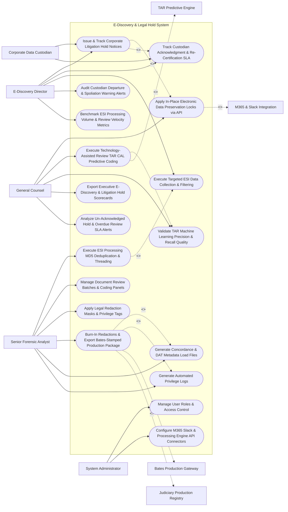

# Use Case Diagram — E-Discovery & Legal Hold System

## Mermaid Code

## Actor Table | Bảng Actor

| # | Actor | Actor Type | Role Description | Related Use Cases |
|---|-------|------------|------------------|-------------------|
| 1 | E-Discovery Director | Primary | Legal ops director issuing legal hold notices, tracking custodian acknowledgments, managing collections, and monitoring spoliation. | UC01, UC03, UC04, UC13, UC14 |
| 2 | Senior Forensic Analyst | Primary | E-discovery reviewer executing ESI processing, managing review batches, tagging privilege, burning in redactions, and exporting Bates files. | UC05, UC06, UC07, UC10, UC11, UC12 |
| 3 | Corporate Data Custodian | Primary | Employee receiving legal hold notices and submitting trackable digital acknowledgments. | UC01, UC03 |
| 4 | General Counsel | Primary | Executive approving in-place preservation, training TAR predictive coding models, validating recall accuracy, and viewing scorecards. | UC02, UC08, UC09, UC15, UC18 |
| 5 | System Administrator | Primary | IT admin managing user security roles, M365/Slack API credentials, and ESI processing workers. | UC16, UC17 |
| 6 | M365 & Slack Integration | System (Secondary) | Cloud APIs (Microsoft 365, Google Workspace, Slack) applying in-place email and file preservation holds. | UC02 |
| 7 | TAR Predictive Engine | System (Secondary) | Machine learning engine (Continuous Active Learning) prioritizing responsive documents for review. | UC08 |
| 8 | Bates Production Gateway | System (Secondary) | Production export engine generating Bates-stamped PDF/TIFF files and Concordance load files. | UC10 |
| 9 | Judiciary Production Registry | System (Secondary) | External court portal receiving official Bates-stamped discovery production packages and privilege logs. | UC10 |

## Use Case Table | Bảng Use Case

| # | UC ID | Use Case Name | Primary Actor | Secondary Actor | Description | Priority |
|---|-------|---------------|---------------|-----------------|-------------|----------|
| 1 | UC01 | Issue & Track Corporate Litigation Hold Notices | Director | None | Dispatches legally binding litigation hold notices to data custodians, tracking digital acknowledgments and re-certifications. | Critical |
| 2 | UC02 | Apply In-Place Electronic Data Preservation Locks via API | CLO | CloudStorage | Integrates with M365, Google Workspace, and Slack APIs to place in-place preservation locks on custodian mailboxes. | Critical |
| 3 | UC03 | Track Custodian Acknowledgment & Re-Certification SLA | Director | None | Monitors custodian acknowledgment SLAs (Target $< 48$ hours), sending automated escalation reminders to managers. | Critical |
| 4 | UC04 | Execute Targeted ESI Data Collection & Filtering | Director | None | Executes targeted keyword, date range, and custodian filter queries to collect relevant ESI data packages. | Critical |
| 5 | UC05 | Execute ESI Processing MD5 Deduplication & Threading | Analyst | None | Ingests ESI container files (PST/ZIP), executing MD5/SHA-256 de-duplication, email threading, and metadata extraction. | Critical |
| 6 | UC06 | Manage Document Review Batches & Coding Panels | Analyst | None | Distributes processed documents into review batches, providing custom coding panels for responsiveness and issue tagging. | High |
| 7 | UC07 | Apply Legal Redaction Masks & Privilege Tags | Analyst | None | Applies black-out redaction masks over PII, trade secrets, or un-related text, and tags attorney-client privilege. | Critical |
| 8 | UC08 | Execute Technology-Assisted Review TAR CAL Predictive Coding | CLO | TAREngine | Uses Continuous Active Learning (CAL) machine learning to score document responsiveness probability (0-100). | Critical |
| 9 | UC09 | Validate TAR Machine Learning Precision & Recall Quality | CLO | None | Evaluates statistical TAR quality control metrics (Elusion Testing, Richness %, Precision/Recall curves) for court defensibility. | High |
| 10 | UC10 | Burn-In Redactions & Export Bates-Stamped Production Package | Analyst | BatesGateway | Generates official discovery production packages, burning in redactions and applying sequential Bates stamps (`ACME-000001`). | Critical |
| 11 | UC11 | Generate Concordance & DAT Metadata Load Files | Analyst | None | Exports industry-standard Concordance OPT image load files and DAT metadata text files for trial software. | High |
| 12 | UC12 | Generate Automated Privilege Logs | Analyst | None | Auto-assembles court-compliant privilege logs (Bates Number, Author, Recipient, Date, Privilege Type, Legal Justification). | Critical |
| 13 | UC13 | Audit Custodian Departure & Spoliation Warning Alerts | Director | None | Triggers urgent alerts when a custodian on active legal hold submits HR resignation, preventing device wiping. | Critical |
| 14 | UC14 | Benchmark ESI Processing Volume & Review Velocity Metrics | Director | None | Measures total gigabytes processed, de-duplication efficiency %, review velocity (docs/hour), and unit cost. | High |
| 15 | UC15 | Export Executive E-Discovery & Litigation Hold Scorecards | CLO | None | Renders executive scorecards detailing active holds count, custodian acknowledgment %, TAR review velocity, and spend. | High |
| 16 | UC16 | Manage User Roles & Access Control | Admin | None | Controls user login credentials, RBAC permissions, and confidential discovery case file access rights. | High |
| 17 | UC17 | Configure M365 Slack & Processing Engine API Connectors | Admin | None | Configures API connection parameters for Microsoft 365 Compliance, Slack Enterprise Grid, and DTSearch. | High |
| 18 | UC18 | Analyze Un-Acknowledged Hold & Overdue Review SLA Alerts | CLO | None | Dispatches urgent notifications when a custodian hold remains un-acknowledged after 7 days or production is due in 48 hours. | High |

## Use Case Specification | Đặc tả Use Case

---

### UC02 — Apply In-Place Electronic Data Preservation Locks via API

| Field | Detail |
|-------|--------|
| **UC ID** | UC02 |
| **Use Case Name** | Apply In-Place Electronic Data Preservation Locks via API |
| **Actor(s)** | Primary: General Counsel / CLO, E-Discovery Director   Secondary: Enterprise Messaging & Cloud Storage (Microsoft 365 / Slack / Google Workspace APIs) |
| **Description** | Automates in-place electronic data preservation on custodian cloud accounts via REST APIs upon litigation hold issuance, suppressing automated email deletion and file auto-archiving. |
| **Precondition** | 1. Corporate litigation hold notice is issued (UC01).   2. Microsoft 365 Compliance / Google Workspace API connectors are authenticated. |
| **Main Flow** | 1. E-Discovery Director issues Litigation Hold `#HOLD-2026-88412` for Matter `Acme vs. Nexus`.   2. System retrieves target custodian list (25 Key Employees, e.g., `VP Engineering John Smith`).   3. System dispatches API payloads to Enterprise Messaging & Cloud Storage platforms:   &nbsp;&nbsp;&nbsp;&nbsp; a. Microsoft 365 Exchange Online API: Invokes `New-ComplianceHoldPolicy` to place John Smith's primary mailbox and archive on immutable Litigation Hold.   &nbsp;&nbsp;&nbsp;&nbsp; b. Microsoft OneDrive / SharePoint API: Applies preservation hold on John Smith's personal OneDrive site collection.   &nbsp;&nbsp;&nbsp;&nbsp; c. Slack Enterprise Grid API: Invokes Discovery API to apply Legal Hold on John Smith's direct messages and channel posts.   4. Cloud APIs return Preservation Lock Confirmations:   &nbsp;&nbsp;&nbsp;&nbsp; a. M365 Confirmation: `Exchange Hold Applied (Guid: e3b0c442...)`.   &nbsp;&nbsp;&nbsp;&nbsp; b. Slack Confirmation: `Slack Custodian Hold Active`.   5. System logs In-Place Preservation Audit Entry: `INPLACE_PRESERVATION_ACTIVE_CUSTODIAN_884`.   6. System monitors custodian data retention policies: If automated 90-day email deletion cron runs, M365 preserves deleted items in recoverable items folder without user awareness. |
| **Alternative Flow** | **AF1** — Google Workspace Vault Hold: Custodian uses Google Workspace; System dispatches API request to Google Vault API, applying Matter Hold on Gmail and Google Drive. |
| **Exception Flow** | **EX1** — API Authentication Revocation Error: M365 OAuth token expires; System logs preservation failure `PRESERVATION_FAILED_OAUTH_EXPIRED`, dispatching immediate SMS alert to IT Admin. |
| **Postcondition** | In-place preservation locks are applied across M365, Google, and Slack APIs, suppressing automated deletion for target custodians. |
| **Business Rule** | **BR1**: Issuing a legal hold MUST automatically trigger in-place electronic data preservation locks on cloud email and storage accounts via API. |

---

### UC05 — Execute ESI Processing MD5 Deduplication & Threading

| Field | Detail |
|-------|--------|
| **UC ID** | UC05 |
| **Use Case Name** | Execute ESI Processing MD5 Deduplication & Threading |
| **Actor(s)** | Primary: Senior Forensic Analyst   Secondary: E-Discovery Data Processing & Parsing Engine |
| **Description** | Ingests raw collected ESI container files (PST, MBOX, ZIP, MSG), extracting embedded attachments, calculating MD5/SHA-256 hashes for global de-duplication, and reconstructing email conversation threads. |
| **Precondition** | 1. Raw collected ESI container files (50 GB PST files) are uploaded to staging vault (UC04).   2. ESI processing engine workers are online. |
| **Main Flow** | 1. Analyst opens "ESI Processing Studio" and submits Data Intake Job: `Batch_Collection_PST_Oct2026` (50 GB, estimated 250,000 files).   2. System dispatches dataset to ESI Processing & Parsing Engine workers.   3. Processing Engine executes 4-Stage ESI Ingestion Pipeline:   &nbsp;&nbsp;&nbsp;&nbsp; a. Stage 1 (Container Unpacking & Text Extraction): Unpacks PST/ZIP archives, extracts text streams, and processes embedded attachments (Word, Excel, PDF).   &nbsp;&nbsp;&nbsp;&nbsp; b. Stage 2 (MD5 Hash Calculation): Computes unique MD5 hash for every file binary stream.   &nbsp;&nbsp;&nbsp;&nbsp; c. Stage 3 (Global De-Duplication): Identifies duplicate copies across custodians:   &nbsp;&nbsp;&nbsp;&nbsp; &nbsp;&nbsp;&nbsp;&nbsp; i. Total Ingested Files: 250,000.   &nbsp;&nbsp;&nbsp;&nbsp; &nbsp;&nbsp;&nbsp;&nbsp; ii. Unique Files: 110,000 (`140,000 Duplicates Suppressed` -> `56% Volume Reduction`).   &nbsp;&nbsp;&nbsp;&nbsp; d. Stage 4 (Email Threading & NIST De-NISTing): Filters out system files using NIST National Software Reference Library (NSRL) hash list and reconstructs email conversation threads (`Inclusive Email Identification`).   4. Processing Engine indexes extracted metadata (Sender, Recipient, Date, Subject, Attachment Count, MD5 Hash).   5. System renders ESI Processing Summary Dashboard (250k Raw Docs -> 95k Review-Ready Unique Documents).   6. System routes review-ready dataset to UC06 (Manage Review Batches) and UC08 (TAR Predictive Coding). |
| **Alternative Flow** | **AF1** — Custodian-Level Deduplication: Analyst configures custodian-level de-duplication (suppresses duplicates within individual custodian mailboxes while retaining duplicates across different custodians). |
| **Exception Flow** | **EX1** — Password-Protected Container Error: Processing engine encounters password-protected PST file `confidential_exec.pst`; Engine flags `ENCRYPTED_CONTAINER_EXCEPTION`, prompting analyst for decryption password. |
| **Postcondition** | Raw ESI is unpacked, MD5 hashes are calculated, 56% duplicates are suppressed, email threads are reconstructed, and review dataset renders. |
| **Business Rule** | **BR1**: ESI processing pipelines MUST execute MD5/SHA-256 de-duplication and NIST file filtering to minimize document review volume and costs. |

---

### UC08 — Execute Technology-Assisted Review (TAR / CAL Predictive Coding)

| Field | Detail |
|-------|--------|
| **UC ID** | UC08 |
| **Use Case Name** | Execute Technology-Assisted Review (TAR / CAL Predictive Coding) |
| **Actor(s)** | Primary: General Counsel / CLO, Senior Forensic Analyst   Secondary: Technology-Assisted Review (TAR) Engine (Continuous Active Learning) |
| **Description** | Leverages Continuous Active Learning (CAL / TAR 2.0) machine learning models to score un-reviewed documents based on responsiveness probability (0-100), prioritizing high-relevance documents for human review. |
| **Precondition** | 1. ESI dataset is processed and de-duplicated (UC05).   2. Expert human reviewer codes initial seed set of 500 documents (Responsive vs. Non-Responsive). |
| **Main Flow** | 1. General Counsel opens "TAR Predictive Coding Studio" for Matter `#MAT-88412` (Dataset: 95,000 unique documents).   2. Senior Attorney codes Initial Seed Set of 500 documents:   &nbsp;&nbsp;&nbsp;&nbsp; a. 120 Documents coded `RESPONSIVE`.   &nbsp;&nbsp;&nbsp;&nbsp; b. 380 Documents coded `NON_RESPONSIVE`.   3. System submits seed coding decisions to TAR Machine Learning Engine.   4. TAR Engine trains SVM / Naive Bayes Classification Model on text TF-IDF vector embeddings.   5. TAR Engine scores remaining 94,500 un-reviewed documents, assigning Responsiveness Probability Scores (Scale 0.0 to 100.0).   6. TAR Engine ranks documents in descending order of relevance.   7. System dispatches top 2,000 highest-probability documents (Scores $> 85.0$) into active human review batches (UC06).   8. As human reviewers code new documents, TAR Engine executes Continuous Active Learning (CAL) re-training loop, continuously refining scores across remaining un-reviewed pool.   9. System tracks Recall Curve: When review of high-scoring documents yields $< 2\%$ responsive hit rate, TAR Engine triggers UC09 (Validate TAR Quality Control), proving statistical review completion. |
| **Alternative Flow** | **AF1** — Issue-Based Predictive Coding: Analyst trains separate TAR models for specific litigation issues (e.g., Issue 1: Patent Infringement, Issue 2: Damages), scoring documents independently per issue. |
| **Exception Flow** | **EX1** — Low Model Precision Warning: Seed set coding is inconsistent (different attorneys coding similar docs differently); TAR Engine flags `LOW_MODEL_PRECISION_WARNING` (F1-Score $< 0.60$), requiring seed set reconciliation. |
| **Postcondition** | Un-reviewed documents are scored (0-100) using CAL machine learning, high-probability documents are prioritized for review, and recall curves update. |
| **Business Rule** | **BR1**: Technology-Assisted Review (TAR) models MUST utilize Continuous Active Learning (CAL) to continuously update document relevance rankings during review. |

---

### UC10 — Burn-In Redactions & Export Bates-Stamped Production Package

| Field | Detail |
|-------|--------|
| **UC ID** | UC10 |
| **Use Case Name** | Burn-In Redactions & Export Bates-Stamped Production Package |
| **Actor(s)** | Primary: Senior Forensic Analyst, General Counsel   Secondary: Bates Stamping & Production Export Gateway, Judiciary Production Registry |
| **Description** | Assembles final approved responsive document sets, applies permanent un-reversible burned-in redactions over sensitive text, stamps sequential Bates numbers (`ACME-000001`), and exports court-compliant production packages. |
| **Precondition** | 1. Document review is complete, responsive documents are coded, and redaction masks are applied (UC07).   2. Bates numbering prefix (`ACME`) and starting number (`000001`) are defined. |
| **Main Flow** | 1. Analyst opens "Discovery Production Export Studio" for Production `#PROD-2026-01`.   2. System retrieves Approved Production Review Set (12,500 Responsive Documents).   3. Analyst configures Production Export Parameters:   &nbsp;&nbsp;&nbsp;&nbsp; a. Bates Numbering Prefix: `ACME`.   &nbsp;&nbsp;&nbsp;&nbsp; b. Starting Bates Number: `ACME-000001`.   &nbsp;&nbsp;&nbsp;&nbsp; c. Output Image Format: Single-Page Black & White 300 DPI TIFF images + Searchable PDF.   &nbsp;&nbsp;&nbsp;&nbsp; d. Confidentiality Stamping: `CONFIDENTIAL - SUBJECT TO PROTECTIVE ORDER`.   4. System dispatches dataset to Bates Stamping & Production Export Gateway.   5. Export Gateway executes Production Processing:   &nbsp;&nbsp;&nbsp;&nbsp; a. Redaction Burn-In: Permanently rasterizes black redaction boxes onto image pixels, completely removing underlying text from TIFF image and extracted text layer.   &nbsp;&nbsp;&nbsp;&nbsp; b. Bates Stamping: Stamps `ACME-000001` to `ACME-045120` on bottom-right corner of all 45,120 pages.   &nbsp;&nbsp;&nbsp;&nbsp; c. Load File Generation: Generates Concordance OPT image load file and DAT metadata load file (UC11).   6. Export Gateway compiles Production Package ZIP (`Production_ACME_01.zip` - 18 GB).   7. System logs Production Volume Receipt: `12,500 Documents | 45,120 Pages | Bates Range ACME-000001 to ACME-045120`.   8. System triggers UC12 (Generate Automated Privilege Logs) and dispatches production package to Judiciary Production Registry. |
| **Alternative Flow** | **AF1** — Native Electronic Production: Opposing counsel requests native Excel files; System exports native `.xlsx` files with companion Bates-stamped placeholder TIFF slips (`ACME-000100 - NATIVE EXCEL FILE`). |
| **Exception Flow** | **EX1** — Un-Burned Redaction Security Warning: System detects un-rasterized text underneath redaction mask; Gateway halts export (`CRITICAL_SECURITY_HALT`), preventing accidental disclosure of redacted PII. |
| **Postcondition** | Redactions are permanently burned in, sequential Bates stamps are applied to all pages, load files generate, and production package exports. |
| **Business Rule** | **BR1**: Discovery production exports MUST permanently burn in redactions, ensuring redacted underlying text cannot be extracted or un-masked. |

---

### UC12 — Generate Automated Privilege Logs

| Field | Detail |
|-------|--------|
| **UC ID** | UC12 |
| **Use Case Name** | Generate Automated Privilege Logs |
| **Actor(s)** | Primary: Senior Forensic Analyst, General Counsel   Secondary: None |
| **Description** | Auto-compiles court-compliant legal privilege logs from documents tagged as Attorney-Client Privilege or Work Product, extracting Bates numbers, authors, recipients, dates, privilege grounds, and justification descriptions. |
| **Precondition** | 1. Document review is complete and privileged documents are tagged (UC07).   2. Bates numbers are assigned to companion production documents (UC10). |
| **Main Flow** | 1. Analyst opens "Privilege Log Generator Desk" for Production `#PROD-2026-01`.   2. System retrieves all documents tagged `ATTORNEY_CLIENT_PRIVILEGE` or `WORK_PRODUCT_PRIVILEGE` (Total: 450 Privileged Documents withheld from production).   3. System extracts Metadata Parameters for Privilege Log Table:   &nbsp;&nbsp;&nbsp;&nbsp; a. Document ID / Control #: `ACME-PRIV-00012`.   &nbsp;&nbsp;&nbsp;&nbsp; b. Document Date: `August 14, 2025`.   &nbsp;&nbsp;&nbsp;&nbsp; c. Author: `Sarah Jenkins (Chief Patent Counsel)`.   &nbsp;&nbsp;&nbsp;&nbsp; d. Recipients: `John Doe (VP Engineering), Dave Miller (CFO)`.   &nbsp;&nbsp;&nbsp;&nbsp; e. Document Type: `Email with Attached Strategy Memorandum`.   &nbsp;&nbsp;&nbsp;&nbsp; f. Privilege Claimed: `Attorney-Client Privilege & Work Product Doctrine`.   4. System generates AI-Assisted Privilege Justification Narrative:   &nbsp;&nbsp;&nbsp;&nbsp; a. Narrative: *"Confidential communication between corporate counsel and executive management seeking legal advice regarding patent infringement exposure and litigation strategy."*   5. Analyst reviews justification narratives, approves privilege log table, and exports Privilege Log Excel/PDF File (`Privilege_Log_ACME_01.xlsx`).   6. System attaches Privilege Log to court discovery production submission (UC10). |
| **Alternative Flow** | **AF1** — Redacted Privilege Log Entry: Document is produced in part with redactions; Privilege log entry lists Bates Number `ACME-001402`, detailing legal justification for redacted paragraph. |
| **Exception Flow** | **EX1** — Missing Attorney Recipient Warning: Document tagged Attorney-Client Privilege contains no registered attorney in Author/Recipient fields; System flags `PRIVILEGE_WITHOUT_ATTORNEY_WARNING`, prompting analyst review. |
| **Postcondition** | Court-compliant privilege log table is auto-assembled, justification narratives are generated, analyst approves, and log exports alongside production. |
| **Business Rule** | **BR1**: Privilege logs MUST contain explicit document metadata (Date, Author, Recipient, Bates #) and specific legal grounds for withholding documents under court rules. |
