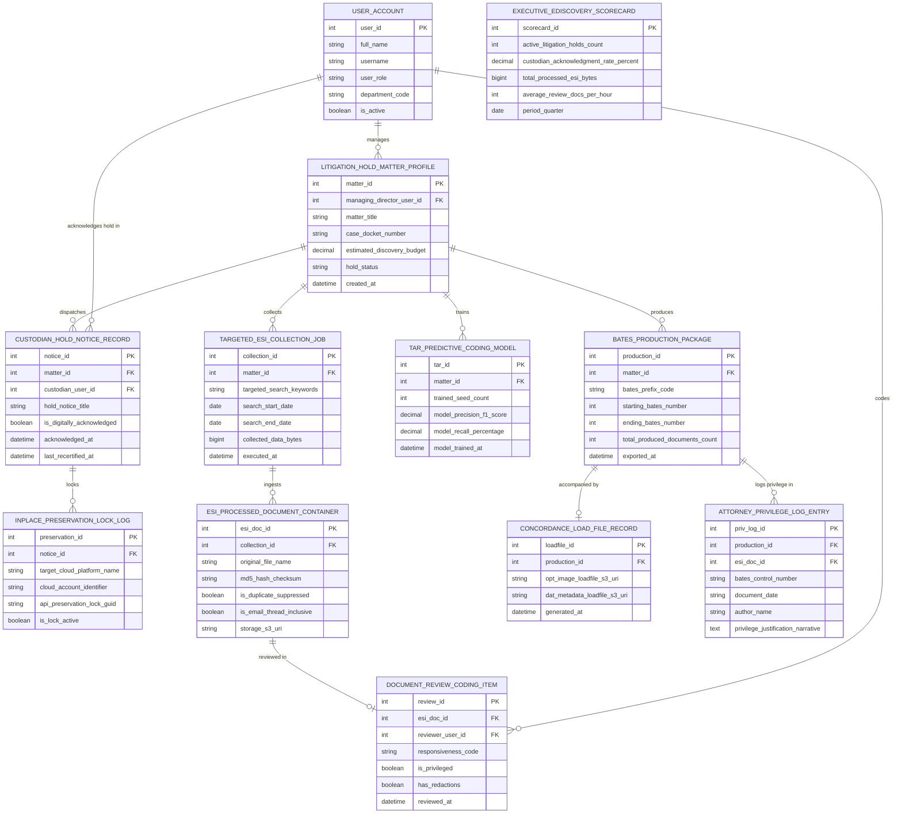

# Conceptual ERD — E-Discovery & Legal Hold System

## Mermaid Code

## Entity Description Table | Bảng mô tả Entity

| # | Entity Name | Vietnamese Name | Description | Key Attributes | Main Relationships |
|---|-------------|-----------------|-------------|----------------|-------------------|
| 1 | USER_ACCOUNT | Tài khoản Nguời dùng | System credentials and access roles for e-discovery directors, forensic analysts, custodians, and admins. | `user_id`, `username`, `user_role`, `department_code` | Manages `LITIGATION_HOLD_MATTER_PROFILE`, acknowledges hold in `CUSTODIAN_HOLD_NOTICE_RECORD`, codes `DOCUMENT_REVIEW_CODING_ITEM`. |
| 2 | LITIGATION_HOLD_MATTER_PROFILE | Profile Matter Litigation Hold | Central litigation hold matter record tracking matter titles, docket numbers, discovery budgets, and hold status (`ACTIVE/RELEASED`). | `matter_id`, `managing_director_user_id`, `matter_title`, `case_docket_number`, `estimated_discovery_budget`, `hold_status` | Dispatches `CUSTODIAN_HOLD_NOTICE_RECORD`, collects `TARGETED_ESI_COLLECTION_JOB`, trains `TAR_PREDICTIVE_CODING_MODEL`, produces `BATES_PRODUCTION_PACKAGE`, managed by `USER_ACCOUNT`. |
| 3 | CUSTODIAN_HOLD_NOTICE_RECORD | Bản ghi Hold Notice Custodian | Custodian legal hold notice record tracking digital signature acknowledgments, acknowledgment timestamps, and 90-day re-certifications. | `notice_id`, `matter_id`, `custodian_user_id`, `hold_notice_title`, `is_digitally_acknowledged`, `acknowledged_at`, `last_recertified_at` | Belongs to `LITIGATION_HOLD_MATTER_PROFILE`, locks `INPLACE_PRESERVATION_LOCK_LOG`, acknowledged by `USER_ACCOUNT`. |
| 4 | INPLACE_PRESERVATION_LOCK_LOG | Nhật ký Lock In-Place Preservation | Cloud API in-place electronic data preservation log tracking platform (M365/Slack/Google), account IDs, and preservation lock GUIDs. | `preservation_id`, `notice_id`, `target_cloud_platform_name`, `cloud_account_identifier`, `api_preservation_lock_guid`, `is_lock_active` | Belongs to `CUSTODIAN_HOLD_NOTICE_RECORD`. |
| 5 | TARGETED_ESI_COLLECTION_JOB | Job Collection ESI Mục tiêu | Targeted ESI data collection job recording search keywords, date range filters, collected byte counts, and execution timestamps. | `collection_id`, `matter_id`, `targeted_search_keywords`, `search_start_date`, `search_end_date`, `collected_data_bytes` | Belongs to `LITIGATION_HOLD_MATTER_PROFILE`, ingests `ESI_PROCESSED_DOCUMENT_CONTAINER`. |
| 6 | ESI_PROCESSED_DOCUMENT_CONTAINER | Container Document ESI Đã xử lý | ESI document processing record storing original file names, MD5 hashes, duplicate suppression flags, and email thread inclusive flags. | `esi_doc_id`, `collection_id`, `original_file_name`, `md5_hash_checksum`, `is_duplicate_suppressed`, `is_email_thread_inclusive` | Belongs to `TARGETED_ESI_COLLECTION_JOB`, reviewed in `DOCUMENT_REVIEW_CODING_ITEM`. |
| 7 | DOCUMENT_REVIEW_CODING_ITEM | Mục Coding Review Document | Document review coding log recording reviewer user ID, responsiveness status (`RESPONSIVE/NON_RESPONSIVE`), privilege flags, and redaction flags. | `review_id`, `esi_doc_id`, `reviewer_user_id`, `responsiveness_code`, `is_privileged`, `has_redactions`, `reviewed_at` | Belongs to `ESI_PROCESSED_DOCUMENT_CONTAINER`, coded by `USER_ACCOUNT`. |
| 8 | TAR_PREDICTIVE_CODING_MODEL | Model Predictive Coding TAR | Technology-Assisted Review (TAR / CAL) machine learning model record tracking trained seed counts, F1-score precision, and recall %. | `tar_id`, `matter_id`, `trained_seed_count`, `model_precision_f1_score`, `model_recall_percentage` | Belongs to `LITIGATION_HOLD_MATTER_PROFILE`. |
| 9 | BATES_PRODUCTION_PACKAGE | Package Production Bates | Discovery production export package recording Bates prefix codes (`ACME`), starting/ending Bates numbers, and produced document counts. | `production_id`, `matter_id`, `bates_prefix_code`, `starting_bates_number`, `ending_bates_number`, `total_produced_documents_count` | Belongs to `LITIGATION_HOLD_MATTER_PROFILE`, accompanied by `CONCORDANCE_LOAD_FILE_RECORD`, logs privilege in `ATTORNEY_PRIVILEGE_LOG_ENTRY`. |
| 10 | CONCORDANCE_LOAD_FILE_RECORD | File Load Concordance & DAT | Production load file record storing Concordance OPT image load file S3 URIs and DAT metadata load file S3 URIs. | `loadfile_id`, `production_id`, `opt_image_loadfile_s3_uri`, `dat_metadata_loadfile_s3_uri` | Belongs to `BATES_PRODUCTION_PACKAGE`. |
| 11 | ATTORNEY_PRIVILEGE_LOG_ENTRY | Mục Entry Log Privilege | Court-compliant privilege log entry recording Bates control numbers, document dates, authors, and privilege justification narratives. | `priv_log_id`, `production_id`, `esi_doc_id`, `bates_control_number`, `document_date`, `author_name`, `privilege_justification_narrative` | Belongs to `BATES_PRODUCTION_PACKAGE` and `ESI_PROCESSED_DOCUMENT_CONTAINER`. |
| 12 | EXECUTIVE_EDISCOVERY_SCORECARD | Scorecard Executive E-Discovery | Executive e-discovery scorecard aggregating active litigation holds, custodian acknowledgment rates %, processed ESI bytes, and review velocity. | `scorecard_id`, `active_litigation_holds_count`, `custodian_acknowledgment_rate_percent`, `total_processed_esi_bytes`, `average_review_docs_per_hour` | Standalone executive performance entity. |

## Relationship Description | Mô tả Quan hệ

| # | From Entity | Cardinality | To Entity | Label | Business Explanation |
|---|-------------|-------------|-----------|-------|----------------------|
| 1 | LITIGATION_HOLD_MATTER_PROFILE | 1 to 0..N | CUSTODIAN_HOLD_NOTICE_RECORD | dispatches | A litigation hold matter profile dispatches custodian hold notice records. |
| 2 | LITIGATION_HOLD_MATTER_PROFILE | 1 to 0..N | TARGETED_ESI_COLLECTION_JOB | collects | A litigation hold matter profile collects targeted ESI data collection jobs. |
| 3 | LITIGATION_HOLD_MATTER_PROFILE | 1 to 0..N | TAR_PREDICTIVE_CODING_MODEL | trains | A litigation hold matter profile trains TAR predictive coding models. |
| 4 | LITIGATION_HOLD_MATTER_PROFILE | 1 to 0..N | BATES_PRODUCTION_PACKAGE | produces | A litigation hold matter profile produces Bates-stamped production packages. |
| 5 | CUSTODIAN_HOLD_NOTICE_RECORD | 1 to 0..N | INPLACE_PRESERVATION_LOCK_LOG | locks | A custodian hold notice record locks cloud accounts via in-place preservation logs. |
| 6 | TARGETED_ESI_COLLECTION_JOB | 1 to 0..N | ESI_PROCESSED_DOCUMENT_CONTAINER | ingests | A targeted ESI collection job ingests ESI processed document containers. |
| 7 | ESI_PROCESSED_DOCUMENT_CONTAINER | 1 to 0..1 | DOCUMENT_REVIEW_CODING_ITEM | reviewed in | An ESI processed document container is reviewed in document review coding items. |
| 8 | BATES_PRODUCTION_PACKAGE | 1 to 1 | CONCORDANCE_LOAD_FILE_RECORD | accompanied by | A Bates production package is accompanied by Concordance load files. |
| 9 | BATES_PRODUCTION_PACKAGE | 1 to 0..N | ATTORNEY_PRIVILEGE_LOG_ENTRY | logs privilege in | A Bates production package logs withheld documents in privilege log entries. |
| 10 | USER_ACCOUNT | 1 to 0..N | LITIGATION_HOLD_MATTER_PROFILE | manages | An e-discovery director user account manages litigation hold matter profiles. |
| 11 | USER_ACCOUNT | 1 to 0..N | CUSTODIAN_HOLD_NOTICE_RECORD | acknowledges hold in | A custodian employee user account acknowledges hold notice records. |
| 12 | USER_ACCOUNT | 1 to 0..N | DOCUMENT_REVIEW_CODING_ITEM | codes | A forensic analyst user account codes document review items. |
