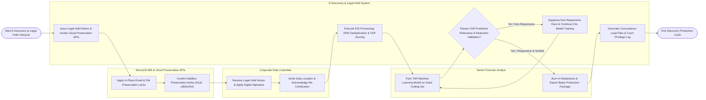

# Swimlane Diagram — E-Discovery & Legal Hold System

## Mermaid Code

## Flow Description | Mô tả luồng

| Lane | Actor | Role in Flow |
|------|-------|-------------|
| 1 | Corporate Data Custodian | Receives legally binding litigation hold notices, applies trackable digital signatures, verifies data storage locations, and completes periodic re-certifications. |
| 2 | Senior Forensic Analyst | Codes initial seed sets for Technology-Assisted Review (TAR / CAL), reviews high-probability responsive documents, applies redaction masks, burns in redactions, and exports Bates production packages. |
| 3 | E-Discovery & Legal Hold System | Dispatches legal hold notices, invokes cloud preservation APIs, processes raw ESI containers (MD5 de-duplication, email threading), scores document responsiveness via Continuous Active Learning (CAL 0-100), validates redaction burn-in security, generates Concordance load files, and compiles privilege logs. |
| 4 | Microsoft 365 & Cloud Preservation APIs | Accepts API in-place preservation commands (`New-ComplianceHoldPolicy`), applies mailbox and OneDrive locks, and preserves deleted items without user awareness. |
