# Action Tree — E-Discovery & Legal Hold System

## Mermaid Code

```mermaid
graph TD
    Root["E-Discovery & Legal Hold System"]

    Root --> M1["Legal Hold Notices & In-Place Preservation"]
    Root --> M2["ESI Processing, MD5 Deduplication & Threading"]
    Root --> M3["Technology-Assisted Review (TAR / CAL)"]
    Root --> M4["Document Review, Redactions & Privilege Tags"]
    Root --> M5["Bates Stamping & Concordance Load File Export"]
    Root --> M6["Privilege Logs, Audit Trails & Executive Scorecards"]

    M1 --> A11["Issue Corporate Litigation Hold Notices with Trackable Magic Links"]
    M1 --> A12["Collect Cryptographic Custodian Digital Signature Acknowledgments"]
    M1 --> A13["Apply In-Place Preservation Locks via M365 & Slack APIs"]
    M1 --> A14["Trigger Custodian Departure & HR Resignation Spoliation Warning Alerts"]

    M2 --> A21["Ingest Raw ESI Container Files (PST, MBOX, ZIP, MSG)"]
    M2 --> A22["Execute MD5/SHA-256 Hash Calculation & De-Duplication"]
    M2 --> A23["Filter System Files using NIST National Software Reference Library"]
    M2 --> A24["Reconstruct Email Conversation Threads & Inclusive Message Trees"]

    M3 --> A31["Train Continuous Active Learning (CAL / TAR 2.0) Machine Learning Models"]
    M3 --> A32["Score Un-Reviewed Document Responsiveness Probability (Scale 0 to 100)"]
    M3 --> A33["Prioritize High-Probability Responsive Documents for Human Review"]
    M3 --> A34["Validate TAR Quality Control via Elusion Testing & Recall Curves"]

    M4 --> A41["Distribute Processed Documents into Custom Review Batches"]
    M4 --> A42["Apply Black-Out Redaction Masks over PII & Un-Related Text"]
    M4 --> A43["Tag Documents for Attorney-Client Privilege & Work Product Flags"]
    M4 --> A44["Enforce Redaction Burn-In Security Rules to Prevent Text Leaks"]

    M5 --> A51["Assign Sequential Bates Prefix Codes & Image Page Numbers (ACME-000001)"]
    M5 --> A52["Permanently Burn In Redaction Masks onto TIFF Image Pixels"]
    M5 --> A53["Generate Concordance OPT Image Load Files & DAT Metadata Load Files"]
    M5 --> A54["Export Production Packages to Judiciary & Opposing Counsel Portals"]

    M6 --> A61["Auto-Compile Court-Compliant Privilege Log Tables & Justifications"]
    M6 --> A62["Maintain Immutable ESI Processing, Review & Export Audit Trails"]
    M6 --> A63["Benchmark Discovery Processing Volume, Review Velocity & Unit Cost"]
    M6 --> A64["Export Executive E-Discovery, Legal Hold & Spend Scorecard PDFs"]
```

## Module Description | Mô tả Module

| # | Module | Description | Actions |
|---|--------|-------------|---------|
| 1 | Legal Hold Notices & In-Place Preservation | Dispatches litigation hold notices, collects digital signature acknowledgments, applies in-place M365/Slack API preservation locks, and triggers spoliation alerts. | Issue Corporate Litigation Hold Notices, Collect Custodian Digital Signature Acknowledgments, Apply In-Place Preservation Locks via API, Trigger Custodian Departure Spoliation Alerts. |
| 2 | ESI Processing, MD5 Deduplication & Threading | Ingests PST/ZIP containers, calculates MD5 hashes, suppresses duplicate files, filters NIST system files, and reconstructs email conversation threads. | Ingest Raw ESI Container Files, Execute MD5 Hash De-Duplication, Filter System Files using NIST NSRL, Reconstruct Email Conversation Threads. |
| 3 | Technology-Assisted Review (TAR / CAL) | Trains Continuous Active Learning (CAL) ML models, scores document responsiveness probability (0-100), prioritizes review batches, and validates recall curves. | Train CAL Machine Learning Models, Score Document Responsiveness Probability, Prioritize High-Probability Documents for Review, Validate TAR Quality via Elusion Testing. |
| 4 | Document Review, Redactions & Privilege Tags | Distributes review batches, applies black-out redaction masks over PII, tags attorney-client privilege, and enforces redaction burn-in security. | Distribute Documents into Custom Review Batches, Apply Black-Out Redaction Masks over PII, Tag Attorney-Client Privilege Flags, Enforce Redaction Burn-In Security Rules. |
| 5 | Bates Stamping & Concordance Load File Export | Stamps sequential Bates numbers (`ACME-000001`), permanently burns in redactions onto TIFF pixels, generates Concordance OPT/DAT load files, and exports packages. | Assign Sequential Bates Prefix & Page Numbers, Permanently Burn In Redactions onto TIFF Pixels, Generate Concordance OPT/DAT Load Files, Export Production Packages to Portals. |
| 6 | Privilege Logs, Audit Trails & Executive Scorecards | Auto-compiles privilege log tables with justification narratives, logs immutable processing/export audit trails, benchmarks review velocity, and exports scorecards. | Auto-Compile Court Privilege Log Tables & Justifications, Maintain Immutable Processing & Export Audit Trails, Benchmark Review Velocity & ESI Unit Costs, Export Executive E-Discovery Scorecard PDFs. |
