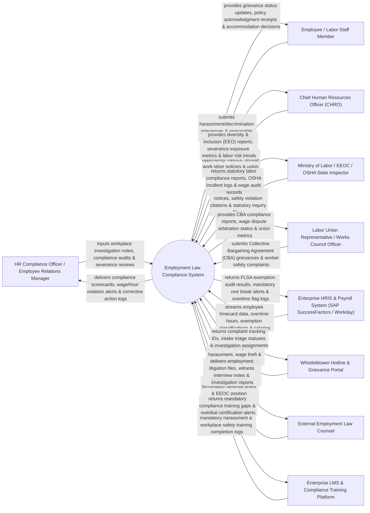

# Context Diagram — Employment Law Compliance System

## Mermaid Code

## Actor & Interaction Table | Bảng Actor & Tương tác

| # | Actor | Actor Type | Data Sent TO System | Data Received FROM System | Notes |
|---|-------|------------|---------------------|---------------------------|-------|
| 1 | HR Compliance Officer / Employee Relations Manager | Primary | Workplace investigation notes, labor compliance audits, severance reviews, corrective action plans. | Compliance scorecards, wage/hour violation alerts, corrective action tracking logs. | Specialist managing labor law compliance, workplace investigations, and employee relations. |
| 2 | Employee / Labor Staff Member | Primary | Harassment/discrimination grievances, reasonable accommodation requests, policy sign-offs. | Grievance status updates, policy acknowledgment receipts, accommodation decision letters. | Corporate staff member submitting workplace grievances or requesting accommodation. |
| 3 | Chief Human Resources Officer (CHRO) | Primary | Equal opportunity policies, remote work labor rules, collective bargaining terms, risk limits. | Diversity & inclusion (EEO) reports, severance exposure metrics, global labor compliance KPIs. | HR executive monitoring corporate labor law compliance, EEO metrics, and union relations. |
| 4 | Ministry of Labor / EEOC / OSHA State Inspector | Supporting / Regulatory | Labor inspection notices, safety violation citations, statutory inquiry requests, audit directives. | Statutory labor compliance reports, OSHA incident logs, FLSA wage audit records, EEO-1 filings. | Government regulatory body enforcing labor laws, equal employment opportunity, and workplace safety. |
| 5 | Labor Union Representative / Works Council Officer | Supporting | Collective Bargaining Agreement (CBA) grievances, worker safety complaints, arbitration demands. | CBA compliance reports, wage dispute arbitration status, union worker metrics. | Representative advocating for labor union members under collective bargaining agreements. |
| 6 | Enterprise HRIS & Payroll System | Supporting | Employee timecard data, overtime hours, FLSA exemption classifications, salary ledgers. | FLSA exemption audit results, mandatory rest break alerts, overtime calculation flag logs. | Core HRIS platform (Workday / SAP) providing employee master records and time tracking data. |
| 7 | Whistleblower Hotline & Grievance Portal | Supporting | Anonymous harassment reports, wage theft complaints, unsafe working condition alerts. | Complaint tracking IDs, intake triage statuses, investigation assignment notifications. | External intake portal capturing confidential and anonymous employee compliance complaints. |
| 8 | External Employment Law Counsel | Supporting | Wrongful termination defense briefs, EEOC position statements, labor arbitration motions. | Employment litigation files, witness interview notes, investigation summary reports. | Outside legal counsel retained for employment discrimination or wrongful termination defense. |
| 9 | Enterprise LMS & Compliance Training Platform | Supporting | Employee mandatory harassment training logs, OSHA safety module completion records. | Mandatory compliance training gaps, overdue certification alerts, compliance completion metrics. | Corporate Learning Management System (LMS) tracking mandatory labor policy training completion. |

## System Boundary Description | Mô tả Phạm vi Hệ thống

The **Employment Law Compliance System** is an enterprise labor law audit, employee grievance investigation, Fair Labor Standards Act (FLSA) wage/hour compliance, Equal Employment Opportunity (EEO) tracking, and workplace safety (OSHA) management platform.

**Inside System Scope:**
- Centralized tracking of employee discrimination, harassment, and retaliation grievance investigations.
- FLSA/Labor Code exemption classification auditing (exempt vs non-exempt staff status) and overtime rules.
- Equal Employment Opportunity (EEO-1) and affirmative action workforce metric reporting.
- Occupational Safety & Health (OSHA 300) incident logging and Corrective Action Plan (CAP) tracking.
- Union Collective Bargaining Agreement (CBA) term compliance and labor inspection portal integration.

**Outside System Scope:**
- Direct bi-weekly employee salary payroll calculation (handled by Enterprise Payroll System).
- Direct physical delivery of workplace safety equipment (handled by Facilities & Environmental Safety).
- Direct conduct of in-person employee performance appraisal meetings (handled by HR Talent Management).
