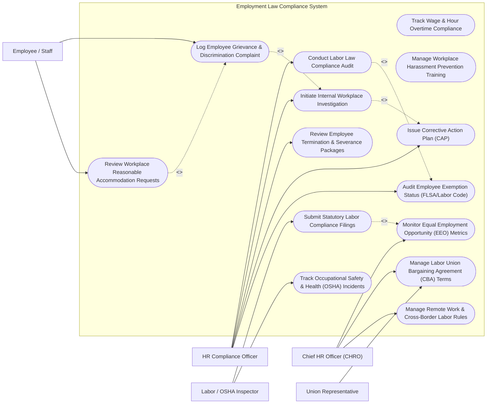

# Use Case Diagram — Employment Law Compliance System

## Mermaid Code

## Actor Table | Bảng Actor

| # | Actor | Actor Type | Role Description | Related Use Cases |
|---|-------|------------|------------------|-------------------|
| 1 | HR Compliance Officer | Primary | Conducts labor audits, manages internal investigations, audits FLSA exemptions, and issues corrective action plans. | UC01, UC03, UC07, UC11, UC13 |
| 2 | Employee / Staff | Primary | Submits workplace grievances, discrimination complaints, harassment reports, and accommodation requests. | UC02, UC14 |
| 3 | Chief HR Officer (CHRO) | Primary | Reviews EEO workforce metrics, oversees union bargaining agreement compliance, and approves remote work policies. | UC06, UC08, UC12 |
| 4 | Labor / OSHA Inspector | Supporting / Regulatory | Inspects workplace safety compliance, reviews statutory labor filings, and audits OSHA 300 logs. | UC09, UC10 |
| 5 | Union Representative | Secondary | Reviews Collective Bargaining Agreement (CBA) adherence and advocates for union worker rights. | UC08 |

## Use Case Table | Bảng Use Case

| # | UC ID | Use Case Name | Primary Actor | Secondary Actor | Description | Priority |
|---|-------|---------------|---------------|-----------------|-------------|----------|
| 1 | UC01 | Conduct Labor Law Compliance Audit | HR Compliance Officer | Labor Inspector | Performs periodic internal audits of workplace posters, labor practices, break compliance, and employee records. | High |
| 2 | UC02 | Log Employee Grievance & Discrimination Complaint | Employee | HR Compliance Officer | Enables employees to confidentially report harassment, discrimination, retaliation, or workplace misconduct. | High |
| 3 | UC03 | Initiate Internal Workplace Investigation | HR Compliance Officer | External Counsel | Tracks workplace investigation steps, witness interviews, evidence gathering, and investigation summary findings. | High |
| 4 | UC04 | Track Wage & Hour Overtime Compliance | HR Compliance Officer | HRIS Payroll | Monitors employee timecards for mandatory meal/rest break compliance and overtime pay accuracy. | High |
| 5 | UC05 | Manage Workplace Harassment Prevention Training | HR Compliance Officer | Training LMS | Audits mandatory anti-harassment training completion rates to ensure statutory state compliance. | Medium |
| 6 | UC06 | Monitor Equal Employment Opportunity (EEO) Metrics | CHRO | Labor Inspector | Tracks workforce diversity statistics, gender pay equity metrics, and generates annual EEO-1 reports. | High |
| 7 | UC07 | Review Employee Termination & Severance Packages | HR Compliance Officer | CHRO | Audits involuntary termination justifications, severance release waivers, and ADEA compliance rules. | High |
| 8 | UC08 | Manage Labor Union Bargaining Agreement (CBA) Terms | CHRO | Union Representative | Tracks terms, seniority rules, grievance arbitration steps, and wage progression under active union contracts. | Medium |
| 9 | UC09 | Submit Statutory Labor Compliance Filings | Labor Inspector | HR Compliance Officer | Submits statutory reports (EEO-1, VETS-4212, OSHA 300A) directly to federal/state labor portals. | High |
| 10 | UC10 | Track Occupational Safety & Health (OSHA) Incidents | Labor Inspector | HR Compliance Officer | Logs workplace injuries, illness reports, lost workday counts, and maintains digital OSHA 300 logs. | High |
| 11 | UC11 | Issue Corrective Action Plan (CAP) | HR Compliance Officer | Employee | Defines mandatory remedial measures, disciplinary warnings, or retraining steps following an investigation. | High |
| 12 | UC12 | Manage Remote Work & Cross-Border Labor Rules | CHRO | HR Compliance Officer | Tracks local labor law compliance, tax nexus rules, and statutory benefits for out-of-state/remote workers. | Medium |
| 13 | UC13 | Audit Employee Exemption Status (FLSA/Labor Code) | HR Compliance Officer | HRIS Payroll | Evaluates job descriptions and salary thresholds against FLSA duties tests to classify exempt vs non-exempt status. | High |
| 14 | UC14 | Review Workplace Reasonable Accommodation Requests | Employee | HR Compliance Officer | Evaluates ADA disability accommodation requests, interactive process notes, and medical doctor certifications. | Medium |

## Use Case Specification | Đặc tả Use Case

---

### UC01 — Conduct Labor Law Compliance Audit

| Field | Detail |
|-------|--------|
| **UC ID** | UC01 |
| **Use Case Name** | Conduct Labor Law Compliance Audit |
| **Actor(s)** | Primary: HR Compliance Officer   Secondary: Labor Inspector |
| **Description** | Conducts comprehensive internal audits of corporate employment practices, mandatory poster displays, record retention, and statutory labor law compliance. |
| **Precondition** | 1. HR Compliance Officer is authorized to access corporate compliance audit modules.   2. Statutory labor audit checklists (Federal / State / Local) are updated. |
| **Main Flow** | 1. HR Compliance Officer initiates new "Labor Law Compliance Audit".   2. System prompts for location jurisdiction (e.g., California, New York, Texas) and business unit scope.   3. System loads active statutory compliance checklist (Wage/Hour Posters, Minor Employee Rules, Personnel File Retention).   4. Officer inspects facility records and inputs compliance status for each checklist item.   5. System flags any non-compliant items and calculates overall Labor Risk Score.   6. Officer generates Labor Audit Summary Report with recommended remediation actions. |
| **Alternative Flow** | **AF1** — Multi-State Branch Audit: System generates side-by-side compliance gap comparison for multi-state branch locations. |
| **Exception Flow** | **EX1** — Critical Non-Compliance Flag: If severe violation (e.g., minor worker overtime violation) is detected, system escalates instant alert to CHRO. |
| **Postcondition** | Labor audit report is recorded and compliance remediation tasks are assigned. |
| **Business Rule** | **BR1**: Facilities must undergo an internal labor compliance audit at least once every 12 months. |

---

### UC02 — Log Employee Grievance & Discrimination Complaint

| Field | Detail |
|-------|--------|
| **UC ID** | UC02 |
| **Use Case Name** | Log Employee Grievance & Discrimination Complaint |
| **Actor(s)** | Primary: Employee / Staff   Secondary: HR Compliance Officer |
| **Description** | Provides a secure, confidential portal for employees to submit grievances regarding discrimination, harassment, retaliation, or hostile work environment. |
| **Precondition** | 1. Employee has access to corporate compliance portal or anonymous whistleblower web form. |
| **Main Flow** | 1. Employee opens "Workplace Grievance & Misconduct Portal".   2. System prompts for complaint details (Category [Harassment, Discrimination, Wage Theft], Incident Date, Location, Accused Party, Witnesses).   3. Employee inputs detailed statement of events and optionally uploads supporting evidence files (emails, chat logs).   4. Employee selects submission mode (Confidential with Name OR 100% Anonymous).   5. System encrypts submission, generates unique Incident Tracking Number, and sends encrypted notification to HR Compliance Officer.   6. System creates pending investigation ticket in HR Compliance triage queue. |
| **Alternative Flow** | **AF1** — Anonymous Submission: System strips IP address and user identity headers, generating an anonymous access key for future updates. |
| **Exception Flow** | **EX1** — Accused HR Officer Conflict: If accused party is the assigned HR Compliance Officer, system automatically reroutes ticket to Chief HR Officer (CHRO). |
| **Postcondition** | Complaint ticket is logged, encrypted, and triaged for investigation. |
| **Business Rule** | **BR1**: All submitted grievances must be triaged by HR Compliance within 24 business hours of intake. |

---

### UC03 — Initiate Internal Workplace Investigation

| Field | Detail |
|-------|--------|
| **UC ID** | UC03 |
| **Use Case Name** | Initiate Internal Workplace Investigation |
| **Actor(s)** | Primary: HR Compliance Officer   Secondary: External Legal Counsel |
| **Description** | Manages formal internal workplace investigations, witness interview scheduling, evidence documentation, and legal finding summaries. |
| **Precondition** | 1. Employee grievance ticket is logged and triaged for formal investigation. |
| **Main Flow** | 1. HR Compliance Officer opens triaged grievance ticket and clicks "Initiate Workplace Investigation".   2. System creates Investigation Master File, assigning Lead Investigator and legal privilege classification (`ATTORNEY-CLIENT PRIVILEGED` / `CONFIDENTIAL INTERNAL`).   3. Investigator logs witness interview schedules, question guides, and interview transcript summaries.   4. Investigator uploads gathered electronic evidence (Slack messages, badge logs, performance reviews).   5. Investigator completes Summary Finding Matrix (Substantiated / Unsubstantiated / Inconclusive).   6. System routes investigation summary to CHRO for approval of disciplinary recommendations. |
| **Alternative Flow** | **AF1** — External Investigator Assignment: If high-risk executive is accused, system assigns investigation to external law firm counsel. |
| **Exception Flow** | **EX1** — Retaliation Warning: System places automatic anti-retaliation monitoring flags on complainant and witness personnel files. |
| **Postcondition** | Workplace investigation is completed, findings documented, and corrective actions queued. |
| **Business Rule** | **BR1**: Investigations must be completed within 30 calendar days of initial complaint filing unless formal extension is granted. |

---

### UC04 — Track Wage & Hour Overtime Compliance

| Field | Detail |
|-------|--------|
| **UC ID** | UC04 |
| **Use Case Name** | Track Wage & Hour Overtime Compliance |
| **Actor(s)** | Primary: HR Compliance Officer   Secondary: Enterprise HRIS Payroll System |
| **Description** | Monitors employee timecard data for statutory meal/rest break violations, off-the-clock work, and accurate FLSA overtime calculations. |
| **Precondition** | 1. Timecard data is streamed from HRIS/Payroll system daily. |
| **Main Flow** | 1. System processes daily timecard records for non-exempt hourly employees.   2. System applies statutory labor rules (e.g., mandatory 30-minute meal break prior to 5th hour worked).   3. System detects meal break omissions, short breaks, or double-time overtime triggers.   4. HR Compliance Officer views Wage & Hour Audit Dashboard.   5. System flags manager approvals requiring penalty pay premiums (e.g., 1 hour meal break penalty pay).   6. Officer approves payroll adjustment export to Enterprise Payroll System. |
| **Alternative Flow** | **AF1** — Repeated Manager Violation: System flags managers whose team members repeatedly miss mandatory rest breaks for compliance retraining. |
| **Exception Flow** | **EX1** — Unapproved Overtime Flag: System highlights non-exempt employees logging unapproved overtime hours for supervisor review. |
| **Postcondition** | Wage/hour violations are logged, premium pay is calculated, and payroll adjustments are synchronized. |
| **Business Rule** | **BR1**: Non-exempt employees working over statutory threshold hours must be paid 1.5x or 2.0x overtime premiums as required by law. |

---

### UC07 — Review Employee Termination & Severance Packages

| Field | Detail |
|-------|--------|
| **UC ID** | UC07 |
| **Use Case Name** | Review Employee Termination & Severance Packages |
| **Actor(s)** | Primary: HR Compliance Officer   Secondary: CHRO |
| **Description** | Audits involuntary employee terminations, severance agreement releases, OWBPA/ADEA age discrimination disclosures, and final paycheck timing rules. |
| **Precondition** | 1. Involuntary termination request is initiated by business unit manager. |
| **Main Flow** | 1. HR Compliance Officer opens termination review ticket.   2. Officer inspects termination justification documents (Prior PIPs, Disciplinary Warnings, Investigation Findings).   3. System checks employee demographic data for protected class status and ADEA age rules (age 40+).   4. System generates statutory severance release agreement, including required 21-day or 45-day consideration period disclosures.   5. Officer verifies state-specific final paycheck timing rules (e.g., immediate payout on termination day in California).   6. Officer and CHRO sign off on termination clearance package. |
| **Alternative Flow** | **AF1** — Group Layoff (WARN Act): If termination is part of a reduction-in-force (RIF), system calculates WARN Act 60-day notice trigger requirement. |
| **Exception Flow** | **EX1** — Pending Whistleblower Complaint: System blocks termination clearance if employee has an active open whistleblower grievance ticket pending. |
| **Postcondition** | Involuntary termination is verified compliant and severance release package is approved. |
| **Business Rule** | **BR1**: Employees aged 40 and older must receive at least 21 days to consider severance agreements under OWBPA regulations. |
