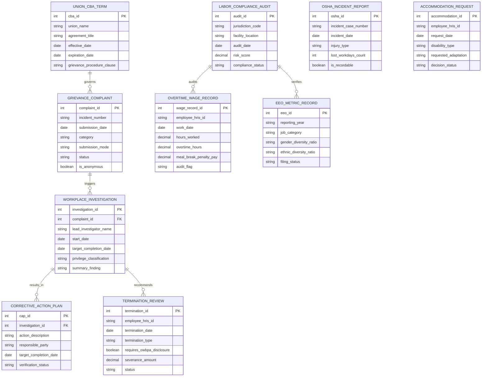

# Conceptual ERD — Employment Law Compliance System

## Mermaid Code

## Entity Description Table | Bảng mô tả Entity

| # | Entity Name | Vietnamese Name | Description | Key Attributes | Main Relationships |
|---|-------------|-----------------|-------------|----------------|-------------------|
| 1 | GRIEVANCE_COMPLAINT | Khiếu nại & Tố giác Lao động | Stores employee grievance logs, harassment reports, discrimination claims, and anonymous hotline submissions. | complaint_id, incident_number, category, status, is_anonymous | Triggers WORKPLACE_INVESTIGATION; governed by UNION_CBA_TERM. |
| 2 | WORKPLACE_INVESTIGATION | Điều tra Nội bộ Môi trường Làm việc | Tracks formal internal workplace investigation details, lead investigators, findings, and privilege legal tags. | investigation_id, lead_investigator_name, target_completion_date, summary_finding | Belongs to GRIEVANCE_COMPLAINT; results in CORRECTIVE_ACTION_PLAN. |
| 3 | LABOR_COMPLIANCE_AUDIT | Kiểm toán Tuân thủ Luật Lao động | Stores facility inspection records, state poster compliance checks, and calculated labor risk scores. | audit_id, jurisdiction_code, facility_location, risk_score | Audits OVERTIME_WAGE_RECORD and EEO_METRIC_RECORD. |
| 4 | OVERTIME_WAGE_RECORD | Hồ sơ Lương Overtime & Nghỉ giải lao | Tracks daily non-exempt employee meal/rest break logs, overtime calculations, and break penalty pay flags. | wage_record_id, employee_hris_id, work_date, meal_break_penalty_pay | Audited by LABOR_COMPLIANCE_AUDIT. |
| 5 | EEO_METRIC_RECORD | Báo cáo Bình đẳng Cơ hội (EEO) | Captures demographic workforce data, job categories, and statutory EEO-1 filing statistics. | eeo_id, reporting_year, job_category, filing_status | Verified by LABOR_COMPLIANCE_AUDIT. |
| 6 | TERMINATION_REVIEW | Thẩm định Sa thải & Trợ cấp | Tracks involuntary employee termination approvals, severance release waivers, and ADEA/OWBPA disclosures. | termination_id, employee_hris_id, termination_type, severance_amount | Recommended by WORKPLACE_INVESTIGATION. |
| 7 | CORRECTIVE_ACTION_PLAN | Kế hoạch Khắc phục Vi phạm (CAP) | Defines mandatory disciplinary warnings, remedial training steps, and post-investigation corrective actions. | cap_id, action_description, target_completion_date, verification_status | Belongs to WORKPLACE_INVESTIGATION. |
| 8 | UNION_CBA_TERM | Thỏa ước Lao động Tập thể (CBA) | Stores labor union agreement clauses, wage scales, seniority rules, and grievance arbitration procedures. | cba_id, union_name, agreement_title, expiration_date | Governs GRIEVANCE_COMPLAINT. |
| 9 | OSHA_INCIDENT_REPORT | Báo cáo An toàn Lao động (OSHA) | Logs workplace injuries, illness incidents, lost workday counts, and OSHA 300 digital recordable events. | osha_id, incident_case_number, injury_type, is_recordable | Independent safety entity. |
| 10 | ACCOMMODATION_REQUEST | Yêu cầu Hỗ trợ Người Khuyết tật | Manages ADA accommodation requests, interactive dialogue records, and medical certification decisions. | accommodation_id, employee_hris_id, requested_adaptation, decision_status | Independent ADA accommodation entity. |

## Relationship Description | Mô tả Quan hệ

| # | From Entity | Cardinality | To Entity | Relationship Label | Business Explanation |
|---|-------------|-------------|-----------|-------------------|----------------------|
| 1 | GRIEVANCE_COMPLAINT | one-to-many | WORKPLACE_INVESTIGATION | triggers | A logged grievance complaint triggers an internal workplace investigation. |
| 2 | WORKPLACE_INVESTIGATION | one-to-many | CORRECTIVE_ACTION_PLAN | results_in | An investigation finding results in one or more corrective action plans. |
| 3 | LABOR_COMPLIANCE_AUDIT | one-to-many | OVERTIME_WAGE_RECORD | audits | A labor compliance audit inspects daily overtime and wage records. |
| 4 | LABOR_COMPLIANCE_AUDIT | one-to-many | EEO_METRIC_RECORD | verifies | A labor compliance audit verifies statutory EEO workforce reports. |
| 5 | WORKPLACE_INVESTIGATION | one-to-many | TERMINATION_REVIEW | recommends | An investigation may recommend an involuntary employee termination review. |
| 6 | UNION_CBA_TERM | one-to-many | GRIEVANCE_COMPLAINT | governs | A union collective bargaining agreement governs applicable employee grievances. |
