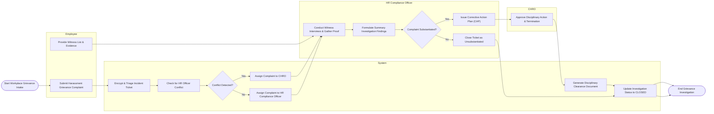

# Swimlane Diagram — Employment Law Compliance System

## Mermaid Code

## Flow Description | Mô tả luồng

| Lane | Actor | Role in Flow |
|------|-------|-------------|
| 1 | Employee | Submits confidential workplace grievance or harassment complaint with supporting witness details and documentary proof. |
| 2 | System | Encrypts grievance data, checks for conflict of interest (e.g., if HR officer is named), assigns investigator, generates disciplinary documentation, and updates audit records. |
| 3 | HR Compliance Officer | Conducts formal witness interviews, evaluates evidence, formulates investigation summary findings, and drafts corrective action plans. |
| 4 | CHRO | Executive approval authority for severe corrective action plans, suspensions, or involuntary employee terminations. |
