# Action Tree — Employment Law Compliance System

## Mermaid Code

```mermaid
graph TD
    Root["Employment Law Compliance System"]

    Root --> M1["Grievance & Dispute Intake"]
    Root --> M2["Labor Law Audit Engine"]
    Root --> M3["Wage & Hour Compliance"]
    Root --> M4["EEO & Workplace Equality"]
    Root --> M5["Statutory Filings & Inspector Portal"]

    M1 --> A1["Log Workplace Harassment Grievance"]
    M1 --> A2["Triage Anonymous Whistleblower Ticket"]
    M1 --> A3["Conduct Witness Interview"]
    M1 --> A4["Issue Corrective Action Plan"]

    M2 --> B1["Initiate Facility Labor Audit"]
    M2 --> B2["Check Mandatory Poster Display"]
    M2 --> B3["Audit Personnel File Retention"]
    M2 --> B4["Calculate Labor Risk Score"]

    M3 --> C1["Audit FLSA Exemption Classification"]
    M3 --> C2["Track Meal & Rest Break Violations"]
    M3 --> C3["Verify Overtime Rate Calculation"]
    M3 --> C4["Export Payroll Premium Adjustments"]

    M4 --> D1["Aggregate Workforce Diversity Metrics"]
    M4 --> D2["Conduct Gender Pay Equity Review"]
    M4 --> D3["Review ADA Accommodation Request"]
    M4 --> D4["Audit OWBPA Severance Waiver"]

    M5 --> E1["Submit Electronic EEO-1 Filing"]
    M5 --> E2["Export OSHA 300 Safety Logs"]
    M5 --> E3["Provide Labor Inspector Access"]
    M5 --> E4["Archive WARN Act Reduction Notices"]
```

## Module Description | Mô tả Module

| # | Module | Description | Actions |
|---|--------|-------------|---------|
| 1 | Grievance & Dispute Intake | Confidential employee complaint portal, anonymous whistleblower triage, witness interview tracking, and corrective action engine. | Log Workplace Harassment Grievance, Triage Anonymous Whistleblower Ticket, Conduct Witness Interview, Issue Corrective Action Plan |
| 2 | Labor Law Audit Engine | Facility compliance auditor, mandatory state/federal labor poster verification, personnel file compliance, and risk score calculation. | Initiate Facility Labor Audit, Check Mandatory Poster Display, Audit Personnel File Retention, Calculate Labor Risk Score |
| 3 | Wage & Hour Compliance | FLSA exempt/non-exempt status audit, daily meal and rest break violation tracking, overtime pay verification, and payroll export. | Audit FLSA Exemption Classification, Track Meal & Rest Break Violations, Verify Overtime Rate Calculation, Export Payroll Premium Adjustments |
| 4 | EEO & Workplace Equality | Workforce diversity metrics aggregator, gender pay equity auditor, ADA accommodation request reviewer, and severance release validator. | Aggregate Workforce Diversity Metrics, Conduct Gender Pay Equity Review, Review ADA Accommodation Request, Audit OWBPA Severance Waiver |
| 5 | Statutory Filings & Inspector Portal | Automated portal for submitting annual EEO-1 reports, digital OSHA 300 injury logs, WARN notices, and handling government labor inspections. | Submit Electronic EEO-1 Filing, Export OSHA 300 Safety Logs, Provide Labor Inspector Access, Archive WARN Act Reduction Notices |
