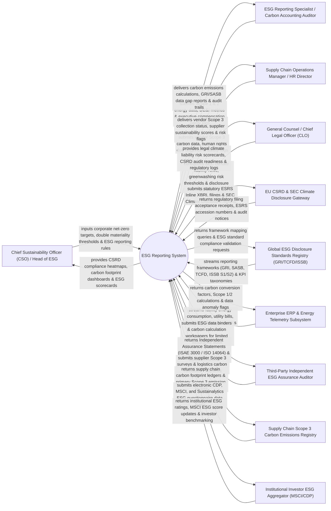

# Context Diagram — ESG Reporting System

## Mermaid Code

## Actor & Interaction Table | Bảng Actor & Tương tác

| # | Actor | Actor Type | Data Sent TO System | Data Received FROM System | Notes |
|---|-------|------------|---------------------|---------------------------|-------|
| 1 | Chief Sustainability Officer (CSO) / Head of ESG | Primary | Corporate net-zero targets, double materiality thresholds, ESG reporting framework selections (GRI/TCFD/ISSB), sustainability goals. | CSRD compliance heatmaps, Scope 1/2/3 carbon footprint dashboards, ESG scorecards, goal tracking. | Executive leading corporate sustainability, net-zero strategy, and global ESG reporting compliance. |
| 2 | ESG Reporting Specialist / Carbon Accounting Auditor | Primary | Scope 1 & 2 energy data, DE&I workforce metrics, board diversity statistics, executive compensation parity logs. | GHG Protocol carbon calculations ($\text{tCO}_2\text{e}$), GRI/SASB data gap reports, audit calculation workpapers. | Specialist calculating carbon emissions, auditing DE&I metrics, and compiling ESG framework disclosures. |
| 3 | Supply Chain Operations Manager / HR Director | Primary | Vendor Scope 3 carbon data, human rights supply chain due diligence, workplace safety incident logs. | Vendor Scope 3 collection status, supplier sustainability risk scores, human rights violation flags. | Operational lead collecting Scope 3 supply chain carbon data and human rights due diligence metrics. |
| 4 | CLO | Primary | SEC climate liability rules, greenwashing risk thresholds, ESG disclosure approval controls, litigation risk limits. | Legal climate liability risk scorecards, CSRD audit readiness verification, regulatory compliance logs. | Executive evaluating legal liability risks associated with SEC climate disclosures and greenwashing claims. |
| 5 | EU CSRD & SEC Climate Disclosure Gateway | Supporting | Regulatory filing acceptance receipts, ESRS accession numbers, SEC climate examination notices. | Electronic ESRS Inline XBRL filings (EU CSRD) and SEC Climate Disclosure reports (Form 10-K / Form 8-K). | Government regulatory gateways (EU ESAP / SEC EDGAR) processing statutory ESG and climate disclosures. |
| 6 | Global ESG Disclosure Standards Registry | Supporting | Reporting frameworks (GRI, SASB, TCFD, ISSB S1/S2), European Sustainability Reporting Standards (ESRS). | Framework cross-mapping queries, ESG standard compliance validation requests, KPI taxonomy filters. | Global standards bodies (GRI, ISSB, EFRAG) providing standardized ESG reporting metrics and taxonomies. |
| 7 | Enterprise ERP & Energy Telemetry Subsystem | Supporting | Facility energy consumption (kWh), natural gas utility bills, corporate travel logs, water/waste metrics. | Carbon conversion factors (DEFRA / EPA eGRID), Scope 1/2 GHG calculations, energy anomaly flags. | Enterprise ERP and IoT smart meter feeds streaming energy consumption and utility bills for carbon accounting. |
| 8 | Third-Party Independent ESG Assurance Auditor | Supporting | Independent Assurance Statements (ISAE 3000 / ISO 14064 Limited/Reasonable Assurance), audit certificates. | ESG data binders, GHG calculation workpapers, internal control evidence, sample data logs. | External audit firm (Big Four / Bureau Veritas) issuing independent assurance statements on ESG data. |
| 9 | Supply Chain Scope 3 Carbon Emissions Registry | Supporting | Supply chain carbon footprint ledgers, primary Scope 3 emission factors (Quantis / Ecoinvent), vendor survey data. | Supplier Scope 3 survey requests, logistics spend carbon calculation requests, primary data queries. | Database providing Scope 3 carbon emission factors across supply chain categories (Cat 1-15 GHG Protocol). |
| 10 | Institutional Investor ESG Data Aggregator | Supporting | Institutional ESG rating scores (AAA-CCC), MSCI ESG score updates, CDP Leadership Band scores, benchmarking. | Electronic CDP, MSCI, and Sustainalytics ESG questionnaire data feeds, sustainability reports. | Investor data platforms (MSCI ESG, Sustainalytics, CDP) rating corporate ESG performance for investors. |

## System Boundary Description | Mô tả Phạm vi Hệ thống

The **ESG Reporting System** is an enterprise Environmental, Social, and Governance (ESG) reporting, Greenhouse Gas (GHG Protocol Scope 1/2/3) carbon accounting, EU CSRD/ESRS compliance, SEC Climate Disclosure, and double materiality assessment platform.

**Inside System Scope:**
- Double materiality assessment workflow evaluating both financial materiality and impact materiality under ESRS rules.
- GHG Protocol Scope 1, Scope 2 (Location & Market-Based), and Scope 3 (Categories 1-15) carbon footprint accounting.
- Multi-framework reporting alignment mapping data across EU CSRD/ESRS, SEC Climate Rules, GRI, SASB, TCFD, and ISSB S1/S2.
- Pre-audit data binder generation for ISAE 3000 / ISO 14064 third-party independent limited assurance audits.
- E-filing conversion to Inline XBRL (iXBRL) for submission to EU ESAP and SEC EDGAR portals.

**Outside System Scope:**
- Direct physical installation of solar panels on corporate factory roofs (handled by Renewable Energy Contractors).
- Direct physical recycling of factory scrap metals (handled by Industrial Waste Management Companies).
- Direct physical measurement of ambient air quality around facilities (handled by Environmental Field Testing Labs).
