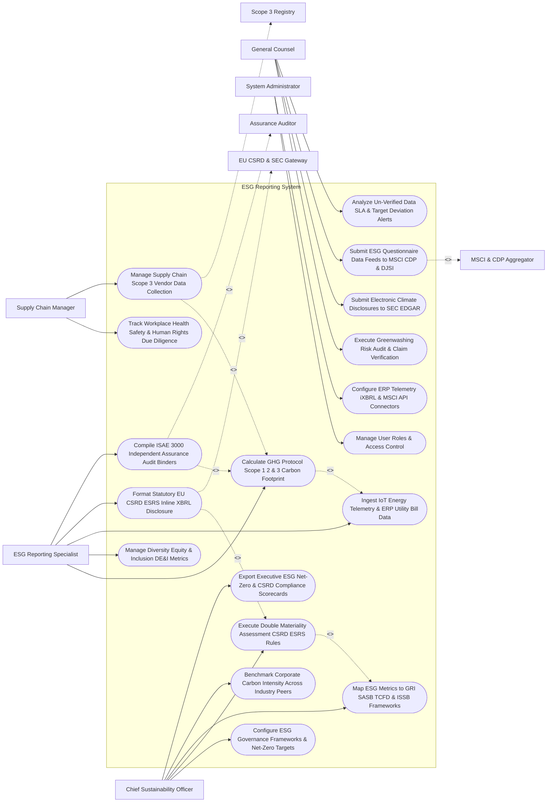

# Use Case Diagram — ESG Reporting System

## Mermaid Code

## Actor Table | Bảng Actor

| # | Actor | Actor Type | Role Description | Related Use Cases |
|---|-------|------------|------------------|-------------------|
| 1 | Chief Sustainability Officer | Primary | Executive modeling net-zero targets, double materiality assessments, GRI/ISSB framework mapping, and CSRD scorecards. | UC01, UC05, UC06, UC14, UC15 |
| 2 | ESG Reporting Specialist | Primary | Specialist calculating Scope 1/2/3 carbon emissions, managing DE&I data, preparing iXBRL reports, and compiling ISAE 3000 binders. | UC02, UC03, UC07, UC08, UC10 |
| 3 | Supply Chain Manager | Primary | Operational lead tracking supplier human rights due diligence, safety metrics, and Scope 3 vendor carbon collections. | UC04, UC12 |
| 4 | General Counsel | Primary | Executive auditing greenwashing risks, submitting SEC climate disclosures, managing MSCI/CDP feeds, and tracking alerts. | UC09, UC11, UC13, UC18 |
| 5 | System Administrator | Primary | IT admin managing user security roles, ERP telemetry connectors, iXBRL generators, and MSCI API keys. | UC16, UC17 |
| 6 | EU CSRD & SEC Gateway | System (Secondary) | Government gateways (EU ESAP, SEC EDGAR) processing statutory ESRS iXBRL disclosures and climate filings. | UC08 |
| 7 | Assurance Auditor | System (Secondary) | Independent audit firm (Big Four / Bureau Veritas) issuing ISAE 3000 / ISO 14064 limited assurance certificates. | UC10 |
| 8 | Scope 3 Registry | System (Secondary) | Database providing supply chain emission factors (Quantis / Ecoinvent) and Scope 3 calculations (Cat 1-15). | UC12 |
| 9 | MSCI & CDP Aggregator | System (Secondary) | Investor platforms (MSCI ESG, CDP) ingesting structured corporate ESG data feeds for rating calculations. | UC13 |

## Use Case Table | Bảng Use Case

| # | UC ID | Use Case Name | Primary Actor | Secondary Actor | Description | Priority |
|---|-------|---------------|---------------|-----------------|-------------|----------|
| 1 | UC01 | Configure ESG Governance Frameworks & Net-Zero Targets | CSO | None | Configures corporate ESG strategy, net-zero reduction targets (2030/2050), and baseline emissions years. | Critical |
| 2 | UC02 | Calculate GHG Protocol Scope 1 2 & 3 Carbon Footprint | Specialist | None | Calculates GHG Protocol emissions in metric tons $\text{tCO}_2\text{e}$ across Scope 1 (Direct), Scope 2 (Location/Market), and Scope 3. | Critical |
| 3 | UC03 | Manage Diversity Equity & Inclusion DE&I Metrics | Specialist | None | Tracks workforce DE&I metrics, gender pay gap ratios, board diversity %, and under-represented group representation. | High |
| 4 | UC04 | Track Workplace Health Safety & Human Rights Due Diligence | SupplyChain | None | Tracks Total Recordable Incident Rate (TRIR), lost time injury rates, and supplier human rights due diligence compliance. | High |
| 5 | UC05 | Execute Double Materiality Assessment CSRD ESRS Rules | CSO | None | Conducts double materiality assessment evaluating both Financial Materiality and Impact Materiality under EU CSRD/ESRS rules. | Critical |
| 6 | UC06 | Map ESG Metrics to GRI SASB TCFD & ISSB Frameworks | CSO | None | Cross-maps corporate ESG data points across GRI, SASB, TCFD recommendations, and ISSB S1/S2 global standards. | Critical |
| 7 | UC07 | Ingest IoT Energy Telemetry & ERP Utility Bill Data | Specialist | None | Ingests real-time IoT smart meter data, facility natural gas bills, corporate flight logs, and fleet fuel receipts. | Critical |
| 8 | UC08 | Format Statutory EU CSRD ESRS Inline XBRL Disclosure | Specialist | CSRDGateway | Formats mandatory European Sustainability Reporting Standards (ESRS) disclosures into Inline XBRL (iXBRL) for EU ESAP submission. | Critical |
| 9 | UC09 | Execute Greenwashing Risk Audit & Claim Verification | CLO | None | Audits marketing claims against substantiating carbon evidence, flagging potential greenwashing legal liabilities. | Critical |
| 10 | UC10 | Compile ISAE 3000 Independent Assurance Audit Binders | Specialist | AssuranceAuditor | Assembles complete audit binders with raw data workpapers for third-party ISAE 3000 / ISO 14064 limited assurance sign-off. | Critical |
| 11 | UC11 | Submit Electronic Climate Disclosures to SEC EDGAR | CLO | None | Transmits statutory SEC Climate Disclosure filings (Form 10-K climate risk disclosures) to SEC EDGAR gateway. | Critical |
| 12 | UC12 | Manage Supply Chain Scope 3 Vendor Data Collection | SupplyChain | Scope3Registry | Dispatches supplier Scope 3 carbon questionnaires, applying primary vendor data or Ecoinvent secondary emission factors. | Critical |
| 13 | UC13 | Submit ESG Questionnaire Data Feeds to MSCI CDP & DJSI | CLO | InvestorAggregator | Formats and transmits automated ESG data feeds to MSCI ESG Research, CDP Climate, and Dow Jones Sustainability Index. | High |
| 14 | UC14 | Benchmark Corporate Carbon Intensity Across Industry Peers | CSO | None | Measures carbon intensity metrics ($\text{tCO}_2\text{e} / \text{\$M Revenue}$) and benchmarks performance against industry peers. | High |
| 15 | UC15 | Export Executive ESG Net-Zero & CSRD Compliance Scorecards | CSO | None | Renders executive scorecards detailing net-zero target progress, Scope 1/2/3 totals, CSRD audit status, and MSCI rating. | High |
| 16 | UC16 | Manage User Roles & Access Control | Admin | None | Controls user login credentials, RBAC permissions, and confidential ESG audit data access rights. | High |
| 17 | UC17 | Configure ERP Telemetry iXBRL & MSCI API Connectors | Admin | None | Configures API connectors for SAP S/4HANA Energy, EPA eGRID, EU ESAP iXBRL, and MSCI ESG Research. | High |
| 18 | UC18 | Analyze Un-Verified Data SLA & Target Deviation Alerts | CLO | None | Dispatches urgent notifications when carbon emissions deviate from net-zero trajectories or un-verified data threatens audit. | High |

## Use Case Specification | Đặc tả Use Case

---

### UC02 — Calculate GHG Protocol Scope 1 2 & 3 Carbon Footprint

| Field | Detail |
|-------|--------|
| **UC ID** | UC02 |
| **Use Case Name** | Calculate GHG Protocol Scope 1 2 & 3 Carbon Footprint |
| **Actor(s)** | Primary: ESG Reporting Specialist, Chief Sustainability Officer   Secondary: Enterprise ERP & Energy Telemetry Subsystem |
| **Description** | Calculates greenhouse gas (GHG) emissions in metric tons of carbon dioxide equivalent ($\text{tCO}_2\text{e}$) across Scope 1 (Direct), Scope 2 (Location & Market-Based), and Scope 3 (Categories 1-15) per GHG Protocol standards. |
| **Precondition** | 1. Facility energy consumption data, fuel receipts, and travel logs (UC07) are ingested.   2. EPA eGRID, DEFRA, and IEA emission factor databases are updated. |
| **Main Flow** | 1. Specialist opens "GHG Protocol Carbon Accounting Engine" for Reporting Year `2026`.   2. System retrieves Ingested Activity Data:   &nbsp;&nbsp;&nbsp;&nbsp; a. Scope 1 (Direct Fuel): `500,000 Therms Natural Gas` (Facility Boilers) + `40,000 Gallons Diesel` (Corporate Fleet).   &nbsp;&nbsp;&nbsp;&nbsp; b. Scope 2 (Purchased Electricity): `12,000,000 kWh Electricity` (US & EU Facilities).   &nbsp;&nbsp;&nbsp;&nbsp; c. Scope 3 (Value Chain): `Category 1 (Purchased Goods): $45M Spend` | `Category 6 (Business Travel): 2.5M Passenger Miles`.   3. System applies Emission Factor Multiplication Equations:   &nbsp;&nbsp;&nbsp;&nbsp; a. Scope 1 Calculation: $500,000 \text{ Therms} \times 0.00532 \text{ tCO}_2\text{e}/\text{Therm} = \mathbf{2,660 \text{ tCO}_2\text{e}}$.   &nbsp;&nbsp;&nbsp;&nbsp; b. Scope 2 Location-Based (eGRID Subregion): $12,000,000 \text{ kWh} \times 0.00038 \text{ tCO}_2\text{e}/\text{kWh} = \mathbf{4,560 \text{ tCO}_2\text{e}}$.   &nbsp;&nbsp;&nbsp;&nbsp; c. Scope 2 Market-Based (Deducts 4,000 MWh PPA Renewable Energy Certificates): $\mathbf{3,040 \text{ tCO}_2\text{e}}$.   &nbsp;&nbsp;&nbsp;&nbsp; d. Scope 3 Calculation (Categories 1-15): $\mathbf{38,500 \text{ tCO}_2\text{e}}$.   4. System aggregates Total Corporate GHG Footprint:   &nbsp;&nbsp;&nbsp;&nbsp; a. Location-Based Total: $2,660 + 4,560 + 38,500 = \mathbf{45,720 \text{ tCO}_2\text{e}}$.   &nbsp;&nbsp;&nbsp;&nbsp; b. Market-Based Total: $2,660 + 3,040 + 38,500 = \mathbf{44,200 \text{ tCO}_2\text{e}}$.   5. System computes Net-Zero Target Variance: `Scope 1 & 2 reduced by 14.2%` vs. 2020 Baseline (On Track for 2030 50% Reduction Goal).   6. System generates Carbon Calculation Audit Workpaper PDF, linking all source emission factors and energy receipts for ISAE 3000 audit (UC10). |
| **Alternative Flow** | **AF1** — Automated EPA eGRID Factor Update: EPA publishes updated grid factors; System auto-recalculates Scope 2 location-based footprint, versioning calculation outputs. |
| **Exception Flow** | **EX1** — Energy Data Anomaly Alert: Facility in Texas reports 500% spike in electricity usage; System flags `DATA_ANOMALY_WARNING`, pausing calculation until specialist verifies meter reading. |
| **Postcondition** | Scope 1, Scope 2 (Location/Market), and Scope 3 carbon footprints are calculated in $\text{tCO}_2\text{e}$, target variances compute, and audit workpapers render. |
| **Business Rule** | **BR1**: Carbon accounting MUST calculate Scope 2 emissions using both Location-Based and Market-Based methods per GHG Protocol Scope 2 Guidance. |

---

### UC05 — Execute Double Materiality Assessment (CSRD / ESRS Rules)

| Field | Detail |
|-------|--------|
| **UC ID** | UC05 |
| **Use Case Name** | Execute Double Materiality Assessment (CSRD / ESRS Rules) |
| **Actor(s)** | Primary: Chief Sustainability Officer, General Counsel   Secondary: Global ESG Disclosure Standards Registry (EFRAG / ESRS) |
| **Description** | Conducts a comprehensive double materiality assessment evaluating both Financial Materiality (outside-in risks) and Impact Materiality (inside-out impacts) across 10 ESRS ESG topics to determine mandatory CSRD disclosures. |
| **Precondition** | 1. Corporate stakeholder survey and ESG risk identification workshops are completed.   2. EU Corporate Sustainability Reporting Directive (CSRD / ESRS 1) rules are loaded. |
| **Main Flow** | 1. CSO opens "Double Materiality Assessment Matrix" for Fiscal Year `2026`.   2. System renders 10 ESRS Sustainability Topics:   &nbsp;&nbsp;&nbsp;&nbsp; a. Environmental: `E1 Climate Change`, `E2 Pollution`, `E3 Water`, `E4 Biodiversity`, `E5 Circular Economy`.   &nbsp;&nbsp;&nbsp;&nbsp; b. Social: `S1 Own Workforce`, `S2 Workers in Value Chain`, `S3 Affected Communities`, `S4 Consumers`.   &nbsp;&nbsp;&nbsp;&nbsp; c. Governance: `G1 Business Conduct & Anti-Corruption`.   3. CSO evaluates Financial Materiality (Outside-In Risk to Corporate Earnings):   &nbsp;&nbsp;&nbsp;&nbsp; a. E1 Climate Change: Carbon tax exposure -> Financial Score `4.5 / 5.0 (Financially Material)`.   &nbsp;&nbsp;&nbsp;&nbsp; b. E3 Water: Low dependence -> Financial Score `1.5 / 5.0 (Not Financially Material)`.   4. CSO evaluates Impact Materiality (Inside-Out Impact on Society & Environment):   &nbsp;&nbsp;&nbsp;&nbsp; a. E1 Climate Change: High Scope 1/2 emissions -> Impact Score `4.8 / 5.0 (Impact Material)`.   &nbsp;&nbsp;&nbsp;&nbsp; b. S1 Own Workforce: DE&I & safety -> Impact Score `4.2 / 5.0 (Impact Material)`.   5. System plots 2D Double Materiality Matrix (Financial Materiality vs. Impact Materiality):   &nbsp;&nbsp;&nbsp;&nbsp; a. Topics Material on Both Dimensions: `E1 Climate Change`, `S1 Own Workforce`, `G1 Business Conduct`.   &nbsp;&nbsp;&nbsp;&nbsp; b. Topics Material on Impact Only: `E5 Circular Economy`.   6. System generates Mandatory ESRS Disclosure List:   &nbsp;&nbsp;&nbsp;&nbsp; a. Identifies 42 mandatory ESRS disclosure requirements to be included in the annual CSRD report (UC08).   7. CSO and CLO sign off on Double Materiality Assessment Report, attaching stakeholder justification evidence. |
| **Alternative Flow** | **AF1** — Automated Materiality Threshold Sensitivity Testing: System runs sensitivity analysis, showing how lowering threshold from 3.5 to 3.0 adds `E3 Water` to mandatory disclosure scope. |
| **Exception Flow** | **EX1** — Un-Justified Omission Warning: CSO attempts to mark `E1 Climate Change` as non-material; System flags `MANDATORY_E1_JUSTIFICATION_REQUIRED`, requiring explicit detailed evidence to omit E1 per ESRS 1. |
| **Postcondition** | Double materiality assessment evaluates 10 ESRS topics, 2D matrix renders, mandatory CSRD disclosure list generates, and assessment report certifies. |
| **Business Rule** | **BR1**: Omission of ESRS E1 Climate Change from CSRD disclosures MUST be supported by explicit, auditable double materiality justification evidence. |

---

### UC08 — Format Statutory EU CSRD ESRS Inline XBRL Disclosure

| Field | Detail |
|-------|--------|
| **UC ID** | UC08 |
| **Use Case Name** | Format Statutory EU CSRD ESRS Inline XBRL Disclosure |
| **Actor(s)** | Primary: ESG Reporting Specialist, General Counsel   Secondary: EU CSRD & SEC Climate Disclosure Gateway (EU ESAP / EFRAG Taxonomy) |
| **Description** | Formats statutory European Sustainability Reporting Standards (ESRS) ESG disclosures into human-readable HTML with embedded machine-readable Inline XBRL (iXBRL) tags for submission to the EU European Single Access Point (ESAP). |
| **Precondition** | 1. Double materiality assessment (UC05) and carbon calculations (UC02) are finalized.   2. EFRAG ESRS iXBRL Taxonomy schema is authenticated. |
| **Main Flow** | 1. Specialist opens "ESRS iXBRL Tagging Studio" for Corporate Annual Report `CSRD_Disclosure_2026.html`.   2. System parses report sections against EFRAG ESRS Taxonomy:   &nbsp;&nbsp;&nbsp;&nbsp; a. ESRS E1-6 Gross Scope 1 GHG Emissions -> Tags value `2,660` with iXBRL concept `esrs_e1:GrossScope1GHGEmissions` ($\text{tCO}_2\text{e}$).   &nbsp;&nbsp;&nbsp;&nbsp; b. ESRS E1-6 Gross Scope 2 Location-Based -> Tags value `4,560` with iXBRL concept `esrs_e1:GrossScope2LocationBasedGHGEmissions`.   &nbsp;&nbsp;&nbsp;&nbsp; c. ESRS S1-16 Gender Pay Gap -> Tags value `8.4%` with iXBRL concept `esrs_s1:PercentageGenderPayGap`.   3. System executes Automated iXBRL Validation Check:   &nbsp;&nbsp;&nbsp;&nbsp; a. Taxonomy Schema Check: Validates against EFRAG 2026 iXBRL Taxonomy -> `VALID`.   &nbsp;&nbsp;&nbsp;&nbsp; b. Calculation Consistency Check: Scope 1 + Scope 2 = Total -> `MATHEMATICALLY_CONSISTENT`.   &nbsp;&nbsp;&nbsp;&nbsp; c. Mandatory Tag Check: All 42 required double materiality concepts tagged -> `100% COVERAGE`.   4. Specialist applies Independent Assurance Auditor Certification Token (UC10).   5. System dispatches HTTPS REST API payload to EU ESAP Gateway.   6. EU ESAP Gateway accepts filing and returns Official Accession Receipt:   &nbsp;&nbsp;&nbsp;&nbsp; a. ESAP Accession #: `EU-CSRD-2026-884120`.   &nbsp;&nbsp;&nbsp;&nbsp; b. Official Filing Date: `April 15, 2027`.   7. System auto-publishes formatted iXBRL report to Corporate Investor Relations ESG website. |
| **Alternative Flow** | **AF1** — SEC Climate iXBRL Filing: Report is for US SEC Form 10-K; System tags climate risk data using SEC Climate iXBRL Taxonomy, submitting payload to SEC EDGAR (UC11). |
| **Exception Flow** | **EX1** — iXBRL Unit Attribute Mismatch: Scope 1 value tagged as `USD` instead of `tCO2e`; System validation flags `ATTRIBUTE_UNIT_MISMATCH_ERROR`, blocking submission until unit is corrected. |
| **Postcondition** | ESRS disclosures are tagged with machine-readable iXBRL concepts, validated against EFRAG taxonomy, submitted to EU ESAP, and accession receipt issues. |
| **Business Rule** | **BR1**: EU CSRD annual ESG reports MUST be formatted as Inline XBRL (iXBRL) documents compliant with the EFRAG ESRS Taxonomy. |

---

### UC10 — Compile ISAE 3000 Independent Assurance Audit Binders

| Field | Detail |
|-------|--------|
| **UC ID** | UC10 |
| **Use Case Name** | Compile ISAE 3000 Independent Assurance Audit Binders |
| **Actor(s)** | Primary: ESG Reporting Specialist, Third-Party Independent ESG Assurance Auditor   Secondary: Third-Party Independent ESG Assurance Auditor |
| **Description** | Assembles complete ESG audit binders containing raw energy activity data, utility invoices, GHG calculation workpapers, and internal control evidence for third-party ISAE 3000 / ISO 14064 limited assurance sign-off. |
| **Precondition** | 1. Annual ESG disclosures and carbon calculations (UC02) are finalized.   2. Independent audit firm (e.g., PwC / Bureau Veritas) is assigned. |
| **Main Flow** | 1. Specialist opens "Independent Assurance Audit Studio" for Audit Cycle `2026 ISAE 3000 Assurance`.   2. System compiles Comprehensive ESG Data Binder:   &nbsp;&nbsp;&nbsp;&nbsp; a. Section 1 (Scope 1 & 2 GHG Evidence): Raw utility bills PDF (120 invoices), IoT meter data logs, fuel receipts, and eGRID factor source links.   &nbsp;&nbsp;&nbsp;&nbsp; b. Section 2 (Scope 3 Calculation Workpapers): Vendor spend ledgers, Quantis emission factor mappings, and business travel mileages.   &nbsp;&nbsp;&nbsp;&nbsp; c. Section 3 (Social & Governance Evidence): HR DE&I payroll extracts, safety incident TRIR logs, and board meeting minutes.   &nbsp;&nbsp;&nbsp;&nbsp; d. Section 4 (Internal Controls): Data verification logs, sign-off approvals, and system access audit trails.   3. System locks binder with Cryptographic Audit Lock, generating SHA-256 Master Hash.   4. Specialist grants secure external auditor portal access to Third-Party Assurance Auditor.   5. Assurance Auditor reviews workpapers, executes sample testing, and verifies calculation methodology.   6. Auditor signs and issues Independent Limited Assurance Statement (ISAE 3000 / ISO 14064-3):   &nbsp;&nbsp;&nbsp;&nbsp; a. Opinion Type: `UNMODIFIED_LIMITED_ASSURANCE_STATEMENT`.   &nbsp;&nbsp;&nbsp;&nbsp; b. Statement: *"Based on our procedures, nothing has come to our attention causing us to believe the 2026 ESG Report is not fairly stated in all material respects."*   7. System attaches Assurance Statement PDF to statutory CSRD (UC08) and SEC (UC11) filing packages. |
| **Alternative Flow** | **AF1** — Reasonable Assurance Upgrade: Company upgrades from Limited Assurance to Reasonable Assurance (higher scrutiny); System expands sample audit workpapers to 100% transaction testing. |
| **Exception Flow** | **EX1** — Un-Substantiated Activity Data Finding: Auditor identifies missing natural gas bill for German plant; System flags `DATA_GAP_AUDIT_FINDING`, prompting specialist to upload missing bill to clear finding. |
| **Postcondition** | ESG audit binder is compiled with raw workpapers, cryptographic lock applies, external auditor executes testing, and ISAE 3000 Assurance Statement issues. |
| **Business Rule** | **BR1**: Statutory CSRD disclosures MUST incorporate an Independent Assurance Statement issued under ISAE 3000 or ISO 14064 standards. |

---

### UC12 — Manage Supply Chain Scope 3 Vendor Data Collection

| Field | Detail |
|-------|--------|
| **UC ID** | UC12 |
| **Use Case Name** | Manage Supply Chain Scope 3 Vendor Data Collection |
| **Actor(s)** | Primary: Supply Chain Operations Manager, ESG Reporting Specialist   Secondary: Supply Chain Scope 3 Carbon Emissions Registry (Ecoinvent / Quantis API) |
| **Description** | Dispatches automated Scope 3 carbon questionnaires to tier-1 suppliers, collecting primary supplier emissions data or applying secondary spend-based emission factors (GHG Protocol Categories 1-15). |
| **Precondition** | 1. Supplier procurement ledger ($45M spend across 350 vendors) is imported from ERP.   2. Ecoinvent / Quantis Scope 3 emission factor database is connected. |
| **Main Flow** | 1. Supply Chain Manager opens "Scope 3 Supplier Engagement Portal".   2. System categorizes Supplier Spend across 15 GHG Protocol Scope 3 Categories:   &nbsp;&nbsp;&nbsp;&nbsp; a. Category 1 (Purchased Goods): $25M Spend (150 Suppliers).   &nbsp;&nbsp;&nbsp;&nbsp; b. Category 4 (Upstream Transportation): $12M Spend (45 Logistics Vendors).   &nbsp;&nbsp;&nbsp;&nbsp; c. Category 9 (Downstream Transportation): $8M Spend.   3. System dispatches Automated Scope 3 Primary Data Questionnaires to Tier-1 Vendors:   &nbsp;&nbsp;&nbsp;&nbsp; a. Asks for vendor facility Scope 1/2 emissions allocated to company products ($\text{kg CO}_2\text{e} / \text{unit}$).   4. Vendor `Apex Components Inc` completes questionnaire, uploading ISO 14064 certified carbon footprint certificate ($2.4 \text{ kg CO}_2\text{e}/\text{component}$).   5. For non-responding vendors (200 vendors), System applies Secondary Spend-Based Emission Factors:   &nbsp;&nbsp;&nbsp;&nbsp; a. Applies Quantis EEIO (Environmentally Extended Input-Output) factor: $\$5,000,000 \text{ Electronics Spend} \times 0.42 \text{ kg CO}_2\text{e}/\text{\$} = \mathbf{2,100 \text{ tCO}_2\text{e}}$.   6. System aggregates Total Scope 3 Footprint across all 15 categories ($\mathbf{38,500 \text{ tCO}_2\text{e}}$).   7. System updates Supplier Sustainability Scorecard, identifying top 10 carbon-intensive suppliers for targeted decarbonization engagement. |
| **Alternative Flow** | **AF1** — Logistics Telemetry API Data Ingestion: Logistics vendor (DHL / FedEx) streams real-time shipment carbon data via API; System auto-populates Category 4 Scope 3 emissions. |
| **Exception Flow** | **EX1** — Outlier Supplier Carbon Data Rejection: Vendor submits primary data reporting $0.0001 \text{ kg CO}_2\text{e}$ (physically impossible); System rejects data (`SUPPLIER_DATA_OUTLIER_REJECTED`), falling back to secondary factor. |
| **Postcondition** | Primary vendor carbon data is collected, secondary spend factors apply for non-responders, Scope 3 categories 1-15 aggregate, and supplier scorecards update. |
| **Business Rule** | **BR1**: Scope 3 carbon accounting MUST prioritize primary supplier-specific data before substituting secondary spend-based EEIO emission factors. |
