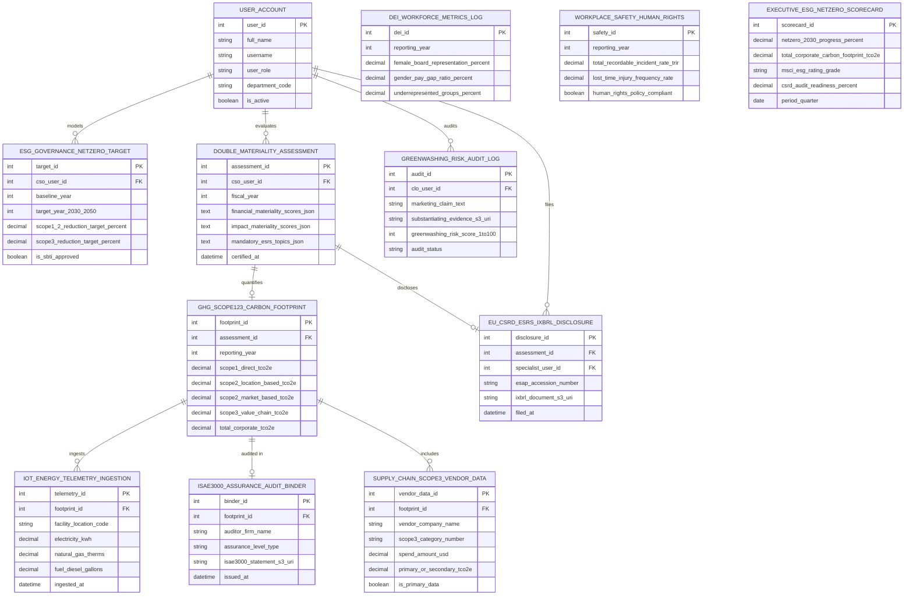

# Conceptual ERD — ESG Reporting System

## Mermaid Code

## Entity Description Table | Bảng mô tả Entity

| # | Entity Name | Vietnamese Name | Description | Key Attributes | Main Relationships |
|---|-------------|-----------------|-------------|----------------|-------------------|
| 1 | USER_ACCOUNT | Tài khoản Nguời dùng | System credentials and access roles for chief sustainability officers, ESG specialists, supply chain managers, CLOs, and admins. | `user_id`, `username`, `user_role`, `department_code` | Models `ESG_GOVERNANCE_NETZERO_TARGET`, evaluates `DOUBLE_MATERIALITY_ASSESSMENT`, files `EU_CSRD_ESRS_IXBRL_DISCLOSURE`, audits `GREENWASHING_RISK_AUDIT_LOG`. |
| 2 | ESG_GOVERNANCE_NETZERO_TARGET | Target Net-Zero Quản trị ESG | Corporate net-zero target entity tracking baseline years, target years (2030/2050), Scope 1/2 reduction %, Scope 3 reduction %, and SBTi approval status. | `target_id`, `cso_user_id`, `baseline_year`, `target_year_2030_2050`, `scope1_2_reduction_target_percent`, `scope3_reduction_target_percent`, `is_sbti_approved` | Modeled by `USER_ACCOUNT`. |
| 3 | DOUBLE_MATERIALITY_ASSESSMENT | Đánh giá Double Materiality CSRD | EU CSRD double materiality assessment record storing fiscal year, financial materiality scores JSON, impact materiality scores JSON, and mandatory ESRS topics JSON. | `assessment_id`, `cso_user_id`, `fiscal_year`, `financial_materiality_scores_json`, `impact_materiality_scores_json`, `mandatory_esrs_topics_json` | Quantifies `GHG_SCOPE123_CARBON_FOOTPRINT`, discloses `EU_CSRD_ESRS_IXBRL_DISCLOSURE`, evaluated by `USER_ACCOUNT`. |
| 4 | GHG_SCOPE123_CARBON_FOOTPRINT | Footprint Carbon GHG Scope 1 2 3 | GHG Protocol carbon footprint record tracking Scope 1 direct $\text{tCO}_2\text{e}$, Scope 2 location-based $\text{tCO}_2\text{e}$, Scope 2 market-based $\text{tCO}_2\text{e}$, Scope 3 $\text{tCO}_2\text{e}$, and total footprint. | `footprint_id`, `assessment_id`, `reporting_year`, `scope1_direct_tco2e`, `scope2_location_based_tco2e`, `scope2_market_based_tco2e`, `scope3_value_chain_tco2e`, `total_corporate_tco2e` | Quantified by `DOUBLE_MATERIALITY_ASSESSMENT`, ingests `IOT_ENERGY_TELEMETRY_INGESTION`, audited in `ISAE3000_ASSURANCE_AUDIT_BINDER`, includes `SUPPLY_CHAIN_SCOPE3_VENDOR_DATA`. |
| 5 | DEI_WORKFORCE_METRICS_LOG | Nhật ký Metric DE&I Workforce | Corporate DE&I workforce metric log tracking female board representation %, gender pay gap ratio %, and underrepresented group representation %. | `dei_id`, `reporting_year`, `female_board_representation_percent`, `gender_pay_gap_ratio_percent`, `underrepresented_groups_percent` | Standalone DE&I metric entity. |
| 6 | WORKPLACE_SAFETY_HUMAN_RIGHTS | An toàn Lao động & Quyền Con người | Workplace safety and human rights due diligence log tracking TRIR, lost time injury frequency rates, and human rights policy compliance. | `safety_id`, `reporting_year`, `total_recordable_incident_rate_trir`, `lost_time_injury_frequency_rate`, `human_rights_policy_compliant` | Standalone safety/human rights entity. |
| 7 | IOT_ENERGY_TELEMETRY_INGESTION | Ingestion Telemetry Năng lượng IoT | IoT smart meter and facility energy ingestion log recording facility location codes, electricity kWh, natural gas therms, diesel gallons, and timestamps. | `telemetry_id`, `footprint_id`, `facility_location_code`, `electricity_kwh`, `natural_gas_therms`, `fuel_diesel_gallons`, `ingested_at` | Belongs to `GHG_SCOPE123_CARBON_FOOTPRINT`. |
| 8 | EU_CSRD_ESRS_IXBRL_DISCLOSURE | Disclosure iXBRL EU CSRD ESRS | Statutory EU CSRD Inline XBRL (iXBRL) disclosure log recording ESAP accession numbers, iXBRL document S3 URIs, specialist user IDs, and filing timestamps. | `disclosure_id`, `assessment_id`, `specialist_user_id`, `esap_accession_number`, `ixbrl_document_s3_uri`, `filed_at` | Belongs to `DOUBLE_MATERIALITY_ASSESSMENT`, filed by `USER_ACCOUNT`. |
| 9 | GREENWASHING_RISK_AUDIT_LOG | Nhật ký Audit Risk Greenwashing | Legal greenwashing risk audit log recording marketing claim text, substantiating evidence S3 URIs, greenwashing risk scores (1-100), and status. | `audit_id`, `clo_user_id`, `marketing_claim_text`, `substantiating_evidence_s3_uri`, `greenwashing_risk_score_1to100`, `audit_status` | Audited by `USER_ACCOUNT`. |
| 10 | ISAE3000_ASSURANCE_AUDIT_BINDER | Binder Audit Assurance ISAE 3000 | Independent ESG assurance audit binder record tracking auditor firm names, assurance levels (`LIMITED/REASONABLE`), ISAE 3000 statement S3 URIs, and issuance timestamps. | `binder_id`, `footprint_id`, `auditor_firm_name`, `assurance_level_type`, `isae3000_statement_s3_uri`, `issued_at` | Belongs to `GHG_SCOPE123_CARBON_FOOTPRINT`. |
| 11 | SUPPLY_CHAIN_SCOPE3_VENDOR_DATA | Dữ liệu Vendor Scope 3 Supply Chain | Supply chain Scope 3 vendor carbon record tracking vendor names, Scope 3 category numbers (Cat 1-15), spend amounts USD, emissions $\text{tCO}_2\text{e}$, and primary data flags. | `vendor_data_id`, `footprint_id`, `vendor_company_name`, `scope3_category_number`, `spend_amount_usd`, `primary_or_secondary_tco2e`, `is_primary_data` | Belongs to `GHG_SCOPE123_CARBON_FOOTPRINT`. |
| 12 | EXECUTIVE_ESG_NETZERO_SCORECARD | Scorecard Executive ESG Net-Zero | Executive ESG scorecard aggregating net-zero 2030 progress %, total carbon footprint $\text{tCO}_2\text{e}$, MSCI ESG rating grade (AAA-CCC), and CSRD audit readiness %. | `scorecard_id`, `netzero_2030_progress_percent`, `total_corporate_carbon_footprint_tco2e`, `msci_esg_rating_grade`, `csrd_audit_readiness_percent` | Standalone executive performance entity. |

## Relationship Description | Mô tả Quan hệ

| # | From Entity | Cardinality | To Entity | Label | Business Explanation |
|---|-------------|-------------|-----------|-------|----------------------|
| 1 | DOUBLE_MATERIALITY_ASSESSMENT | 1 to 1 | GHG_SCOPE123_CARBON_FOOTPRINT | quantifies | A double materiality assessment quantifies GHG Scope 1, 2, and 3 carbon footprints. |
| 2 | DOUBLE_MATERIALITY_ASSESSMENT | 1 to 0..1 | EU_CSRD_ESRS_IXBRL_DISCLOSURE | discloses | A double materiality assessment discloses via EU CSRD ESRS iXBRL disclosures. |
| 3 | GHG_SCOPE123_CARBON_FOOTPRINT | 1 to 0..N | IOT_ENERGY_TELEMETRY_INGESTION | ingests | A carbon footprint record ingests IoT energy telemetry ingestion logs. |
| 4 | GHG_SCOPE123_CARBON_FOOTPRINT | 1 to 0..1 | ISAE3000_ASSURANCE_AUDIT_BINDER | audited in | A carbon footprint record is audited in ISAE 3000 assurance audit binders. |
| 5 | GHG_SCOPE123_CARBON_FOOTPRINT | 1 to 0..N | SUPPLY_CHAIN_SCOPE3_VENDOR_DATA | includes | A carbon footprint record includes supply chain Scope 3 vendor data. |
| 6 | USER_ACCOUNT | 1 to 0..N | ESG_GOVERNANCE_NETZERO_TARGET | models | A Chief Sustainability Officer user account models net-zero targets. |
| 7 | USER_ACCOUNT | 1 to 0..N | DOUBLE_MATERIALITY_ASSESSMENT | evaluates | A CSO user account evaluates double materiality assessments. |
| 8 | USER_ACCOUNT | 1 to 0..N | EU_CSRD_ESRS_IXBRL_DISCLOSURE | files | An ESG specialist user account files EU CSRD iXBRL disclosures. |
| 9 | USER_ACCOUNT | 1 to 0..N | GREENWASHING_RISK_AUDIT_LOG | audits | A CLO user account audits greenwashing risk logs. |
