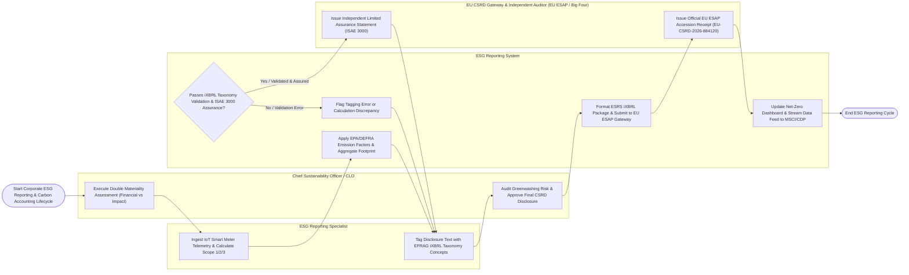

# Swimlane Diagram — ESG Reporting System

## Mermaid Code

## Flow Description | Mô tả luồng

| Lane | Actor | Role in Flow |
|------|-------|-------------|
| 1 | ESG Reporting Specialist | Ingests facility IoT energy telemetry, utility bills, and travel logs, calculates Scope 1, 2, and 3 carbon footprints, and tags disclosure text with machine-readable EFRAG ESRS iXBRL taxonomy concepts. |
| 2 | Chief Sustainability Officer / CLO | Conducts double materiality assessments evaluating financial vs. impact materiality across 10 ESRS topics, audits greenwashing risks, and approves final CSRD disclosures. |
| 3 | ESG Reporting System | Applies EPA eGRID and DEFRA emission factors to calculate carbon footprints ($\text{tCO}_2\text{e}$), validates iXBRL taxonomy schemas, compiles ISAE 3000 audit binders, transmits electronic iXBRL filings to EU ESAP via API, and streams ESG feeds to MSCI and CDP. |
| 4 | EU CSRD Gateway & Independent Auditor (EU ESAP / Big Four) | Audits raw calculation workpapers to issue ISAE 3000 / ISO 14064 Independent Limited Assurance Statements, processes statutory ESRS iXBRL filings, and issues official EU ESAP accession receipts (`EU-CSRD-2026-884120`). |
