# Action Tree — ESG Reporting System

## Mermaid Code

```mermaid
graph TD
    Root["ESG Reporting System"]

    Root --> M1["Carbon Accounting & GHG Scope 1, 2 & 3 Footprint"]
    Root --> M2["Double Materiality & Multi-Framework Mapping"]
    Root --> M3["Supply Chain Scope 3 Vendor Engagement"]
    Root --> M4["EU CSRD ESRS iXBRL E-Filing & SEC Climate"]
    Root --> M5["ISAE 3000 Assurance & Greenwashing Risk Audit"]
    Root --> M6["Investor Data Feeds & Net-Zero Scorecards"]

    M1 --> A11["Ingest IoT Smart Meter Telemetry, Utility Bills & Travel Flight Logs"]
    M1 --> A12["Apply EPA eGRID, DEFRA & IEA Emission Factors for Scope 1 & 2 Calculations"]
    M1 --> A13["Calculate Location-Based & Market-Based Scope 2 Carbon Footprints (tCO2e)"]
    M1 --> A14["Aggregate Total Corporate Carbon Footprint & Measure Net-Zero Target Progress"]

    M2 --> A21["Conduct Double Materiality Assessment (Financial vs. Impact Materiality)"]
    M2 --> A22["Plot 2D Materiality Matrix across 10 ESRS Sustainability Topics (E1-E5, S1-S4, G1)"]
    M2 --> A23["Cross-Map Corporate Data Points across GRI, SASB, TCFD & ISSB S1/S2"]
    M2 --> A24["Generate Mandatory ESRS Disclosure Checklist based on Materiality Matrix"]

    M3 --> A31["Categorize Supplier Spend across 15 GHG Protocol Scope 3 Categories"]
    M3 --> A32["Dispatch Automated Scope 3 Carbon Questionnaires to Tier-1 Suppliers"]
    M3 --> A33["Apply Secondary Quantis EEIO Spend-Based Emission Factors for Non-Responders"]
    M3 --> A34["Identify Carbon-Intensive Suppliers for Targeted Decarbonization Programs"]

    M4 --> A41["Tag ESG Disclosures with EFRAG ESRS Inline XBRL (iXBRL) Taxonomy Concepts"]
    M4 --> A42["Validate iXBRL Technical Schemas & Mathematical Calculation Consistency"]
    M4 --> A43["Transmit Electronic CSRD iXBRL Packages to EU ESAP Gateway API"]
    M4 --> A44["Submit Statutory SEC Climate Risk Disclosures to SEC EDGAR Gateway API"]

    M5 --> A51["Compile Comprehensive Audit Binders with Raw Utility Workpapers for Auditors"]
    M5 --> A52["Lock Audit Binders with SHA-256 Cryptographic Hashes for ISAE 3000 Sign-Off"]
    M5 --> A53["Audit Marketing Claims against Carbon Data to Flag Greenwashing Risks"]
    M5 --> A54["Ingest Independent Assurance Statements (ISAE 3000 / ISO 14064 Certificates)"]

    M6 --> A61["Format & Stream Electronic ESG Data Feeds to MSCI, CDP Climate & DJSI"]
    M6 --> A62["Benchmark Carbon Intensity Metrics (tCO2e / $M Revenue) against Peers"]
    M6 --> A63["Track DE&I Ratios, Gender Pay Gap & Workplace Health & Safety (TRIR)"]
    M6 --> A64["Export Executive ESG Net-Zero, CSRD Audit Readiness & Risk Scorecards"]
```

## Module Description | Mô tả Module

| # | Module | Description | Actions |
|---|--------|-------------|---------|
| 1 | Carbon Accounting & GHG Scope 1, 2 & 3 Footprint | Ingests IoT smart meter telemetry and utility bills, applies EPA eGRID/DEFRA emission factors, calculates Scope 1, 2 (Location & Market), and Scope 3 footprints ($\text{tCO}_2\text{e}$), and tracks net-zero targets. | Ingest IoT Telemetry & Utility Bills, Apply EPA/DEFRA Emission Factors, Calculate Location & Market Scope 2 Footprints, Aggregate Corporate Footprint & Target Progress. |
| 2 | Double Materiality & Multi-Framework Mapping | Conducts double materiality assessments (Financial vs. Impact Materiality) across 10 ESRS topics, plots 2D matrices, cross-maps data to GRI/SASB/TCFD/ISSB, and generates disclosure checklists. | Conduct Double Materiality Assessment, Plot 2D Materiality Matrix across ESRS Topics, Cross-Map Data to GRI/SASB/TCFD/ISSB, Generate Mandatory ESRS Disclosure Checklist. |
| 3 | Supply Chain Scope 3 Vendor Engagement | Categorizes vendor spend across 15 Scope 3 categories, dispatches supplier carbon questionnaires, applies secondary Quantis EEIO spend factors for non-responders, and ranks supplier carbon intensity. | Categorize Spend across 15 Scope 3 Categories, Dispatch Scope 3 Supplier Questionnaires, Apply Secondary Quantis EEIO Spend Factors, Identify Carbon-Intensive Suppliers. |
| 4 | EU CSRD ESRS iXBRL E-Filing & SEC Climate | Tags disclosures with EFRAG ESRS iXBRL taxonomy concepts, validates iXBRL schemas, transmits electronic packages to EU ESAP via API, and submits SEC climate filings to EDGAR. | Tag Disclosures with EFRAG ESRS iXBRL Concepts, Validate iXBRL Schemas & Calculation Consistency, Transmit CSRD iXBRL Packages to EU ESAP API, Submit SEC Climate Disclosures to EDGAR API. |
| 5 | ISAE 3000 Assurance & Greenwashing Risk Audit | Compiles audit binders with raw workpapers, locks binders with SHA-256 hashes, audits marketing claims for greenwashing risks, and ingests ISAE 3000 / ISO 14064 assurance certificates. | Compile Comprehensive Audit Binders with Raw Workpapers, Lock Audit Binders with SHA-256 Hashes, Audit Marketing Claims for Greenwashing Risks, Ingest ISAE 3000 Assurance Statements. |
| 6 | Investor Data Feeds & Net-Zero Scorecards | Formats and streams automated data feeds to MSCI, CDP, and DJSI, benchmarks carbon intensity against industry peers, tracks DE&I and TRIR metrics, and exports scorecards. | Format & Stream ESG Data Feeds to MSCI/CDP, Benchmark Carbon Intensity against Peers, Track DE&I Ratios & TRIR Safety Metrics, Export Executive ESG & CSRD Scorecards. |
