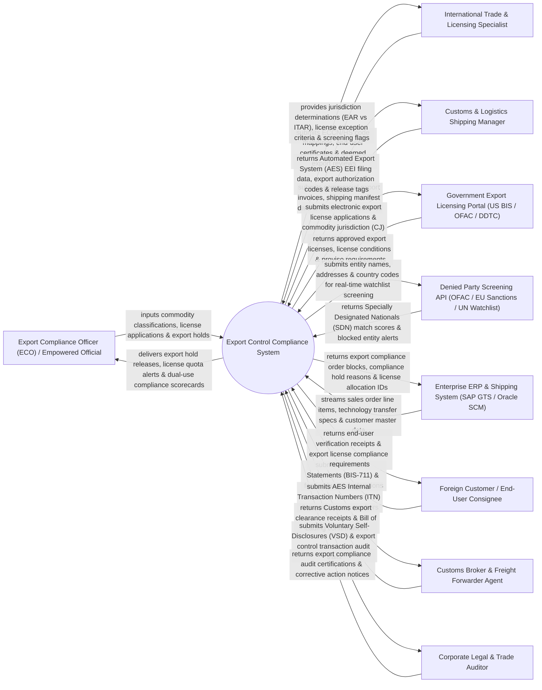

# Context Diagram — Export Control Compliance System

## Mermaid Code

## Actor & Interaction Table | Bảng Actor & Tương tác

| # | Actor | Actor Type | Data Sent TO System | Data Received FROM System | Notes |
|---|-------|------------|---------------------|---------------------------|-------|
| 1 | Export Compliance Officer (ECO) / Empowered Official | Primary | Commodity classifications, license applications, compliance hold overrides, license usage logs. | Export hold releases, license quota alerts, dual-use risk scorecards, VSD audit logs. | Empowered legal officer authorized to sign government export licenses and place order holds. |
| 2 | International Trade & Licensing Specialist | Primary | ECCN/HS code mappings, end-user certificates, foreign national employee technical disclosures. | ITAR vs EAR jurisdiction determination, license exception eligibility, screening match flags. | Trade specialist classifying export commodities and evaluating technology transfer rules. |
| 3 | Customs & Logistics Shipping Manager | Primary | Commercial export invoices, physical shipping manifests, destination country codes, port of export. | Automated Export System (AES) filing data, Internal Transaction Numbers (ITN), shipping release tags. | Shipping manager executing international freight packaging and customs clearance procedures. |
| 4 | Government Export Licensing Portal | Supporting / Regulatory | Approved export licenses, license conditions, proviso requirements, commodity jurisdiction rulings. | Electronic export license applications, commodity jurisdiction (CJ) requests, proviso compliance logs. | Federal export agencies (US Bureau of Industry and Security [BIS], OFAC, State Dept DDTC) issuing export permits. |
| 5 | Denied Party Screening API | Supporting | Specially Designated Nationals (SDN) match scores, PEP flags, blocked entity watchlist alerts. | Entity names, physical addresses, country codes, ultimate parent company details for screening. | External API (Dow Jones, Descartes, E2open) screening against OFAC, EU, UN, and BIS denied party lists. |
| 6 | Enterprise ERP & Shipping System | Supporting | Sales order line items, technology transfer specs, customer master data, country of final destination. | Export compliance order blocks, compliance hold reasons, approved license allocation IDs. | Core ERP (SAP GTS / Oracle SCM) managing sales orders and supply chain fulfillment. |
| 7 | Foreign Customer / End-User Consignee | Supporting | End-User Statements (Form BIS-711), end-use declarations, foreign buyer identity proof. | End-user verification receipts, export license compliance terms, re-export restriction notices. | International buyer or foreign recipient of controlled military, dual-use, or high-tech goods. |
| 8 | Customs Broker & Freight Forwarder Agent | Supporting | Customs export clearance receipts, Bill of Lading confirmations, port departure timestamps. | Electronic Export Information (EEI) filings, AES ITN numbers, export license authorization codes. | External customs broker filing export manifests with government border agencies. |
| 9 | Corporate Legal & Trade Auditor | Supporting / Regulatory | Export compliance audit certifications, corrective action notices, trade penalty risk assessments. | Voluntary Self-Disclosures (VSD), export control transaction audit trails, license usage ledgers. | Independent legal auditor evaluating trade compliance and dual-use technology transfer risks. |

## System Boundary Description | Mô tả Phạm vi Hệ thống

The **Export Control Compliance System** is an enterprise international trade compliance, Export Control Classification Number (ECCN) / ITAR military classification, Denied Party Screening (DPS), government export licensing, and embargo enforcement platform.

**Inside System Scope:**
- Real-time automated screening of customers, vendors, and consignees against global denied party watchlists (OFAC SDN, BIS Entity List, EU Sanctions).
- Classification engine determining ITAR US Munitions List (USML) vs EAR Export Control Classification Numbers (ECCN).
- Automated license determination logic identifying required government permits (BIS, OFAC, DDTC) or License Exceptions (e.g., STA, ENC, CIV).
- Order hold enforcement blocking ERP sales order fulfillment pending trade compliance release.
- Deemed Export control tracking foreign national employee access to sensitive technical data and software source code.

**Outside System Scope:**
- Physical loading and maritime vessel container transport operations (handled by Freight Carriers).
- General domestic non-export sales invoicing (handled by Enterprise Billing).
- Tariff duty tax payment processing for foreign import customs (handled by Import Customs Brokers).
