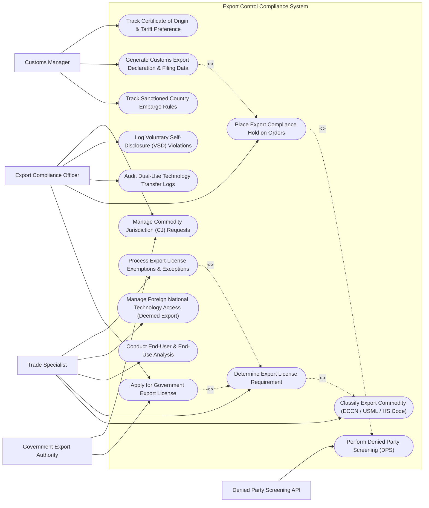

# Use Case Diagram — Export Control Compliance System

## Mermaid Code

## Actor Table | Bảng Actor

| # | Actor | Actor Type | Role Description | Related Use Cases |
|---|-------|------------|------------------|-------------------|
| 1 | Export Compliance Officer | Primary | Empowered officer managing government licensing, compliance order holds, VSD filings, and commodity jurisdiction requests. | UC04, UC09, UC10, UC12, UC13 |
| 2 | Trade Specialist | Primary | Classifies export items (ECCN/USML), conducts end-user checks, evaluates license exceptions, and monitors deemed exports. | UC02, UC03, UC06, UC07, UC11 |
| 3 | Customs Manager | Primary | Manages customs declarations, embargo destination checks, certificate of origin filings, and shipping compliance releases. | UC05, UC08, UC14 |
| 4 | Government Export Authority | Supporting / Regulatory | Federal regulatory body (BIS, OFAC, DDTC) reviewing export license applications and issuing export permits. | UC04, UC13 |
| 5 | Denied Party Screening API | Secondary / System | External automated API service evaluating party names against global government sanctioned entity watchlists. | UC01 |

## Use Case Table | Bảng Use Case

| # | UC ID | Use Case Name | Primary Actor | Secondary Actor | Description | Priority |
|---|-------|---------------|---------------|-----------------|-------------|----------|
| 1 | UC01 | Perform Denied Party Screening (DPS) | Trade Specialist | Screening API | Screens buyer, consignee, intermediate agents, and vendors against OFAC, BIS, and EU blocked party lists. | High |
| 2 | UC02 | Classify Export Commodity (ECCN / USML / HS Code) | Trade Specialist | None | Assigns export control numbers (e.g., ECCN 3A090, EAR99, ITAR USML Category XI) and Harmonized Tariff codes. | High |
| 3 | UC03 | Determine Export License Requirement | Trade Specialist | None | Evaluates commodity ECCN, country of destination, and end-use rules to determine if a government license is required. | High |
| 4 | UC04 | Apply for Government Export License | Export Compliance Officer | Government Export Authority | Submits electronic export license application packages (BIS SNAP-R, DDTC DTrade) to regulatory agencies. | High |
| 5 | UC05 | Track Sanctioned Country Embargo Rules | Customs Manager | None | Enforces comprehensive trade embargo restrictions for sanctioned jurisdictions (e.g., Cuba, Iran, North Korea, Syria). | High |
| 6 | UC06 | Conduct End-User & End-Use Analysis | Trade Specialist | Foreign Consignee | Verifies End-User Certificate (BIS-711) to prevent illegal diversion to prohibited military or nuclear proliferation end-uses. | High |
| 7 | UC07 | Manage Foreign National Technology Access (Deemed Export) | Trade Specialist | HRIS System | Monitors foreign national employee access to sensitive export-controlled technical data and software source code. | High |
| 8 | UC08 | Generate Customs Export Declaration & Filing Data | Customs Manager | Customs Broker | Formats Electronic Export Information (EEI) filing data required for US Census Automated Export System (AES). | High |
| 9 | UC09 | Place Export Compliance Hold on Orders | Export Compliance Officer | Enterprise ERP | Places an immediate automated compliance lock on ERP sales orders pending trade screening or license approval. | High |
| 10 | UC10 | Audit Dual-Use Technology Transfer Logs | Export Compliance Officer | None | Audits digital downloads, cloud file transfers, and server accesses containing dual-use technical specifications. | Medium |
| 11 | UC11 | Process Export License Exemptions & Exceptions | Trade Specialist | None | Validates statutory EAR license exceptions (e.g., STA, ENC, LVS) or ITAR exemptions, documenting legal eligibility. | Medium |
| 12 | UC12 | Log Voluntary Self-Disclosure (VSD) Violations | Export Compliance Officer | Government Export Authority | Prepares legal Voluntary Self-Disclosure reports for government agencies upon discovering inadvertent trade compliance violations. | Medium |
| 13 | UC13 | Manage Commodity Jurisdiction (CJ) Requests | Export Compliance Officer | Government Export Authority | Files formal CJ requests to determine whether a dual-use item falls under State Dept ITAR or Commerce Dept EAR jurisdiction. | Medium |
| 14 | UC14 | Track Certificate of Origin & Tariff Preference | Customs Manager | None | Manages preferential origin certificates (USMCA, EU-UK TCA) to ensure legal tariff preference claims. | Low |

## Use Case Specification | Đặc tả Use Case

---

### UC01 — Perform Denied Party Screening (DPS)

| Field | Detail |
|-------|--------|
| **UC ID** | UC01 |
| **Use Case Name** | Perform Denied Party Screening (DPS) |
| **Actor(s)** | Primary: Trade Specialist   Secondary: Denied Party Screening API |
| **Description** | Automatically screens all transaction entities (Customer, Consignee, Freight Forwarder, Financial Bank) against global sanctioned entity watchlists. |
| **Precondition** | 1. Entity name and address details are entered into the system or received via ERP sales order stream. |
| **Main Flow** | 1. System extracts entity names, street addresses, parent companies, and country codes from transaction payload.   2. System calls Denied Party Screening API with fuzzy-matching algorithm parameters.   3. API queries government watchlists (OFAC SDN, BIS Entity List, Unverified List, EU Consolidated Sanctions).   4. API returns match percentage score for each entity.   5. If match score is below 70%, system marks entity status as "DPS CLEARED".   6. If match score exceeds 70%, system triggers a "POTENTIAL MATCH SANCTION ALERT" and locks transaction. |
| **Alternative Flow** | **AF1** — False Positive Resolution: Trade Specialist reviews matching party parameters, confirms entity is a false positive match, records justification notes, and releases block. |
| **Exception Flow** | **EX1** — Confirmed Sanctioned Entity: If screening confirms exact Specially Designated National (SDN) match, system permanently blocks transaction and alerts Export Compliance Officer. |
| **Postcondition** | Transaction entity screening log is timestamped and stored for trade audit. |
| **Business Rule** | **BR1**: 100% of international trade partners must be screened prior to order fulfillment or technical data release. |

---

### UC02 — Classify Export Commodity (ECCN / USML / HS Code)

| Field | Detail |
|-------|--------|
| **UC ID** | UC02 |
| **Use Case Name** | Classify Export Commodity (ECCN / USML / HS Code) |
| **Actor(s)** | Primary: Trade Specialist   Secondary: None |
| **Description** | Determines the precise regulatory classification for commercial products, software, and technology (ECCN under EAR vs USML Category under ITAR). |
| **Precondition** | 1. Product technical specifications, performance parameters, and schematics are available. |
| **Main Flow** | 1. Trade Specialist opens "Commodity Classification Module" and selects target product part number.   2. Specialist inputs product technical parameters (e.g., processing performance, laser wavelength, encryption algorithm length).   3. System guides specialist through Commerce Control List (CCL) decision tree.   4. System prompts for jurisdiction determination: International Traffic in Arms Regulations (ITAR) vs Export Administration Regulations (EAR).   5. System assigns classification code (e.g., ECCN `5A002.a` for dual-use encryption hardware OR `EAR99` for commercial items).   6. Specialist attaches technical rationale document and signs off on classification. |
| **Alternative Flow** | **AF1** — Official Government Classification (CCATS): If classification is ambiguous, specialist submits Commodity Classification Automated Tracking System (CCATS) request to BIS. |
| **Exception Flow** | **EX1** — ITAR Defense Article Flag: If item meets military specification criteria, system flags item as ITAR USML controlled, locking export without Department of State license. |
| **Postcondition** | Master product catalog is updated with verified ECCN, USML, and Harmonized Tariff codes. |
| **Business Rule** | **BR1**: Products containing strong cryptography or dual-use capabilities must be formally classified prior to international distribution. |

---

### UC03 — Determine Export License Requirement

| Field | Detail |
|-------|--------|
| **UC ID** | UC03 |
| **Use Case Name** | Determine Export License Requirement |
| **Actor(s)** | Primary: Trade Specialist   Secondary: None |
| **Description** | Evaluates export transaction parameters (Commodity ECCN, Destination Country, End-User Type, End-Use Purpose) against Commerce Country Chart matrix to determine licensing obligations. |
| **Precondition** | 1. Item ECCN classification is established.   2. Country of final destination and end-user identity are verified. |
| **Main Flow** | 1. Trade Specialist selects pending export shipment.   2. System retrieves item ECCN (e.g., `3A090`), destination country code (e.g., `CN`), and Reason for Control (e.g., National Security [NS], Regional Stability [RS]).   3. System checks Commerce Country Chart matrix for intersections between Reason for Control and Destination Country.   4. System determines if an "X" mark exists in the matrix column.   5. If "X" exists, system declares "GOVERNMENT EXPORT LICENSE REQUIRED".   6. System evaluates eligible EAR License Exceptions (e.g., License Exception STA or ENC) to see if exception conditions are met.   7. System outputs License Determination Decision Report. |
| **Alternative Flow** | **AF1** — License Exception Eligible: If transaction qualifies for License Exception ENC, system records License Exception Symbol `ENC` and authorizes export without formal individual license application. |
| **Exception Flow** | **EX1** — Total Embargo Jurisdiction: If destination is a sanctioned country under OFAC regulations, system displays "TOTAL EMBARGO - EXPORT PROHIBITED". |
| **Postcondition** | Licensing determination is logged with statutory justification references. |
| **Business Rule** | **BR1**: Exports to restricted countries requiring a license shall not ship until an approved government export permit is attached to the shipping file. |

---

### UC04 — Apply for Government Export License

| Field | Detail |
|-------|--------|
| **UC ID** | UC04 |
| **Use Case Name** | Apply for Government Export License |
| **Actor(s)** | Primary: Export Compliance Officer   Secondary: Government Export Authority |
| **Description** | Compiles and submits electronic export license applications (BIS SNAP-R, DDTC DTrade) including end-user certificates and technical specifications. |
| **Precondition** | 1. License requirement is confirmed by License Determination engine.   2. End-User Statement (BIS-711) signed by foreign buyer is uploaded. |
| **Main Flow** | 1. Export Compliance Officer selects "Create Export License Application".   2. System populates application fields with applicant details, foreign consignee info, ECCN, quantity caps, and total dollar value.   3. Officer attaches signed End-User Statement, technical datasheets, and corporate cover letter.   4. Officer reviews complete license package and signs with digital Empowered Official certificate.   5. System formats XML payload and transmits to BIS SNAP-R or DDTC portal API.   6. Government portal returns Application Control Number (e.g., `D123456`).   7. System updates application status to "UNDER GOVERNMENT REVIEW". |
| **Alternative Flow** | **AF1** — License Approval with Provisos: Government agency approves license with statutory provisos (e.g., mandatory annual usage reports). System logs provisos and sets license status to "ACTIVE - PROVISO RESTRICTED". |
| **Exception Flow** | **EX1** — License Application Denial (RWA): If government issues Return Without Action (RWA) or Denial, system flags license status as "DENIED" and blocks all related orders. |
| **Postcondition** | Government export license application is submitted, tracked, and registered upon approval. |
| **Business Rule** | **BR1**: Only designated corporate Empowered Officials have legal authority to submit government export license applications. |

---

### UC09 — Place Export Compliance Hold on Orders

| Field | Detail |
|-------|--------|
| **UC ID** | UC09 |
| **Use Case Name** | Place Export Compliance Hold on Orders |
| **Actor(s)** | Primary: Export Compliance Officer   Secondary: Enterprise ERP |
| **Description** | Automatically locks sales orders in Enterprise ERP when trade risks (denied party match, unclassified product, missing export license) are detected. |
| **Precondition** | 1. Enterprise ERP streams new sales order event to Export Control Compliance System. |
| **Main Flow** | 1. System receives order payload (Order #, Line Items, Customer, Destination Country).   2. System executes real-time validation checks (DPS Screening, ECCN Classification, License Requirement, Embargo Rule).   3. System identifies a compliance blocker (e.g., License Required but no valid license assigned).   4. System issues API command to ERP setting sales order status to `EXPORT COMPLIANCE HOLD - BLOCKED FOR SHIPMENT`.   5. System generates compliance task ticket for Export Compliance Officer detailing block reason.   6. ERP prevents warehouse pick, pack, and shipping label generation. |
| **Alternative Flow** | **AF1** — Automated Release: Once required export license is approved and linked to the order, system automatically sends release command to ERP, unblocking order. |
| **Exception Flow** | **EX1** — Manual Override Request: If an officer attempts manual override without attaching license proof, system blocks action and logs unauthorized override alert. |
| **Postcondition** | Non-compliant sales order is physically locked from supply chain shipment. |
| **Business Rule** | **BR1**: No physical warehouse dispatch shall occur for international orders bearing an active Export Compliance Hold tag. |
