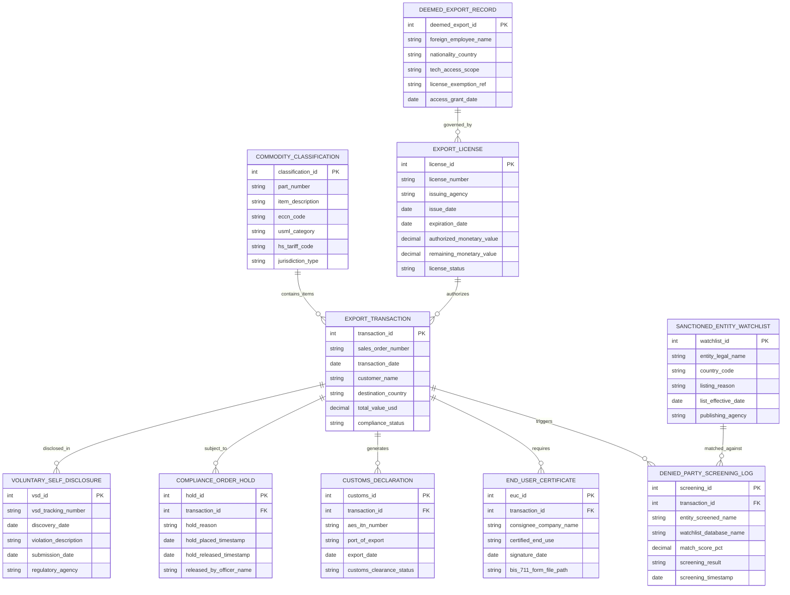

# Conceptual ERD — Export Control Compliance System

## Mermaid Code

## Entity Description Table | Bảng mô tả Entity

| # | Entity Name | Vietnamese Name | Description | Key Attributes | Main Relationships |
|---|-------------|-----------------|-------------|----------------|-------------------|
| 1 | EXPORT_TRANSACTION | Giao dịch Xuất khẩu | Master transaction record tracking sales order numbers, destination countries, order values, and trade compliance status. | transaction_id, sales_order_number, destination_country, compliance_status | Primary entity; relates to screening logs, holds, and customs. |
| 2 | COMMODITY_CLASSIFICATION | Phân loại Hàng hóa Xuất khẩu | Stores product catalog ECCN numbers, ITAR USML categories, HS tariff codes, and jurisdiction classifications. | classification_id, part_number, eccn_code, usml_category, jurisdiction_type | Linked to EXPORT_TRANSACTION items. |
| 3 | DENIED_PARTY_SCREENING_LOG | Nhật ký Tầm soát Danh sách Đen | Archives automated screening attempts, fuzzy match percentage scores, watchlist database hits, and screening outcomes. | screening_id, entity_screened_name, match_score_pct, screening_result | Belongs to EXPORT_TRANSACTION; matched against SANCTIONED_ENTITY_WATCHLIST. |
| 4 | EXPORT_LICENSE | Giấy phép Xuất khẩu | Manages government-issued export licenses (BIS, OFAC, DDTC), monetary caps, expiration dates, and remaining quotas. | license_id, license_number, issuing_agency, remaining_monetary_value, license_status | Authorizes EXPORT_TRANSACTION; governs DEEMED_EXPORT_RECORD. |
| 5 | SANCTIONED_ENTITY_WATCHLIST | Danh sách Thực thể Cấm / Trừng phạt | Master regulatory database containing OFAC SDN, BIS Entity List, UN, and EU sanctioned party names. | watchlist_id, entity_legal_name, country_code, publishing_agency | Matched against DENIED_PARTY_SCREENING_LOG. |
| 6 | END_USER_CERTIFICATE | Cam kết Sử dụng Cuối (BIS-711) | Stores certified End-User Statements, certified end-use purposes, foreign consignee identities, and signature dates. | euc_id, consignee_company_name, certified_end_use, bis_711_form_file_path | Belongs to EXPORT_TRANSACTION. |
| 7 | DEEMED_EXPORT_RECORD | Quản lý Chuyển giao Công nghệ (Deemed Export) | Tracks foreign national employee nationalities, technology access scopes, EAR license exceptions, and access authorization dates. | deemed_export_id, foreign_employee_name, nationality_country, tech_access_scope | Governed by EXPORT_LICENSE. |
| 8 | CUSTOMS_DECLARATION | Tờ khai Hải quan Xuất khẩu | Stores Census Automated Export System (AES) Electronic Export Information (EEI) filings and ITN confirmation numbers. | customs_id, aes_itn_number, port_of_export, customs_clearance_status | Belongs to EXPORT_TRANSACTION. |
| 9 | COMPLIANCE_ORDER_HOLD | Lệnh Phong tỏa Đơn hàng Xuất khẩu | Tracks automated compliance hold locks placed on sales orders, hold reasons, timestamps, and officer release signatures. | hold_id, hold_reason, hold_placed_timestamp, released_by_officer_name | Subject to EXPORT_TRANSACTION. |
| 10 | VOLUNTARY_SELF_DISCLOSURE | Tự nguyện Kê khai Vi phạm (VSD) | Records legal Voluntary Self-Disclosure case reports, violation descriptions, discovery dates, and government filings. | vsd_id, vsd_tracking_number, discovery_date, violation_description | Disclosed from EXPORT_TRANSACTION. |

## Relationship Description | Mô tả Quan hệ

| # | From Entity | Cardinality | To Entity | Relationship Label | Business Explanation |
|---|-------------|-------------|-----------|-------------------|----------------------|
| 1 | EXPORT_TRANSACTION | one-to-many | DENIED_PARTY_SCREENING_LOG | triggers | An export transaction triggers real-time denied party screening attempts. |
| 2 | EXPORT_TRANSACTION | one-to-many | END_USER_CERTIFICATE | requires | An export transaction requires a signed End-User Certificate for controlled destinations. |
| 3 | EXPORT_TRANSACTION | one-to-many | CUSTOMS_DECLARATION | generates | An export transaction generates customs export declaration filings. |
| 4 | EXPORT_TRANSACTION | one-to-many | COMPLIANCE_ORDER_HOLD | subject_to | An export transaction may be subject to compliance order holds. |
| 5 | COMMODITY_CLASSIFICATION | one-to-many | EXPORT_TRANSACTION | contains_items | A product commodity classification covers items contained in export transactions. |
| 6 | EXPORT_LICENSE | one-to-many | EXPORT_TRANSACTION | authorizes | An approved export license authorizes multiple export transaction shipments within value caps. |
| 7 | SANCTIONED_ENTITY_WATCHLIST | one-to-many | DENIED_PARTY_SCREENING_LOG | matched_against | Sanctioned entity watchlists are matched against screening attempts. |
| 8 | DEEMED_EXPORT_RECORD | one-to-many | EXPORT_LICENSE | governed_by | Deemed export technology access is governed by approved government licenses. |
| 9 | EXPORT_TRANSACTION | one-to-many | VOLUNTARY_SELF_DISCLOSURE | disclosed_in | Inadvertent export violations are disclosed in formal VSD filings. |
