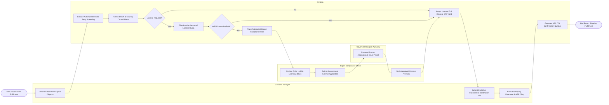

# Swimlane Diagram — Export Control Compliance System

## Mermaid Code

## Flow Description | Mô tả luồng

| Lane | Actor | Role in Flow |
|------|-------|-------------|
| 1 | Customs Manager | Initiates international shipping fulfillment, submits buyer end-user statements, executes final customs export declarations, and receives AES ITN numbers. |
| 2 | System | Automates real-time denied party screening, checks Commerce Country Matrix for license requirements, verifies available license quota balances, locks non-compliant orders in ERP, and interfaces with AES Customs portal. |
| 3 | Export Compliance Officer | Reviews compliance order holds, drafts and submits government license applications (BIS SNAP-R), and verifies government proviso conditions upon permit issuance. |
| 4 | Government Export Authority | Federal export licensing agency (BIS / OFAC / DDTC) evaluating permit applications, conducting inter-agency reviews, and issuing approved export licenses. |
